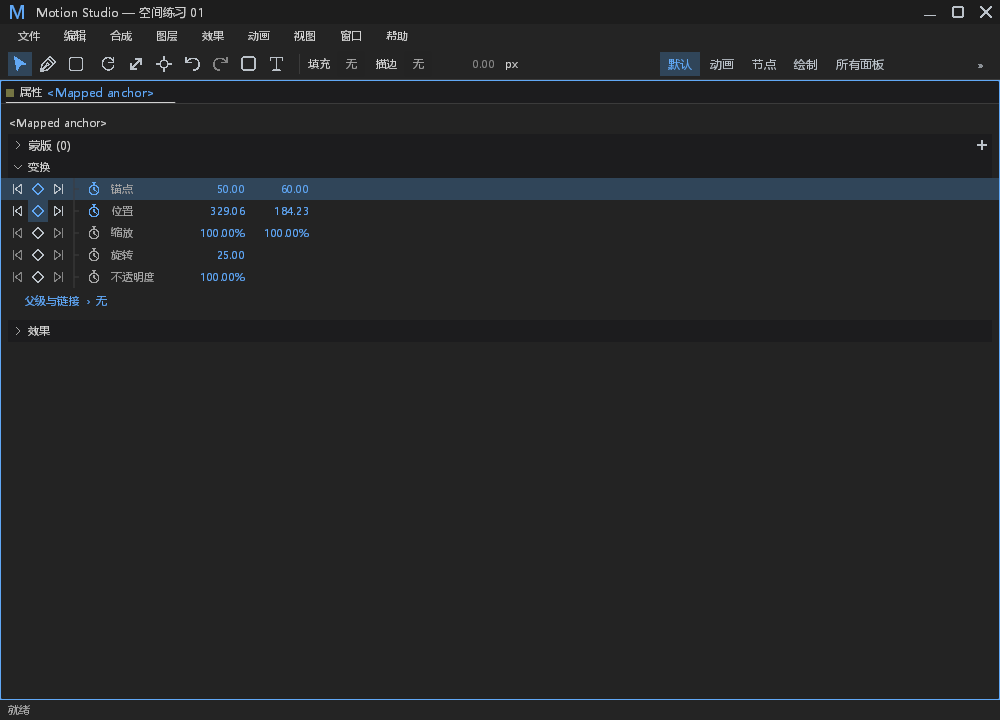
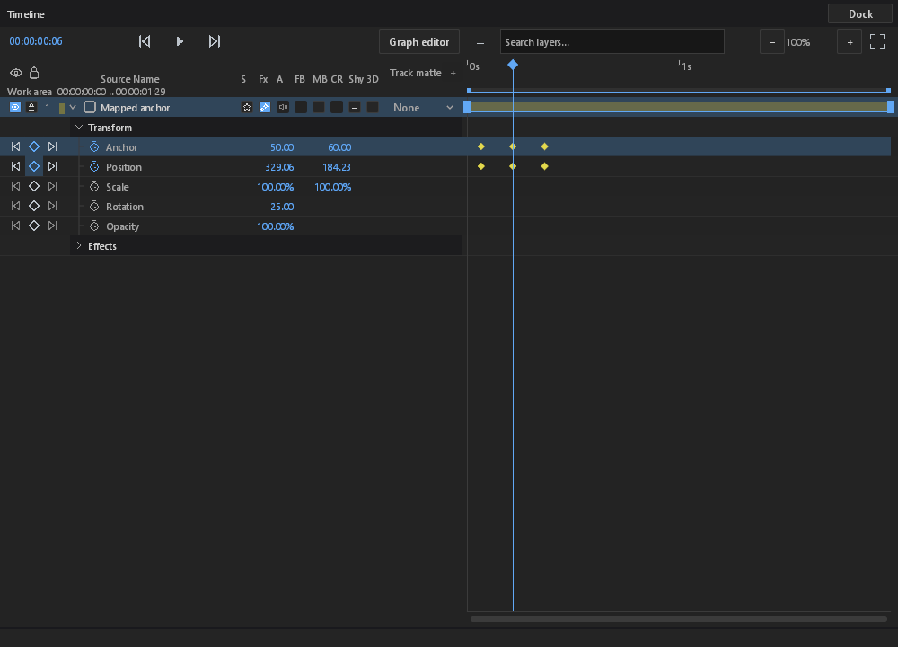

# 锚点补偿手势的双轨道键身份（#257 阶段交付）

问题：原锚点数值或画布手势只保留播放时间。锚点键或补偿位置键在按下后被同一时刻的新键替换时，后续预览仍按时间写入，可能误改替换键。

`anchor_at` 增加语义可选的 `keys`，分别记录锚点、位置的连续空间键 ID；未绑定的时间编辑和静态全局锚点操作保留原行为。模型在计算和发布候选前校验两个已绑定 ID 的存在、存储类型及其投影时刻，然后按 ID 写入两个候选。键失效时前端取消手势；排队后发生的失效仍由模型拒绝，保留对象、属性、键 ID、阶段和原始原因。Roving 补偿会改变当前样本时仍明确拒绝，不偷偷固定键或解除恒速约束。

## 本地验收

- 修改前，新回归实际失败：被替换的锚点键仍保持数字手势激活，见 `before-single-cgu.log`。
- 整合主线 `6ab57829` 后，模型 17 项、属性面板 17 项、变换手柄 44 项及显式原生 GPU 1 项通过，共 79 项不同测试。子进程、修改前失败和重复运行不另计。两个面板前缀另有 6 项原生测试保持原有 ignored 状态。
- 模型验证正放/倒放下两条轨道的 ID、完整项目、独立姿态、保存重开及单次撤销/重做；任一来源键被替换、移动或移除存储时，旧绑定在发布任一候选前被拒绝。新的 Roving 夹具仍验证原补偿约束。
- 默认日志验收实际向串行 worker 提交失效绑定：工程及历史不变，文件日志和 stderr 各出现一条包含请求、操作、对象、属性、键和阶段的 Error，stdout 无日志；有效的新绑定随后成功，撤销恢复完整工程。见 `integrated-channel/`。
- 原生 Windows GPU 验收实际打开中文主窗口属性面板及英文浮动时间轴，验证预览、取消、提交、撤销和重做，并保存截图及完整状态，见 `native-integrated/`。此项验证交互，不是 UI 改版。
- FFmpeg 与宿主 diagnostics 的工作区全目标检查通过（排除 Android）；远端 CI 单独以 PR 当前提交为准。此次仍不宣称 #257 已完成。

[证据清单](anchor-key-identities-evidence/manifest.json) · [原始记录](anchor-key-identities-evidence/evidence.zip)。初次夹具导入类型失败、编译器访问冲突、一次新代码类型错误和空间不足的原始记录均保留。最终测试保留 test profile 的断言与溢出检查；桌面最终 crate 关闭符号并使用单个代码生成分区，模型最终 crate 仅关闭符号。未改产品等待期限、预算、重试、样式或命中范围，也未修改任何既有断言以通过验收。

第一次模型验收为 15 通过、2 失败，均来自本轮新增测试的夹具或协议预期：Roving 初始点改为可精确表示且等距的坐标，并先断言原键的解算时间；命令测试改为分别比较原始 JSON 与既有 `in_composition` 注册表包装，使用精确可表示的数字做字节比较。原失败记录 `first-core.log` 保留；补偿拒绝条件、姿态容差和已有断言不变。

## 错误与行为边界

错误沿用现有 `properties.anchor_time_begin/continue`、`transform.numeric_time_begin/continue` 和串行 worker 信道；没有新增日志计数器或观察键。目标不存在属于正常取消；损坏数据返回错误，仍由既有观察器按原阈值记录。属性与手柄前缀中的既有错误、抑制及恢复测试通过；新测试验证失效命令的默认文件/stderr 输出与正常恢复。阻塞与 panic 通路未修改，本轮不宣称重新验收这些通路。

绑定仅针对按下时已存在的准确空间键；未绑定的新键或时间编辑沿用原作者操作。Roving 改动若改变当前补偿样本仍明确拒绝。本轮没有引入轨道世代 ID，也没有扩展到全部关键帧手势。

## 样式基线与范围

无依赖、第三方素材、工程格式或渲染像素语义改动。DESIGN §0.7 的 Path 六处纵向步进、双列切分、按钮高度、手绘数值框、布尔按钮，Effect 行步进、布尔按钮、枚举按钮、悬停颜色、层级，以及 Timeline 列坐标和吸附线，共 12 项均为 **retained with reason**：这些位置未改动，本阶段仅改变输入目标身份，不能据此宣称已修复已有样式缺陷。§5.2 的行、控件、命中区域和样式 token 未变。`verify_style_consumers()`、新增模块 rustfmt 和差异空白检查通过。

§12 已验证本轮涉及的 Windows 中文属性/英文浮动时间轴、拖动取消、迟到松开、模型姿态、历史及错误反馈；全部 19 面板、其他平台及全部 DPI/窄面板组合 **pending verification**，不宣称完成整体 UI 验收。

