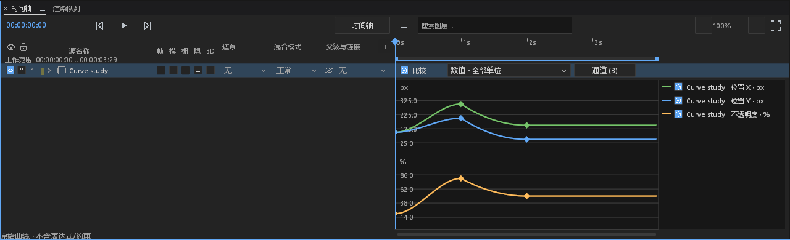
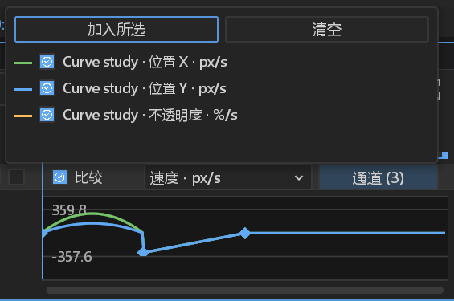
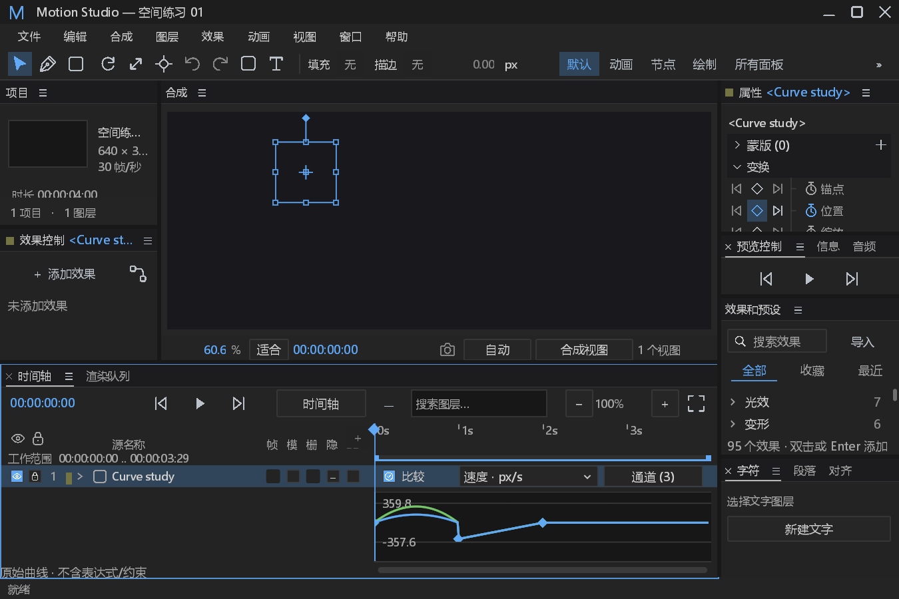
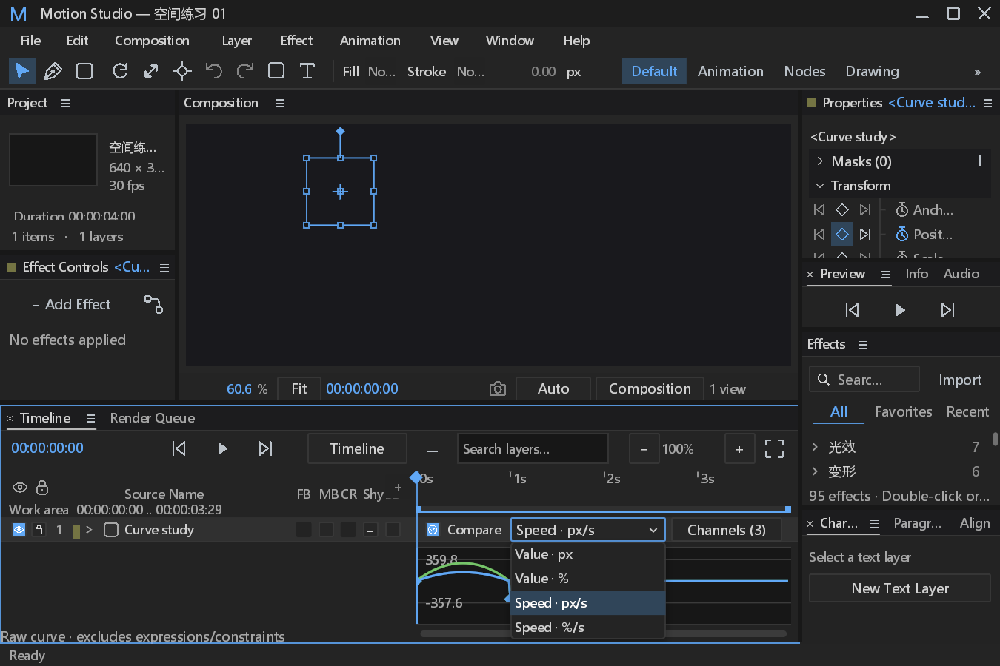
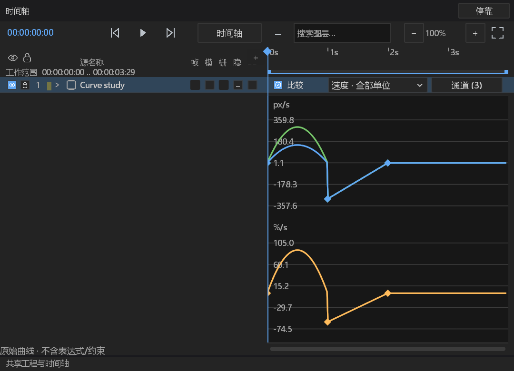

# #220 多通道曲线比较验收记录

在既有值图／速度图上增加独立的显示集合，复用已有关键帧来源、采样器和原子编辑命令。显示状态不写入工程或历史，不增加工程格式字段、依赖或第三方素材。接续已合入的 #501、#504，当前基线主分支为 `880739de`。

## 行为边界

| ID | 行为 | 证据与边界 |
|---|---|---|
| CC-01 | 选择数值属性或关键帧，通过“动画 → 多通道曲线比较”加入显示集合。 | 耦合向量展开为分量；分离轴保留本身地址。按通道去重，最多 128 条显示曲线；预检失败不留下部分集合。几何路径和曲线对象没有数值纵轴，明确拒绝。 |
| CC-02 | 不同单位各有纵轴，共享合成时间。 | px、%、deg、dB、RGBA 分组；未知效果单位按效果包／效果／参数身份隔离，显示原生参数名，不假定同名 value 具有相同量纲。图层本地偏移仅应用一次；锚点按源尺寸换算。 |
| CC-03 | 逐通道显隐与颜色图例。 | Checkbox 只改变显示集合。图层切换保留比较集合；文档／合成／代次改变清空集合，防止复用对象 ID。修订改变重读真实轨道，播放帧改变复用已采样曲线。 |
| CC-04 | 窄窗口一行工具栏，通道控制使用弹层。 | 下拉明确显示值／速度及单位；空间不足时只显示当前单位组。宽窗口可同时显示全部单位，右侧图例独立滚动。刻度尺、缩放、导航和关键帧共享扣除图例后的时间视口，“适合”保留末尾关键帧。公共导航栏预留空间，弹层在窗口层绘制，不被时间轴小区域裁切。 |
| CC-05 | 曲线关键帧追溯到原属性。 | 点击定位确切属性／分离轴，拖动沿用现有 EditorAction，预览不写数据，释放一次事务；保存重开及撤销／重做精确比较完整工程。没有改变 CurveSpace 或插值采样语义。 |
| CC-06 | 输入归属与正常失效。 | 中英、主窗／浮窗共用控制器；弹层屏蔽背景，Tab／方向键／Enter／Space 不触发播放，Esc／失焦退出，IME 消费不执行控件操作。过期选区不能向复用 ID 的新文档加入通道。系统前台物理输入仍待人工验证。 |

## 验证结果

验证源提交为 `17f48e9cff8dc2d6284a5a149a26b1deb65145e4`。专测 **10 项通过、0 失败**；完整面板回归 **557 项通过、0 失败、1 项手工 GPU 测试未自动运行**，耗时 461.83 秒。手工原生 GPU 验证另行执行，**1 项通过，生成 13 张完整截图**，包含中英、900×600／1600×1000、比例 1／1.5、值图／速度图、通道弹层、单位下拉及实际浮窗呈现。静态样式消费者检查、格式检查和 `git diff --check` 通过。

完整主窗／浮窗测试验证真实控件输入、关键帧来源、单步事务、保存重开、撤销和重做；新增尾部关键帧对照验证图例预留后仍与刻度尺精确映射。默认日志子进程验证坏字段连续读取 90 次只产生一次载入 Error，保留具体字段原因、对象、目标、修订和耗时，恢复后可重新读取；Error 同时写文件和 stderr，Info 只写文件，stdout 无产品诊断。

带 FFmpeg 的 dev 程序已编译，复制完整七个共享运行库及许可证；在仅系统 PATH 环境下，71 项命令目录输出为合法 JSON，实际 MP4 的首／中／末及回绕寻帧解码通过，后端为 libav。可执行文件 SHA-256 为 `0472d30859b0c42cbd0616318ab157b1d9cb873c92cc01f6a0d6cb5f2ffbc38d`。结构化结果包含测试可执行文件散列和各阶段原始日志，不以旧截图或首轮通过代替最终源提交。

```powershell
cargo test -p motion-desktop --bin motion-studio curve_comparison -- --test-threads=1
cargo test -p motion-desktop --bin motion-studio panels:: -- --test-threads=1
$env:MOTION_CURVE_COMPARISON_GPU_ARTIFACTS = '<新的空证据目录>'
cargo test -p motion-desktop --bin motion-studio curve_comparison_native_main_and_float_pixels_preserve_authored_project -- --ignored --test-threads=1
cargo build -p motion-desktop --bin motion-studio --features ffmpeg
```

下图为实际 GPU 截图，局部图只裁剪像素，未重绘；完整原图和裁剪坐标见结构化结果。右键菜单没有改动。











完整证据见 [原始日志与截图](curve-comparison-evidence.zip) 和 [结构化结果](curve-comparison-results.json)。本轮没有全局性能对比或系统前台物理输入证据，其他系统原生窗口行为仍需人工核验；#220 保持开放等待最终验收。

## 错误与可观测性处置

| ID | 分类 | 处置 |
|---|---|---|
| CCO-01 | 新观察 | 用户加入操作在解码之前记录 Info start，包含目标数量、修订；完成为 Debug。真实坏字段保留具体解析原因，Error 到文件及 stderr；原因保留上限 2048 字符。 |
| CCO-02 | 缓存与正常分支 | 同一轨道／修订只解码一次，坏轨道没有逐帧重复 Error。缺通道、非数值属性、显示上限、取消和过期来源不记故障。恢复后的修订重新加载；健康播放不新增每帧 Info。 |
| CCO-03 | 既有采样观察 | 采样失败沿用固定站点 panel observation，计数饱和，进程生命周期第 1 次 Warn、第 60 次 Error，混合列表成功项不重置相邻坏项；不是每秒阈值。没有修改既有观察器策略；完整面板回归包含其既有阈值测试，新增采样／缺样式站点尚未分别做 60 次故障注入，不把继承机制说成每个新站点均已验收。 |
| CCO-04 | 功能／协议边界 | 显示集合、单位分组和弹层为功能改动；编辑沿用既有受来源保护命令及错误信道。不吞 panic，不增加重试／重启／线程超时，不清除真实错误。 |
| CCO-05 | 保留与待验 | 原始 GPU 日志保留本机缺失 Epic Vulkan overlay 注册文件的既有 Error；不宣称整个环境日志无 Error。物理键鼠／系统 IME、其他系统窗口行为尚无本次人工证据。 |

## 失败记录

- 首轮编译遇到可见性、浮窗绘制参数及历史接口错误，改用现有接口，未删除测试。
- 默认日志负向测试发现 Track 外层 untagged 反序列化抹去了具体字段原因；按已定位通道直接解析，保留原始失败字段，原断言不变。
- 第一组原生截图虽然完成真实 GPU 捕获，但窄窗口两行工具栏与底部图例挤压图表，图例还被公共导航栏遮盖；这些截图只作为初始缺陷证据，最终改为单行工具栏和通道弹层后重新验收。
- 紧凑布局首轮编译有局部名称遮蔽；修正局部索引名。首次测试命令误用了可执行文件名作为 Cargo 包名，随后使用实际包 motion-desktop。
- 下拉键盘测试在完整主窗／浮窗中失败；主窗需要阻止控件键先进入全局快捷键，浮窗还会在弹层之前把 Enter 识别为图层重命名。两处分别修正，保留真实 Tab → Space → Down → Enter 路由断言，未改为直接设置速度模式。

- 新增的维度失效负向断言曾直接匹配 Arc 包装中的错误类型，产生类型错误；正确解引用后保留原本 Unsupported 语义断言。
- 宽窗口最初仅扣除图例绘制宽度，刻度尺仍使用完整宽度，会使适合视图漏掉末尾键；增加真实末尾键及横坐标对照，四处时间映射统一预留图例。弹层移至窗口层，避免小时间轴截断通道列表。
- 加入操作、关窗和采样错误沿用现有信道；未调整既有测试断言、模型预算、生产超时或重试策略。

## DESIGN.md §0.7 处置

| 基线行 | 处置与原因 |
|---|---|
| path_controls 六处行步进 | 保留：本轮不改路径属性行。 |
| path_controls 双列宽度 | 保留：比较视图不重排路径字段。 |
| path_controls 混合按钮高度 | 保留：不改变现有命中区。 |
| path_controls 自绘数值背景 | 保留：本轮没有数值字段编辑。 |
| path_controls 布尔全宽按钮 | 保留：本轮新增显隐用真实 Checkbox。 |
| effect_controls 行高和步进 | 保留：不改效果属性行。 |
| effect_controls fx／— 布尔按钮 | 保留：不改效果开关。 |
| effect_controls 枚举按钮 | 保留：本轮图表选择使用原生 Dropdown。 |
| effect_controls hover alpha | 保留：不新增颜色或 alpha 绘制。 |
| effect_controls 层级缩进 | 保留：不改变效果树。 |
| 时间轴列坐标／11 列栏 | 按兼容基线保留；仅改变图表右侧比较区域。 |
| 时间轴黄色吸附线 | 保留原行为；本轮没有修改吸附反馈。 |

所有新增布局尺寸先定义于 dark.json，再由控件读取。§12 仅对实际截图和输入测试覆盖的比较视图作结论，不声称 19 个面板、全部工作区或整个视觉规范已验收。
