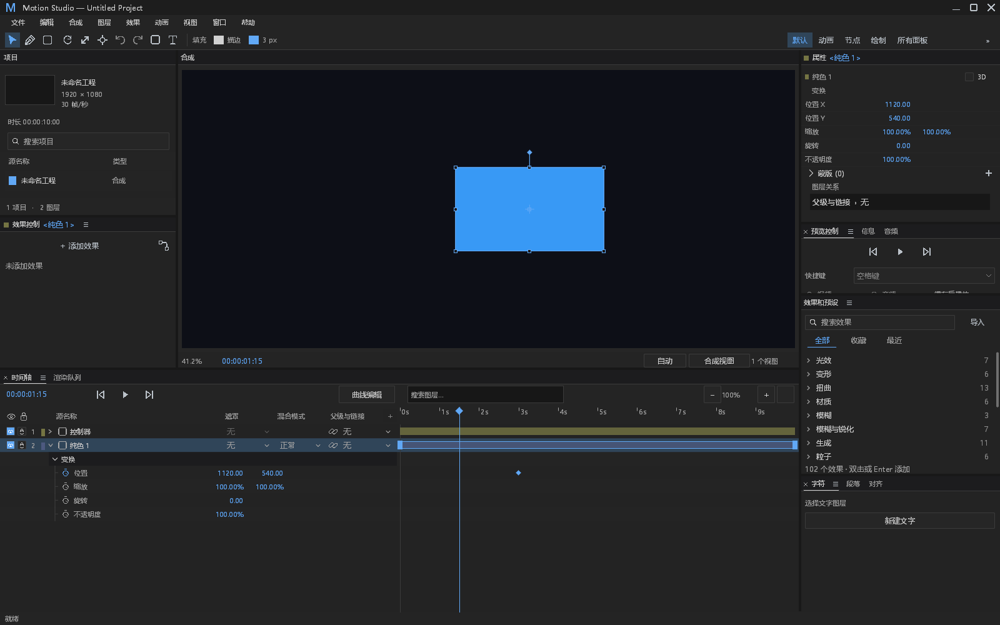
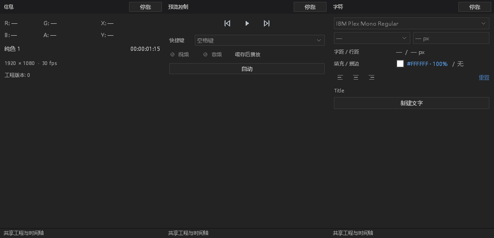
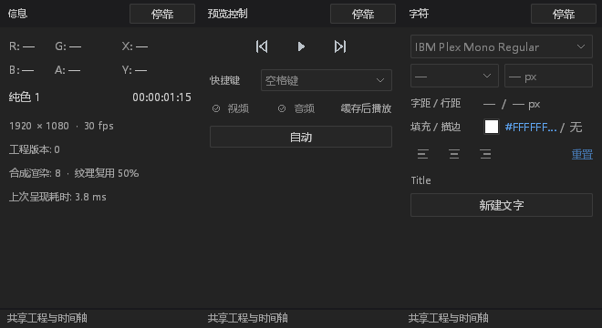
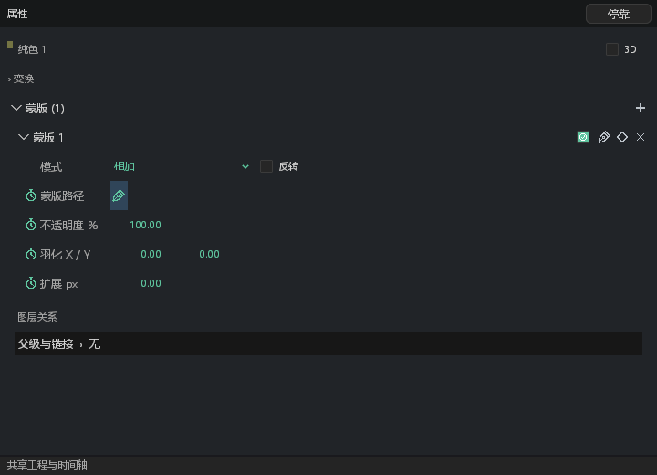
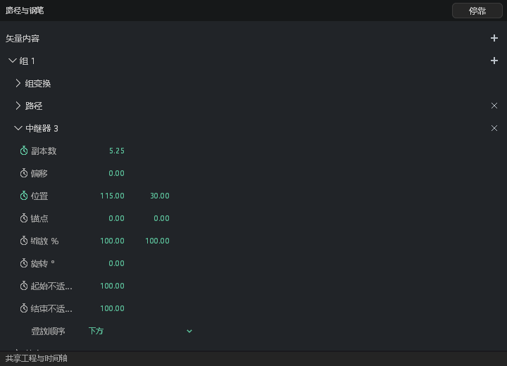
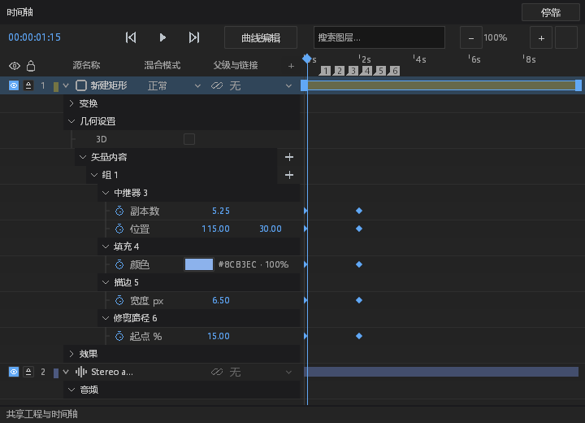
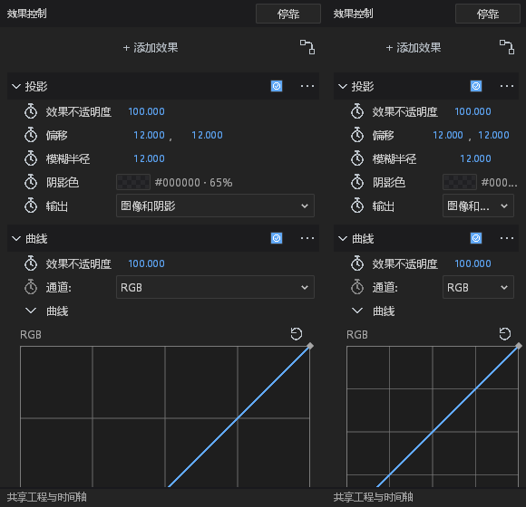
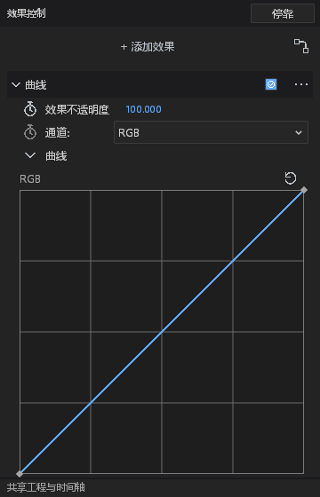

# 桌面 UI 阶段交付与验收边界

本记录整理 PR #303 的最终实现与验证范围。前置 [PR #302](https://github.com/MAD-Producer/Kilonova/pull/302) 已合并；本分支已合入对应 `main`（`c0dadd58`），包含桌面专用 CI 与选框主题修复，并重新验证组合结果。

本文件不是 DESIGN.md 全部通过的声明。下表中的 `fixed` 只覆盖列出的实现与证据；未覆盖的平台行为、显示比例和视觉状态另列为后续验收边界，不将局部验证扩大为全仓合规结论。

## 本次范围

- 蒙版归入图层属性，蒙版路径和数值动画接入共享时间轴；兼容读取旧独立面板 ID。
- 矢量内容树、填充、描边、修剪路径、中继器及其已有关键帧能力接入属性和时间轴。
- 效果参数与矢量颜色使用共享色板，RGBA 通道复用数值编辑事务。
- 信息、预览控制和字符面板重新排版。可用数据和命令保留真实连接，未支持项维持禁用态。
- 延续原生 PaintList、窗口输入、主题、工程与历史模型。矢量参数命令扩展已存在于本分支，不能将本 PR 描述为纯视觉改动。
- 效果属性改为同行控件、Checkbox、Dropdown、Stopwatch 与原位展开的曲线编辑区；父子层级和布局使用语义 token。偏移并排显示数值，去掉重复 X/Y 字样；数值区域在宽面板保持紧凑。保留原有精度和命中容差。
- 时间轴分组标题使用现有头部底色，子属性使用树形引导线；移除内容区逐秒竖线，保留顶部标尺、播放头、关键帧与吸附反馈。
- 修正枚举从 schema 最小值到选项索引的映射；曲线通道显示 RGB/R/G/B/A，并驱动实际编辑通道，通道修改和曲线修改分别可撤销。
- 辅助面板使用语义布局 token；画质使用显式下拉选择，弹层阻止穿透到播放控件。
- 新增中英文辅助/效果面板及窄面板截图；真实字符/效果测试图层捕获后撤销，并验证工程恢复。原生渲染按真实像素比例裁切。

网站、macOS 打包脚本、本地研究资料、构建目录和 agent 记忆不属于此 PR。

## DESIGN.md §0.7 逐项核对

旧行号以 DESIGN.md 的审计位置为锚点；代码已迁移时以下列文件与函数为准。

| 基线项 | 当前实现与证据位置 | 状态 |
| --- | --- | --- |
| `path_controls.rs` 六处 30/34/36/30/28/28 行步长 | 蒙版行移至 `path_controls/mask_inspector.rs`；矢量内容行移至 `path_controls/groups.rs`，使用 `row.height`、`padding` | fixed；完整视觉状态矩阵仍待验收 |
| `path_controls.rs` 两列固定间距 | `mask_inspector::property_row` 与内容树参数布局复用样式尺寸并约束可用宽度；`shape_content_geometry_tree_and_fields_stay_inside_narrow_and_wide_panels` 覆盖窄宽面板 | fixed；系统 DPI 手动验收待完成 |
| `path_controls.rs` 控件高度混用 | 新的蒙版/内容属性使用行高、字段高度、图标槽及复选框；动作与属性区分 | fixed；旧路径绘制中的其他尺寸未作整体清理 |
| 蒙版数字自绘背景 | 新蒙版字段通过 `numeric::Field` / `numeric::passive` 接入 `field.number`，保留拖动、编辑和历史 | fixed；对应输入/取消测试及原生截图见验证记录 |
| `Mask enabled` 全宽按钮 | `mask_inspector.rs` 使用 Checkbox，保留启用状态命令 | fixed；蒙版与效果头均使用真实 Checkbox |
| `effect_controls.rs` 30/26/34 行高及步长 | `render_mode` 使用 `effect.row.height`、`effect.header.height` 等 token；标量、颜色、二维值与动作同行；行高至少为全局密度 | fixed；220/360 宽、22/32 行高与 1/1.5/2 渲染比例测试；窄宽/滚动截图 |
| 效果布尔值 `fx` / `—` | 参数与效果头均用原生 Checkbox，动画使用 Stopwatch 图标 | fixed；真实参数编辑与撤销测试；效果操作进入 More 菜单，保持上移/复制/删除可用 |
| 效果枚举全宽按钮 | 原生 Dropdown 位于同一属性行，打开菜单不循环改值 | fixed；打开/外部关闭与选值路由测试，保留模态输入 |
| 效果悬停 `.with_alpha(0.2)` | 本次改为解析 `row` 的 `Hovered` 状态，使用现有 `$colors.hover`；没有新增颜色 token | fixed；其他 `.with_alpha` 用法仍需逐一审计 |
| 效果树层级缺失 | 效果标题跟随展开箭头；子级秒表、名称和值各有固定槽位；头部开关与操作菜单置于右侧 | fixed；同行测试检查实际矩形，原生效果截图核对层级；效果子属性名称相对父标题的缩进与跨行列对齐测试 |
| 时间轴 11 列坐标 | 保留既有列坐标与命中边界；本 PR 新增的蒙版、矢量属性行在名称区复用共享布局 | retained with reason：兼容基线，不做无差别主题重构 |
| 时间轴黄色吸附线 | 保留 `timeline.rs` 中既有 `Color::rgb(255, 210, 60)` | retained with reason：DESIGN.md 明确要求保留现状，后续先定义 token 再改反馈 |

## 本轮修复与后续验收边界

- 辅助面板行高、动作尺寸、间距与重置禁用态已改用语义样式；字符填充文字和预览控制按可用宽度布局，内容高度依据实际行数计算。
- 路径草稿颜色及连线透明度、效果曲线图尺寸/命中/透明度均先加入 `dark.json` 再读取。旧有未修改的菜单等布局不作全仓清理，不能声称实现中所有 literal 均已消失。
- 曲线编辑保留真实后端命令与一次撤销；曲线以独立详情区原位展开，通道使用下拉选择，图形为方形，保留 7px 命中容差。Escape、失焦和锁定取消尚未完成的手势；即使按下节点后没有移动，也会结束对应历史事务。
- 实际 900×600 原生窗口捕获已纳入本轮验证。控件测试覆盖逻辑比例 1/1.5/2 与密度 22/32；不等价于完整 Windows 系统 DPI、多显示器迁移验收。
- DESIGN.md §12 的全局 8×7 状态矩阵、全部工作区完整交互、IME/系统失焦、Reduced Motion 和 Info 性能基线对照仍待专项验收。本 PR 只报告下列已运行证据，不宣称规范全量完成。

## 后端能力边界

详细缺口与待评审的接口建议见 [辅助面板后端需求](../desktop-auxiliary-backend.md)。

| 面板 | 已接入 | 仍未实现/未接入 |
| --- | --- | --- |
| 信息 | 图层名称、时间码、工程摘要；有性能数据时显示现有计数 | 合成光标 X/Y、像素 RGBA 探针 |
| 预览控制 | 首帧、播放/暂停、末帧、现有画质模式 | 快捷键选择、视频/音频开关、缓存后播放；需分别核实真实音频和缓存能力 |
| 字符 | 字体名读取、填充颜色与 RGBA 编辑、新建文字 | 字体修改、样式、字号、字距、行距、描边、段落对齐、重置 |

未实现项不能因版式已经出现而写成“功能完成”。后端接入应分项提交，包含旧工程兼容、排版失效、撤销和会话设置验证。

## 复现与验收

Windows 需先初始化 MSVC 开发环境；本机使用本地 `.tools/msvc-portable/env.ps1`，该脚本不随 PR 分发，其他机器可使用 MSVC 开发终端。资源受限机器采用单任务编译。

```powershell
cargo build --locked -j 1 -p motion-desktop --bin motion-studio
cargo test --locked -j 1 -p motion-desktop -p motion-ui -p motion-host -p motion-desktop-media -p motion-core -- --test-threads=1
python tools/generate_desktop_icons.py --check
python tools/validate_provenance.py
python tools/ci_desktop.py --binary target/debug/motion-studio.exe --output artifacts/pr302-303-ready/pr303-native
```

本次 Windows 本地验证结果：

| 检查 | 结果 |
| --- | --- |
| 相关五个 Rust 包测试 | 628 通过，2 忽略；忽略项为手动性能测量和真实音频设备 |
| 合入最新主分支后的桌面测试 | 315 通过，1 忽略；覆盖效果同行/真实参数与曲线编辑/撤销、画质弹层防穿透、RGBA、蒙版/矢量键操作、取消、主窗/浮窗路由 |
| 干净工作树的 Python CI 工具测试 | 41 项运行，40 通过，1 项因未配置效果验证器而跳过 |
| 原生窗口验收 | 中英文、节点真实渲染、共享 MCP、样式覆盖及全部 20 个当前可用浮窗通过；旧独立蒙版面板已退役 |
| 辅助面板截图 | 每种语言 19 张设计截图，包含 360×520 和 220×360 辅助面板、360/220×560 效果面板、底部滚动与曲线编辑区；比例检查与测试工程恢复检查通过 |
| 来源、54 个图标、样式上下文静态检查、差异空白 | 通过；静态检查不代表所有硬编码尺寸均已清除 |
| UI 样式测试 | 6 通过；样式继承、文本几何与窗口上下文 |
| 格式 | 新增截图模块通过 rustfmt 检查；没有将全仓库格式合规记为通过 |

初次高并行编译耗尽本机内存，最终使用 `-j 1` 完成。原工作目录的工具清单检查受无关未跟踪 `tools/package_macos.py` 影响，因此 Python 工具套件在保留相同受审改动的干净工作树重跑并通过；没有删除或纳入该脚本。

本轮日志与全部 PNG 在本地 `artifacts/pr302-303-ready/`；前轮五包日志保留在 `artifacts/ui-handoff-20261016/`。Windows、Linux、两种 macOS 与可选 FFmpeg 构建以最终 PR CI 为准；Android 已停止自动构建/发布。

### 当前截图

以下为本仓库临时验收工程的真实原生渲染；面板拼接只并排排列 PNG，没有补画控件。窄面板使用既有省略与布局收缩，完整数值可通过编辑或悬停读取。性能计数随捕获步骤变化，本组截图不能替代性能基线对照。







下面两张使用默认主题与 22px 行高，展示蒙版、矢量内容及共享时间轴。32px 密度和其他强调色覆盖另由 CI 验证，不作为默认 UI 截图。











## 资产与来源

本 PR 沿用 Motion Studio 原有原生 UI 和图标体系。新增对齐等图标为本项目原创补充，来源标识在 `desktop/ui/icons/manifest.json`；图标总数为 54。无新增依赖或第三方素材，既有字体与第三方组件继续使用 `ATTRIBUTION.md` 中的来源与许可记录。

本文件中的截图由临时验收工程和本仓库原生 GPU 渲染生成，不包含第三方产品截图或产品资产。没有检查 Adobe 二进制、字符串表或资源段。
