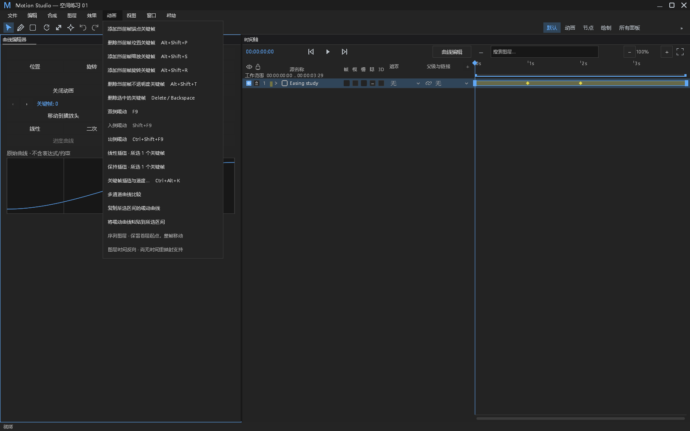
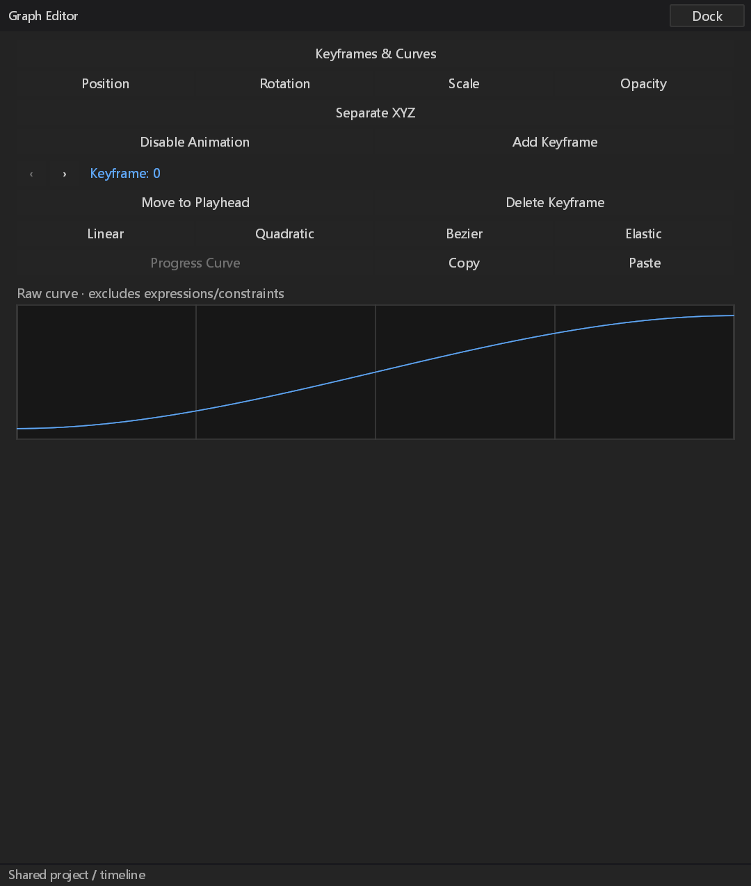

# 缓动曲线系统剪贴板验收（#261）

## 范围与兼容规则

基于 main `2227a195fb21d765b24abdb45f1759d7fe06c0ec`，本分支只交付 #261。#259 的采样、锁轴、自适应范围由另一个 agent 负责；两个既有草稿工作区保留，本 PR 不包含它们。没有修改工程版本、像素语义或渲染基线。

系统剪贴板是 `motion_studio_easing` / version 1 的 JSON；只接受当前版本。它记录缓动、曲线空间、形状和无量纲单位：横轴为区间归一化时间，纵轴为归一化进度或每归一化时间的进度变化。编码上限 16 KiB；此上限约束解析和本产品生成的文本，不保证操作系统读取任意巨大剪贴板文本时的原生分配也受此上限约束。

复制源必须是一个有后继关键帧的已选关键帧。粘贴目标是明确选中的关键帧所拥有的出区间；不会向其他属性连线，不携带源属性地址、物理速度、关键帧时间或值。标量、未分离向量、路径几何及颜色曲线沿用同一归一化时间定义；向量各通道共享缓动，分离向量必须明确指定轴。效果参数复用现有 typed keyframe channel。锁定源允许只读复制，锁定目标拒绝修改；仅选终点会报出没有出区间，和较早关键帧一同选中终点则跳过终点。

所有目标先完成地址、锁定、关键帧和区间检查，再作为一个事务粘贴。撤销一次恢复全部目标；保存、重开和重做保留结果。版本、单位或 JSON 不合法、目标已失效时不改数据。非法 JSON 错误保留解析类别和行列，避免 serde 的原始文本回显泄漏剪贴板内容。

## 功能与输入边界

- 曲线面板的复制／粘贴入口及动画菜单共用 shell 的一个待处理任务和引擎提交屏障。每次粘贴实际读取系统剪贴板，没有应用内旧内容回退。
- 通过项目根、generation、revision 和 composition 冻结源及目标。取消或旧修订在提交前丢弃，正常空选择、忙碌和失效不报故障。
- 系统 IO 使用容量为 1 的队列和单个长期线程，原生上下文留在所属线程；UI 非阻塞轮询，退出不 join 可能卡住的原生操作。没有新增自动重试、超时重启或把失败变成成功。
- 原生写入已经成功后再到达的取消，仍确认复制已完成；读入后到事务提交前取消不会写模型。不能声称撤回操作系统已经完成的写入。
- 本轮没有改动右键菜单。动画菜单与面板入口均提供中文和英文。主窗与实际浮窗回放生产 Input，检查目标、焦点丢失、IME composing / consumed 输入；没有冒称物理 OS 鼠标或输入法注入。
- Windows 验证写入子进程退出后，由另一个子进程读取、粘贴、撤销、重做和保存重开。Linux 的 selection 由存活的应用线程持有；应用退出后的保留取决于桌面剪贴板管理器。macOS / Linux 原生跨会话行为尚未在本机验证，不能以 Windows 结果替代。

## 结果与证据

结果清单：[easing-clipboard-results.json](easing-clipboard-results.json)。原始输出、源码 SHA-256、测试程序 SHA-256、截图和依赖审计回执保存在 [easing-clipboard-evidence.zip](data/easing-clipboard-evidence.zip)。归档不含程序、字体、DLL、用户原始剪贴板文本或用户工程。

初轮当前分支：模型 keyframe_clipboard 56 通过；桌面剪贴板回归 52 通过／1 手动系统剪贴板 ignored，动画菜单 10 通过，mini 控件 1 通过。系统剪贴板新增受控阻塞阶段抓到开始日志未立即落盘，原始失败及后续 gate 断连 panic 保留在 `initial/`。修正生产代码，在任务入队、原生处理前刷新 Info；没有更改原断言、等待预算或增加重试。最终源码的重验状态以结果清单为准，不把初轮绿色检查充作最终源码的证明。

实现阶段另有两次编译错误：新增引擎命令最初漏接 panic 回复分支，以及测试误用了不存在的 History 变体。补齐真实回复路由、改用现有 history API 后通过，原构建输出保留在 `initial/`。原生日志仍记录本机 Epic Vulkan overlay 注册指向已不存在 JSON 的 loader Error；没有过滤它或把它当成本 PR 的功能修复，实际 GPU 呈现与专项断言通过。

最终源码复验：系统剪贴板 1 通过、原生 UI 1 通过（6 张截图）、剪贴板回归 52 通过／1 手动 ignored、动画菜单 10 通过、mini 控件 1 通过；测试程序全程 SHA-256 未改变。模型 56 项所用的全部 crates 源码哈希与最终源码一致。带 FFmpeg 的最终开发构建通过。ignored 的系统用例已单独显式运行，不能把两个统计重复相加；这是相关专项通过，不是完整 workspace 验收。





带 FFmpeg 的开发构建成功；已有 23 条桌面与 2 条 render 警告未在本轮顺带清理。`verify_style_consumers()`、样式 JSON 解析、provenance 守卫和 `git diff --check` 已执行。锁文件使用 cargo-audit 0.22.2、RustSec `3279c99911354c400e1d41e47c7d60e39258b147` 检查：0 已知漏洞；既有 ttf-parser 的 unmaintained 提示保留。完整 workspace 测试及跨平台 CI 尚不能由这些专项宣称通过。

## 错误与观测处置

| ID | 分类 | 证据与限制 |
|---|---|---|
| EC01 | 新增观察 | OS 任务发布 request、queued/io/complete、elapsed；Info start 并 flush 在入队和原生初始化前，日常完成 Debug。受控阻塞断言在释放 gate 前读取真实文件、检查 in-flight 和可取消状态。 |
| EC02 | 新增观察与实际失败 | 非法真实系统文本、受控原始 panic 经现有 log 输出文件 Error 和 stderr Error；逐子进程验证 stdout 隔离及敏感字段不泄漏。异常回复保留主因并结束 pending。 |
| EC03 | 既有覆盖 | 引擎非 Present 请求开始、handler 的计时和 in-flight、panic hook、编辑事务回滚与 shell 错误提示复用原机制；新增命令接入诊断名、错误及 panic 回复。没有改 hook 或 Present 热路径。 |
| EC04 | 正常分支 | 忙碌、无选择、取消、修订变化、尚无回复属于正常流程；不按每次轮询计故障，不引入 60 次计数器。 |
| EC05 | 协议与功能边界 | UI 关闭后 best-effort 回复可丢弃。系统线程若原生调用一直不返回，状态保持 in-flight，UI 可取消并继续；没有承诺终止原生调用。后续队列满／线程退出是可报告错误。 |
| EC06 | 有界上下文与保留原因 | 默认记录 request、操作、phase、时间，源修订和 composition（128 字符）、前 8 个对象 ID 与总通道数；原因限 1024 字符，解析不回显用户文本。剪贴板恢复失败单独 Error；不覆盖主失败。 |
| EC07 | 待验证 | 真实 OS 不可用／权限拒绝和 spawn 失败具有错误通路，但没有人为破坏用户 OS 环境来取得运行证据；跨平台原生行为及物理 OS 输入见上文边界。 |

## DESIGN §0.7 的逐项处置

下表对照当前 main 源码重查；既有改进不计作本 PR 修复，没有改动路径、效果或时间轴绘制。所有 retained 项的全量视觉复验仍待对应 UI 工作，不能据此宣称整个 DESIGN 合规。

| 基线项 | 当前位置／观察 | 本轮处置 |
|---|---|---|
| 路径六种字面步进 | 路径属性已分拆至 `path_controls/groups.rs`、`groups/parameters.rs`、`mask_inspector.rs`，已有 token 行布局 | retained：本轮不改路径布局；全量截图待验证 |
| 路径两列固定拆分 | 分拆模块已有共享行／列布局，原行号不再对应 | retained：不改列宽；窄面板待对应专项 |
| 路径按钮与字段高度混用 | 分拆模块使用现有行和字段 token | retained：不缩减命中区，不声称本轮修复 |
| 路径自绘数值背景 | 数值编辑现位于分拆模块 | retained：不重绘字段，完整状态矩阵待验证 |
| 路径全宽布尔按钮 | 蒙版与形状参数模块已有各自控制路由 | retained：不修改开关或交互，待独立视觉验证 |
| 效果行高／步进 | `effect_controls.rs` 已使用 `effect.row.height`、`effect.header.height` 和分组 token | retained：本轮只借用既有 typed channel |
| 效果布尔文本按钮 | 参数分支位于效果属性行 | retained：不修改布尔控件，不增加第二行 |
| 效果枚举全宽按钮 | 参数分支与现有值列位于效果属性行 | retained：不改枚举或循环值语义 |
| 效果 hover alpha | 当前文件无基线的 `.with_alpha(0.2)` 表达式 | retained：既有变更，不计为本轮修复；视觉待验证 |
| 效果无层级 | 当前已读取 `tree.indent` 和 header 样式 | retained：保持现状，全量层级验收不在本轮 |
| 时间轴固定坐标列 | 现有 timeline label gutter 和列布局未修改 | retained：兼容基线，不全局 token 化 |
| 时间轴硬编码吸附线 | `timeline.rs` 仍有 `Color::rgb(255, 210, 60)` 与 1px 宽度 | retained：明确保留已知现状，不伪称已 token 化 |

新增入口复用已有按钮／菜单样式；仅将 mini 按钮原有 24 高度和 2 间距移入 `dark.json` 的 `graph.control.height` / `graph.control.gap`，绘制和命中共用矩形。未增加属性行、布尔按钮、枚举循环或新的颜色。

§12 本轮覆盖中文／英文实际主窗、原生浮窗及 1.5 像素比的目标与焦点行为、撤销和持久化；没有重验全部 19 面板、5 个布局、完整 8×7 状态矩阵、900×600／全部 DPI、Reduced Motion 或所有性能指标。它们保留为未验证，不能以编译成功代替。

## 复现

```powershell
cargo test -p motion-core --test keyframe_clipboard --locked -- --test-threads=1
cargo test -p motion-desktop --features ffmpeg --locked layer_clipboard:: -- --test-threads=1
cargo test -p motion-desktop --features ffmpeg --locked panels::animation_menu:: -- --test-threads=1
cargo test -p motion-desktop --features ffmpeg --locked panels::animation_controls:: -- --test-threads=1
```

Windows 手动系统验收：运行精确测试 `layer_clipboard::curves::tests::curve_clipboard_real_system_roundtrip_between_processes_and_default_error_output`，加 `--ignored --test-threads=1 --nocapture`，用 `MOTION_CURVE_SYSTEM_CLIPBOARD_ARTIFACTS` 指定输出；需要可恢复的文本剪贴板，原文本只在进程内保留并在退出时恢复。原生截图测试为 `shell::curve_comparison_tests::curve_clipboard_native::curve_clipboard_native_main_and_float_keep_explicit_targets_and_cancel_focus_loss`，输出变量为 `MOTION_CURVE_CLIPBOARD_GPU_ARTIFACTS`，同样显式运行 ignored。
