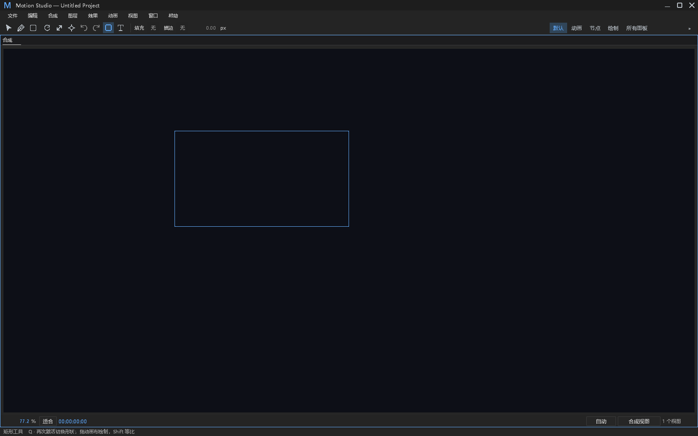
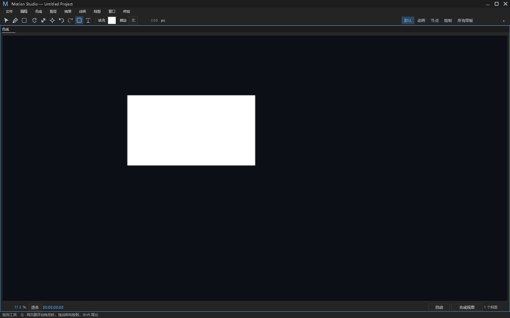
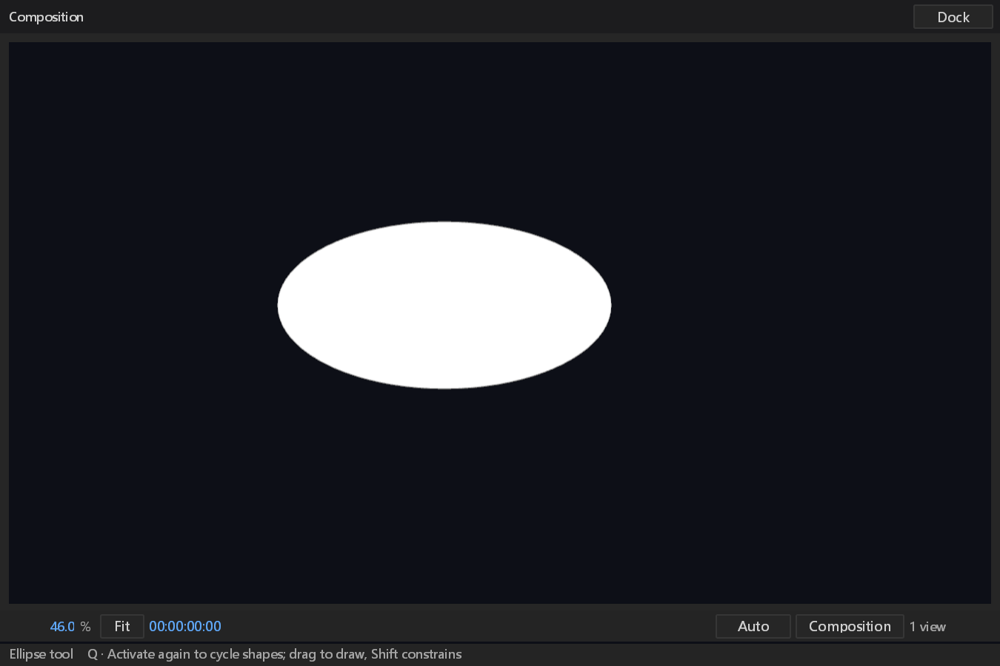

# 查看器工具激活与输入所有权验收

对应 #230，分支 `feat/editor-tool-state`。从 main d07b8b13 建立独立工作树；开始前核对开放 PR 和本地分支，#471 是本线程的节点剪贴板，#470 是其他线程的 UI 绘制优化，没有重复的工具状态实现。没有接管或审阅其他 PR，也没有混入根工作树改动。

## 功能与边界

- `tools::choose` 为工具栏与查看器快捷键提供同一激活转换；复用原 Path / Transform 控件的绘制和回滚，不引入项目模型、历史或第二套 UI 框架。已有检查器钢笔按钮仍通过原控件反映真实活动工具。
- 新增可配置 Viewer 作用域，V/G/Y/W、Q、T、H/Z/C 与时间轴和节点语义分离；工具提示读取实际改键。Ctrl 文档操作与文本、IME、菜单和拖动所有权继续由原路由仲裁。
- 激活不创建图层或改属性；Q 当前循环矩形/椭圆，画布拖动松开才调用已有 AddShape；Shift 等比。图层菜单中既有直接新建行为不变。文字工具激活后点击画布进入现有设置对话框；未声称画布内文字编辑或点击位置排版。
- 抓手与缩放复用独立 Navigation。中键临时平移、Alt 点击缩小不改选中工具。摄影机工具只在观察视图可用，复用 ViewOrbit，不编辑作者摄影机图层。退出观察视图退回选择工具。
- 绘制候选绑定根、revision、frame、映射和合成上下文；失焦、Esc、切换原生输入窗口或上下文取消，不在后续松开时偷偷创建形状。只有真实输入改变窗口所有权，后台重绘不抢占。
- 方向键按源坐标移动 1 / Shift 10 像素。未锁定图层、矢量/组内路径及蒙版节点复用现有模型命令；保留相对切线与分离位置维度，批量编辑原子且单步撤销。宿主拒绝仍走原错误信道，不吞掉错误。

## 验证记录

最终生产源码对应 153 项相关测试通过，0 失败：

| 验证 | 结果 | 本机 `artifacts/pr-ci-followups/` 证据 |
|---|---|---|
| 工具状态专项，包括默认错误双输出、原生截图、保存重开 | 12 通过，9.33 s | `editor-tools-final-tests.log` |
| 快捷键真实目录与预设冲突 | 8 通过 | `editor-tools-final-shortcuts__.log` |
| 完整路径控件，包括新增矢量/蒙版节点微移 | 77 通过，13.08 s | `editor-tools-final-panels__path_controls__.log` |
| 主窗 / 浮窗键盘仲裁 | 24 通过 | `editor-tools-final-panels__keyboard__.log` |
| 查看器导航 | 4 通过 | `editor-tools-final-panels__composition__.log` |
| 工具栏样式与输入 | 9 通过 | `editor-tools-final-panels__toolbar_style__.log` |
| 变换与锁定/修饰键 | 19 通过 | `editor-tools-final-panels__transform_controls__.log` |
| FFmpeg 产品构建 | 成功，60 s；保留 20 项既有 app 警告 | `editor-tools-product-build.log` |
| Windows x64 / 共享 FFmpeg 与隔离 PATH 启动 | 12 个运行时条目验证，55 个命令，退出 0，stderr 0 字节 | `editor-tools-package-evidence.json`、`editor-tools-startup.stdout.json` / `.stderr.log` |

测试使用 `cargo test -p motion-desktop --bin motion-studio --no-default-features --features ffmpeg --locked --offline -j1` 和既有测试二进制按上述真实模块过滤。生成默认键位参考后保留原目录断言；只是将目录枚举扩展到新 Viewer 作用域，不降低冲突、重复或原有命令断言。新文件 rustfmt、样式消费门禁与 `git diff --check` 通过；不重排无关 legacy 面板源码。

构建命令为 `cargo build -p motion-desktop --bin motion-studio --no-default-features --features ffmpeg --locked --offline -j1`。本机工具分支开发构建位于 `E:/Dev/aem/artifacts/desktop-tool-state-preview/`，含 FFmpeg DLL、许可证和来源清单。exe SHA-256 为 `e88bfc618a03fb5f5e735f4bf0c65786c9049789ff4d1f83ee93a224737a73b1`。隔离启动清除开发 FFmpeg / PKG_CONFIG 配置，PATH 仅保留 Windows / System32；命令目录启动证明 DLL 可加载，不代替完整人工播放。

初始编译发现新增测试的 floating_chrome 参数顺序错误，修正后第一批 5 项通过。随后新增测试发现 Bindings 为 Arc，改用 Arc::make_mut 修改测试配置；加入合成上下文取消时编译发现候选初始化缺字段，补齐实际存储和比较。原始失败日志保留为本机 `artifacts/pr-ci-followups/editor-tool-state-first.log`、`editor-tool-state-third.log` 和 `editor-tool-state-fifth.log`，没有修改已有断言来换取通过。第四轮 10 项工具测试通过，并有 65 项相邻回归通过；最终新增原生窗口所有权、摄影机能力与保存重开验证后单独记录，不将中间结果冒充最终结果。

测试包含真实宿主读状态、AddShape / SetVector / SetComponent / Vector / Mask 命令、撤销、保存重开和 HWND / GPU surface 截图。原生输入显式注入生产 chrome / floating_chrome API，截图为真实 Present / CaptureUi；不冒充 OS 物理鼠标、键盘或系统输入法测试。Windows 主窗 1600×1000、英文浮窗 900×600 逻辑尺寸 / 150% 输出。其他平台运行、原生输入法和更多 DPI 由 CI 与人工继续验收，不声称已完整人工覆盖。

## 错误与观察审计

| ID | 分类 | 处置与证据 |
|---|---|---|
| TOOL-01 | 新观察：准备阶段拒绝 | 显式创建超限、缩放映射失败或第一次微移读取失败发出 Error，包含 operation、revision、frame、selected、phase 和原始原因；cause 最多 512 字符，用户获得错误说明，不记录正文或 JSON。默认日志子进程验证文件、Error stderr 及 stdout 隔离。 |
| TOOL-02 | 新观察：重复微移退化 | 首次失败 Error；同一实例继续 OS repeat 失败进入已有 FailureCounter，首个重复 Debug、第 60 个重复 Error，饱和有界。成功微移、正常空选择/相消、工具取消重置；不把次数解释为秒。手动重新按键作为新的离散请求报告 Error。默认级别测试验证抑制、阈值与恢复后的再次报告。 |
| TOOL-03 | 正常分支 | 空选区、锁定层、未达拖动阈值、取消、失焦、上下文更换、后台重绘及非观察视图的摄影机禁用均非故障。文字工具只打开既有对话框，不伪造完成编辑。 |
| TOOL-04 | 功能/协议边界 | 新绘制候选是内存状态，提交复用原宿主错误与历史通路；没有新 worker、超时、重试、重启、吞 panic 或修改返回语义。串行 worker Info start / in-flight、panic hook 和原生等待诊断为既有覆盖。 |
| TOOL-05 | 保留限制 | 此批不是全库错误合集收敛；不将 API 输入测试说成 OS 原生事件验证。已有环境 overlay / GPU 日志保留。 |

## 视觉与来源

已检查 PROVENANCE.md、ATTRIBUTION.md、NOTICE、DESIGN.md 及已有 UI 绘制/样式 API。没有新依赖、外部资产、Adobe 图标、字体或截图。截图为本项目原创测试图层生成。

工具按钮复用既有图标与选中状态；把修改区域原本的按钮位置、间距和大小先写入 dark.json 语义 token，再在代码消费。原有 24 / 25 像素命中区域保持，不以缩小命中来增加密度。新绘制框使用已有 focus / border / motion.drag_threshold token；不创建平行色板或凭空样式名。

DESIGN §0.7 各项 retained with reason：path_controls 步进、双列、按钮高度、数值 painter、布尔控件五项；effect_controls 行高、布尔、枚举、hover、层级五项；timeline 列坐标与吸附线两项均不是此批视觉改变，不冒充已修复。§12 按本批动作、取消、坐标映射、实际渲染和窗口所有权验证；其他面板状态矩阵、Reduced Motion 系统集成及全局性能基线未改、未声称全面通过。

## 实际界面

截图夹具最后改为空工程分别绘制，避免既有同色图层重叠遮住创建结果；只改测试数据，没有修改生产渲染或断言。原件尺寸与 SHA-256 记录于 [captures.json](editor-tool-state/captures.json)，PNG 仅做无损重编码，已逐像素核对 RGBA 一致；没有裁剪或重绘。

主窗矩形候选（松开前没有创建图层）：

松开后的矩形：

英文 150% 浮窗中的椭圆：

