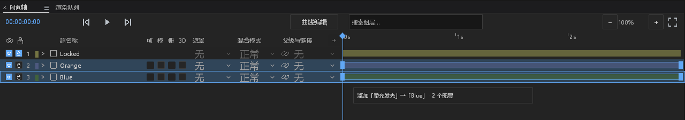
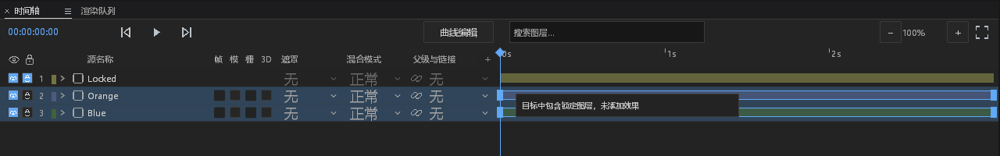
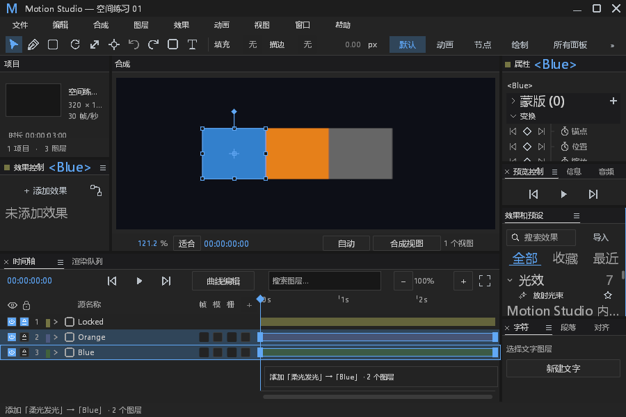
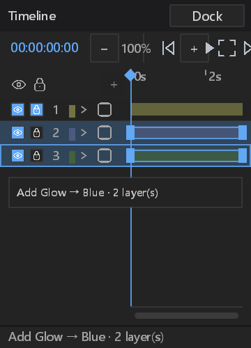

# 效果库拖放验收与错误审计

对应 #224。分支 `feat/effect-library-drag`；基于工具栏 #467 合并后的 main `37a0a5dd`，没有接管其他 PR。开始前核对开放 PR、本地 worktree 和近期分支：删除反馈、原生成本观测、效果菜单批量移除等已有工作不在本批重复实现。根工作树未提交的效果包改动未带入此分支。

## 实际行为

- 单击仍选择效果，双击和 Enter 保留已有应用入口。按住效果项移动超过既有 `motion.drag_threshold` 才成为拖放；收藏星标和类别标题不能发起拖放。
- 时间轴仅图层标题行接受投放，不把属性子行或空白当作图层。投到选区内的行，目标为整个选区；投到未选中的行，仅作用于该行。合成画面入口明确作用于当前选区，观察视图不接受投放。
- 提示显示效果、首个目标和图层数量，时间轴目标沿用实际布局矩形。锁定、不兼容、没有选择、已删除目标或包被替换时整次取消，不静默跳过部分目标。
- 拖动和取消不安装实例、不写工程历史。释放后只发出一个显式 `objects` 请求，附当前合成 ID，复用既有效果添加事务、结果反馈和参数定位；多选可单步撤销。真正后端失败保留原始错误。
- 主窗/浮窗共用手势；实际 native client 坐标先转物理屏幕坐标，再按目标 DPI 回到逻辑坐标。释放时重新核验目标。Windows 使用 [WindowFromPoint](https://learn.microsoft.com/en-us/windows/win32/api/winuser/nf-winuser-windowfrompoint) 检查实际可见窗口，避免向被覆盖的窗口投放；空桌面命中属于正常取消。
- 拖动拥有其间的指针和键盘输入，Space/Delete/全选不会落入时间轴；内部窗口之间的 PointerLeft 保留本手势，失焦、Esc、关闭、上下文切换取消。清理两个窗口的旧按下/释放状态，同时保留最终鼠标坐标，避免松手后旧事件重新发起操作。
- 开始拖动及取消后清除上一次点击记录，避免快速重拖被误认成双击。当前拖动提示优先于之前的普通状态消息；主窗已有渲染错误优先级保留。

## 验证记录

组合源码验证共 42 项通过 / 0 失败 / 0 忽略：effect_drag 8 项、工具栏 10 项、效果库 6 项、既有效果应用 4 项、快捷键 9 项、视口 4 项、原生双窗输入 1 项。日志为本机 `artifacts/pr-ci-followups/effect-drag-verified-*.log`。

随后增加最小窗口截图，并补齐浮窗当前状态优先级；最终源码重新运行 `cargo test -p motion-desktop --bin motion-studio --features ffmpeg --locked --offline effect_drag -- --nocapture --test-threads=1`，8 项通过 / 0 失败 / 0 忽略，耗时 34.53 秒。日志为 `effect-drag-final-source-tests.log`；这次输出作为附图来源。其余 34 项组合回归在这一行状态优先级及最小窗口测试补充前通过，未冒充全量重新运行。

最终 `cargo build -p motion-desktop --bin motion-studio --no-default-features --features ffmpeg --locked --offline -j 1` 通过，耗时 46.35 秒，保留 20 条既有编译告警。日志为 `effect-drag-final-product-build.log`。

可运行开发目录：本机 `artifacts/desktop-effect-drag-preview/`，包含实际 EXE、FFmpeg 动态库、许可和来源记录。校验 PE 平台为 windows-x86_64，并将 PATH 仅留 Windows 系统目录、移除 FFmpeg 开发环境后运行 `--command-list`：退出 0，stdout 为有效命令 JSON，stderr 0 字节。该检查验证启动依赖完整性，不冒充人工全功能验收。EXE 为本地 debug 构建，SHA-256：`354d1807d779ef26d7bcf75e79f7d83bd5bb21eea3d2c0f5ecfd65787a00f1bb`。样式消费者检查、新模块 rustfmt 和 `git diff --check` 已通过。

独立初版：8 项定向测试通过；效果库 6 项、既有效果应用 4 项、快捷键 9 项、视口 4 项、原生双窗输入 1 项回归通过；带 FFmpeg 的 debug 构建通过。同步 main 后，再次运行定向测试和工具栏回归。

测试使用真正的 `Shell`、效果包和引擎，不模拟添加成功。断言成功前无实例、每个目标只添加一次、无重复释放提交、撤销/重做以及保存重开。拒绝/取消覆盖锁定、类型不兼容、空选区、缺失目标、包失效、空白、Esc、失焦及工程/合成切换。

原生截图使用真实 Windows HWND、已附着 GPU surface、生产 panel painter、Present 和 CaptureUi。输入为显式注入的 WindowEvent，经生产拖放桥接处理，不冒充物理鼠标、系统输入法或人工桌面验收。隐藏 GPU 窗口没有 OS 命中面，测试明确采用 client 几何；另外直接核验 Win32 句柄匹配、外部句柄拒绝以及屏幕外 WindowFromPoint 正常空命中，不把它们声称为可见重叠窗口的人工验收。

截图范围：默认主窗 1600×1000、最小主窗 900×600、浮窗 100%/150%/200% DPI；中英文和双向 native client 转换。跨平台构建由远程 CI 验证，非 Windows 桌面的真实鼠标捕获、重叠窗口及 IME 仍需平台验收；平台无法提供跨窗位置时明确取消并报告原始原因，同窗投放不要求该位置 API。

初期验证保留在本机 `artifacts/pr-ci-followups/effect-drag-tests-first.log`、`effect-drag-tests-second.log`。前者新测试缺少 fs 导入、坐标类型及关闭方法名错误，随后修正夹具；后者 7 通过 / 1 失败，实际揭示取消后重拖误触旧双击记录。修正生产手势清理，不修改已有断言以获得通过。截图后的集成检查另补当前拖动状态和原生可见窗口判断，最终结果单独记录。

## 错误与边界审计

| ID | 分类 | 处置与证据 |
|---|---|---|
| E-DROP-01 | 新观察：窗口坐标/原生句柄失败 | 结束当前手势，Error 包含 window、phase 和原始 cause，界面保留原因；cause 最多 512 字符。一次失败结束一次手势，没有热路径日志、重试或保留错误集合。受控坐标失败经过实际日志 sink，检查默认文件 / Error stderr / stdout 隔离。真实 OS 获取位置失败无法稳定制造，夹具注入失败边界，不声称已复现 OS 故障。 |
| E-DROP-02 | 既有覆盖：后端添加失败 | 复用 `Action::Plugin` 和串行 worker 的 Info start、in-flight、请求 ID、原始错误与完成清理。真实不存在包 hash 走实际 worker，核对工程不变、可见原因、文件与 stderr 有 Error、stdout 无错误日志。没有新增 handler、线程、阻塞队列或恢复策略。 |
| E-DROP-03 | 正常分支 | 未过阈值、Esc/失焦/关闭、切换上下文、无目标、锁定/不兼容、效果包变更、PointerLeft 跨内部窗口、OS 空命中均不算故障，不添加频繁 Warn/Error。拒绝目标有用户提示。 |
| E-DROP-04 | 功能/协议边界 | 发出显式目标集合和合成 ID，最终成功仍以 worker 返回为准；不更改 respond、错误结构、采样、渲染、资源回收或包格式。没有吞 panic、新增业务状态 unwrap、超时或后台重启；tooltip 样式解析沿用内建样式完整性约束与既有 panic 诊断钩子，本批未更换 hook。 |
| E-DROP-05 | 既有环境记录 | Epic Vulkan Overlay JSON 缺失的日志继续保留，不屏蔽日志、不修改系统注册表。 |

## DESIGN §0.7 基线处置

本批新增拖放反馈，不重排属性树。以下各项逐项保留，理由为与效果投放入口独立；未将历史违规描述为已修复。

| 基线位置 | 本批状态 / 原因 |
|---|---|
| path_controls 六处纵向步进 | retained：未修改路径属性行。 |
| path_controls 两列硬编码 | retained：未修改数值字段布局。 |
| path_controls 混合按钮高度 | retained：未修改按钮或命中区。 |
| path_controls SUNKEN/ACCENT 数值绘制 | retained：未触及该 painter。 |
| path_controls 全宽布尔按钮 | retained：未修改布尔控件。 |
| effect_controls 属性行 30/26/34 | retained：仅增加库拖放候选字段，没有修改属性行。 |
| effect_controls fx/— 布尔按钮 | retained：未修改效果启用控件。 |
| effect_controls 全宽枚举按钮 | retained：未修改枚举控件。 |
| effect_controls 手写 hover alpha | retained：未改既有效果行 hover。 |
| effect_controls 缺少层级 | retained：本批不重排效果属性树。 |
| timeline 既有 11 列坐标 | retained：从已经算出的图层标题行登记目标，不变更列宽、滚动、刻度或命中容差。 |
| timeline 硬编码吸附线颜色 | retained：没有改吸附线；新目标描边读取既有 accent/border token。 |

§12 范围内：没有新 UI 栈、项目结构、依赖或历史协议；新增绘制使用既有 `tooltip`、accent、border、padding.panel、icon.slot、row.height，未修改 dark.json 或发明色值。已有按钮/字段/行的命中容差不变。样式消费者、局部新模块格式和差异检查另行验证。未声称完成其他属性树整改、全部面板状态矩阵、系统 Reduced Motion 或总体性能基线。

## 截图来源

附图均由本项目和原创三色图层夹具生成。没有新增第三方图像、依赖或复制 UI 资产；已核对 PROVENANCE.md、ATTRIBUTION.md、NOTICE。`effect-library-drag/captures.json` 记录完整输出的 SHA-256、尺寸、裁剪范围及附图 SHA-256；裁剪没有重绘内容。原始日志和完整截图位于本机 `artifacts/pr-ci-followups/effect-drag-native-verified-final`。

