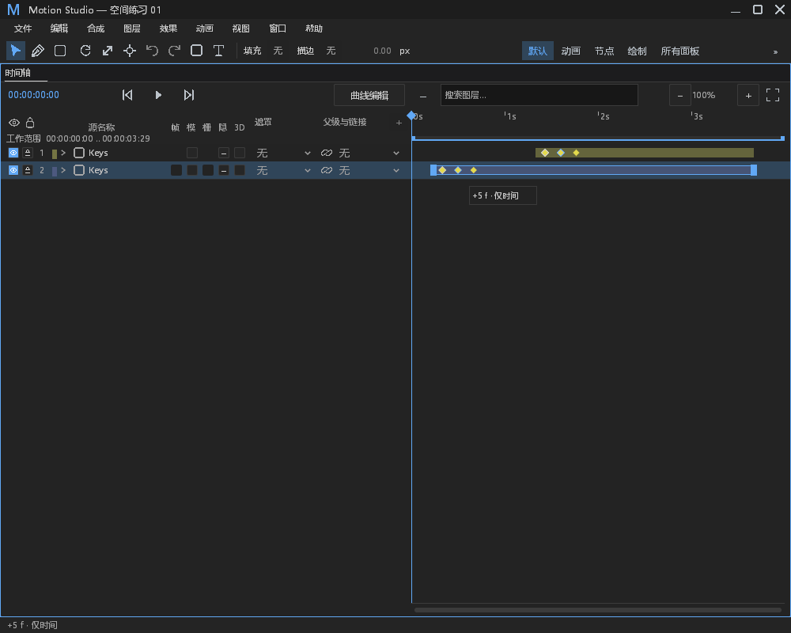
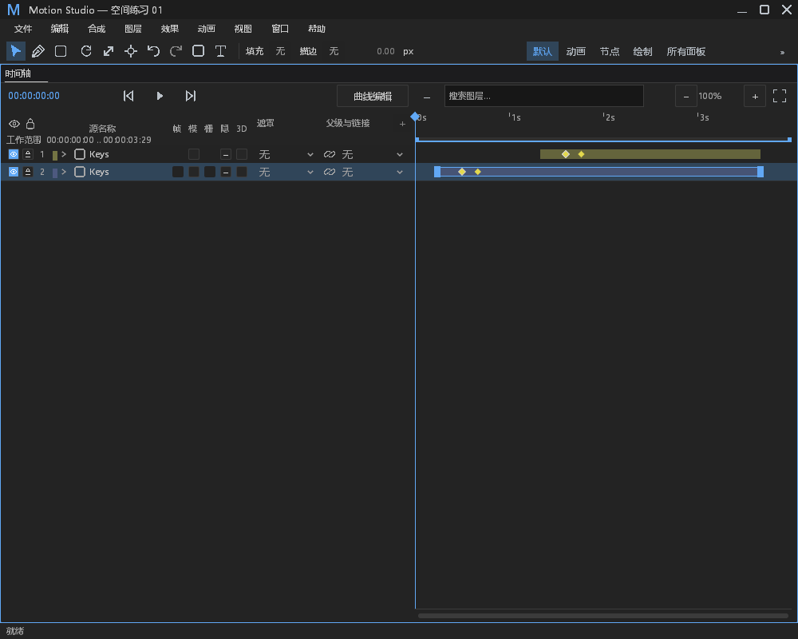
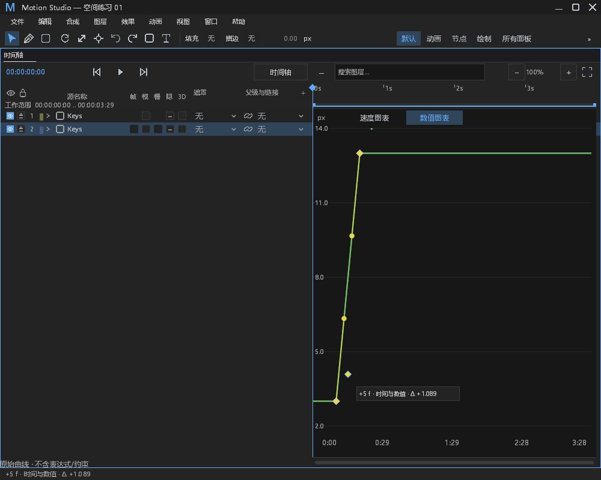
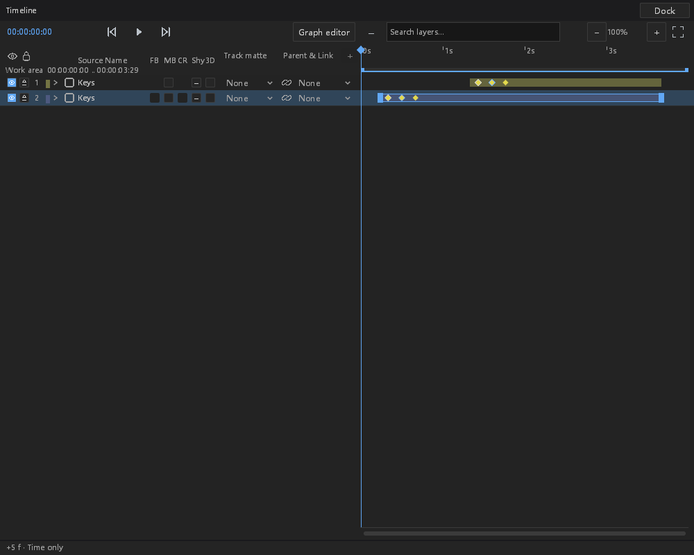
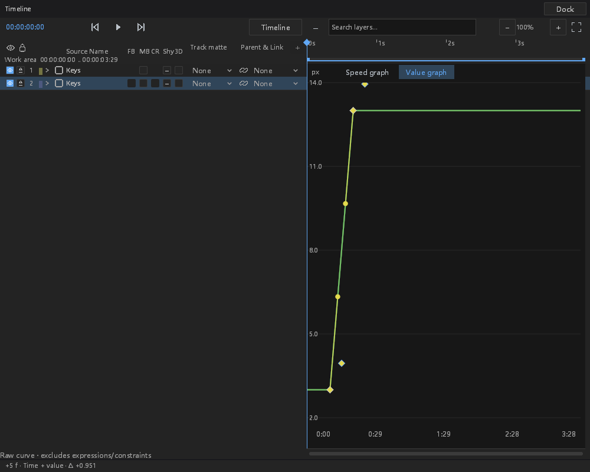
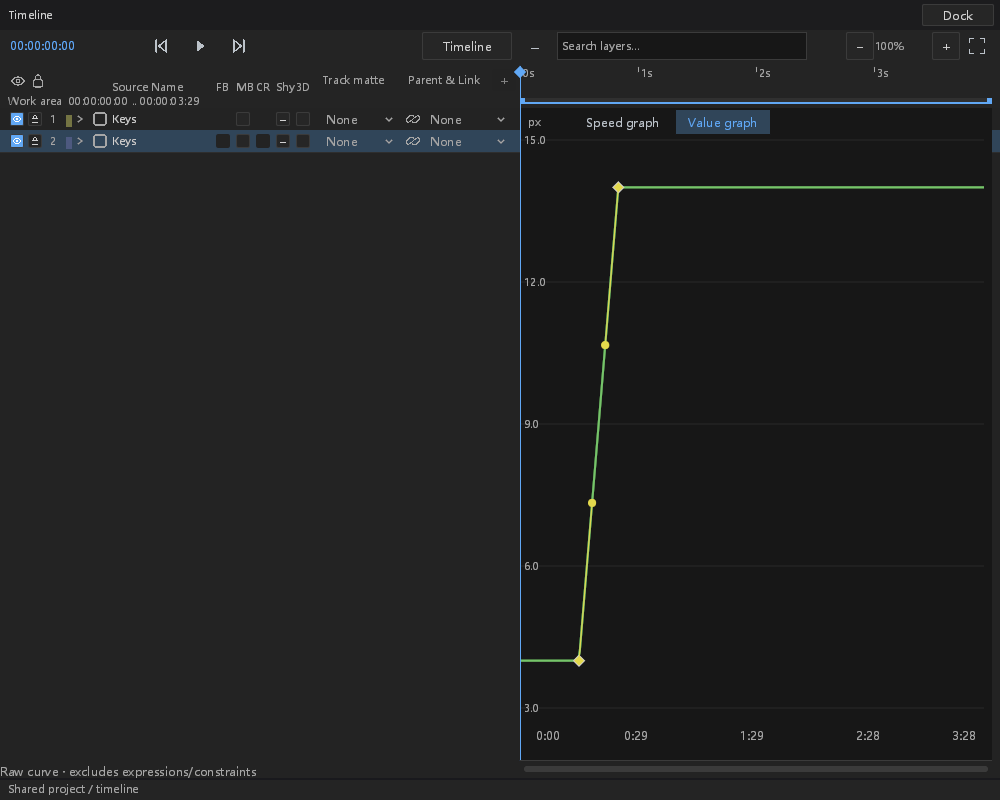

# #217 关键帧拖动、吸附与帧级微移验收

在 #216 的类型化选择集上增加时间轴／曲线的集合拖动及一帧／十帧微移。生产改动提交为 `da4b1ebe`；不改工程版本、效果包、着色器或像素渲染语义，不新增依赖或第三方素材。截图来自 Motion Studio 自己的原生 GPU 绘制。

## 行为与事务

| ID | 行为 | 验证 |
|---|---|---|
| KD-01 | 时间轴多键共用时间偏移；Ctrl 拖动复制，源键保留。图层偏移、分离轴、跨层选择保持原始通道身份。 | 先预检全部通道，再提交一次 `TransformKeyframes`；允许选中源键互相交叠，不覆盖未选键。 |
| KD-02 | 曲线关键帧本体可同时调整时间和值；数值只作用于活动通道的活动分量。 | 其余值分量、静态回退值、间距、缓动及空间元数据保持；枚举／速度图只移动时间，参数范围限制取所有选中值的交集。 |
| KD-03 | Alt 约束时间并关闭吸附；Shift 约束鼠标位移较大的轴。 | Alt 优先；纯纵向自由拖动不触发时间吸附；贝塞尔手柄仍交给既有控制器。 |
| KD-04 | Alt+左／右一帧，Shift+Alt+左／右十帧。 | 进入现有快捷键注册、偏好设置、重映射及重复按键路由；文字／IME、其他面板、只读状态不编辑。工程的已创作键仍为整数帧，本轮不引入子帧键。 |
| KD-05 | 按屏幕逻辑像素吸附到既有候选。 | `dark.json` 的 `timeline.key.snap_tolerance=8`；不同缩放下帧距离不同、屏幕容差不变；排除所选源时间，吸附目标也必须通过占用检查。 |
| KD-06 | 多键拖动期间只绘制预览，释放后一次编辑、一次撤销。 | Esc、失焦、文档／合成／修订变化、缩放／滚动变化、锁定、越界、冲突和迟到释放均不提交旧手势。 |
| KD-07 | 沿用单键及折叠摘要的既有历史和通道导航。 | 同一折叠摘要的整批键保留旧控制器；展开属性行即使与其他属性同帧，也移动整个已选集合；路径导航和 Ctrl 单击保留原语义。 |

## 验证层次与实际截图

生产改动完成后的结果：模型剪贴板／原子变换 **34 项通过**，实际主窗／浮窗 chrome 交互专测 **33 项通过**，完整面板回归 **543 项通过**，真实串行引擎的默认错误信道专测 **1 项通过**。编译、样式消费者检查及 `git diff --check` 通过。

原生 GPU 验证使用隐藏的真实 Windows 窗口和共享引擎设备；通过生产主窗／浮窗 chrome 输入，检查释放前完整工程不变，释放后真实 `EditorAction` 只有一个历史项，保存后一次撤销恢复完整工程。覆盖主窗／浮窗 × 中文／英文 × 时间轴／曲线八格，生成 16 张实际 GPU PNG。保存的最终工程由另一个 OS 进程通过真实引擎重新加载，按完整 `Project` 类型精确比较，且新历史为空。

该项是显式运行的 GPU 验证，不加入普通单元测试的硬门禁。复现：

```powershell
$env:MOTION_KEY_DRAG_GPU_ARTIFACTS = '<新的空证据目录>'
cargo test -p motion-desktop --features ffmpeg --bin motion-studio native_key_drag_pixels_transactions_and_independent_reopen -- --ignored --test-threads=1
```

这里的输入是生产 chrome 的面板输入，不宣称是系统物理鼠标或真实浮窗 HWND 的完整人工验收。两轮外部鼠标脚本因前台焦点、窗口位置变化及窗口退出未获得有效验收；原始截图、几何和状态保留，未作为通过证据。此前 #216 已有的普通窗口输入证据仍见 [多选验收](keyframe-selection-ui.md)。













## 默认日志与功能边界

| ID | 分类 | 证据与边界 |
|---|---|---|
| KDO-01 | 新观察 | UI 准备占用快照时发现损坏的已创作时间，记录 operation、phase、revision、主对象、通道／键索引及原始原因；Error 到文件和 stderr，给出用户提示。每次用户动作检查一次，不在播放热路径轮询报错。独立子进程验证失败、成功恢复、stdout 无诊断。 |
| KDO-02 | 既有观察 | 原子编辑继续走串行 `EditorAction` 的在途状态、非 Present 的默认 Info start 和 Error 信道；五次真实拒绝覆盖占用、越界、缺对象、锁定和分量错误。每次完整工程、修订及历史不变，随后有效操作和一次撤销通过。 |
| KDO-03 | 正常分支 | 空选择、普通占用／边界提示、只读、取消和来源戳失效不记 Error；旧来源由现有协议返回 cancelled，未改变 `respond` 或线程期限。健康 Present 不新增 Info。 |
| KDO-04 | 功能修正 | 新命令和预览控制器是交互功能；观察只记录其实际失败。没有通过重试、重启、吞异常、改变返回值或放宽生产预算掩盖失败。 |
| KDO-05 | 保留限制 | 原始 GPU 日志保留本机缺失 Epic Vulkan 层注册文件等既有诊断；合成字体测试的既有缺字记录不被过滤。没有宣称所有日志无 Error。系统物理输入验收未通过，不能用隐藏 GPU 测试替代该结论。 |

## 原始失败及修正

1. 首轮 UI 22 过／2 失败：新夹具的十帧移动撞到未选轴键，修正夹具选择；产品在点击已选成员时漏设所有权意图，已补齐。次轮 27 过／1 失败为新测试误点了重复层中被遮挡的旧行，改用实际绘制的顶层 ID。
2. 完整面板首轮 536 过／2 失败：新预览接管了旧折叠摘要立即编辑，以及取消旧控制器后丢失蒙版导航投影。修正接管条件并恢复主属性投影，原摘要 7 项、蒙版导航 1 项断言原样通过；最终完整 543 项通过。
3. 新重映射测试先后出现私有导入及 `Arc` 可变借用编译错误，改用公开类型和 `Arc::make_mut`；旧断言未改。
4. UI 错误信道夹具最初损坏选中键本身，先被既有来源校验正确取消；追加损坏的未选尾键，使被测动作实际到达占用准备失败分支，保留 Current 状态和完整失败信道断言。
5. 原生 GPU 首轮八格绘制、编辑、保存和撤销都完成；第二进程读取证据 JSON 时，宽化 f32 的十进制经 f64 JSON 解析出现末位差异。重开比较改为完整 `Project` 类型的精确相等，不引入容差或字段投影；原始失败目录保留。
6. 外部 OS 输入的窗口焦点失败、位置变化、意外退出和关闭超时均保留；没有据此重试生产命令或将它们计为交互通过。
7. 首轮远端 Linux 桌面测试 1050 过／1 失败：`default_binding_reference_matches_live_resolver` 发现四个新增 Alt 方向键绑定未同步到默认键位参考表。按 `CONTRIBUTING.md` 使用真实解析器重新生成目录，保留完整 CI 失败日志，未改解析器或测试断言；本地重新生成及关闭更新开关后的精确核对均通过。后续 CI 仍须验证新提交。

## DESIGN.md §0.7／§12 的处置

复查了当前文件与旧审计位置：`path_controls.rs`／`effect_controls.rs` 已因后续功能拆分和 token 化发生位移，旧行号不能当作当前原样缺陷。本轮未改这些属性控件，不将既有实现算作本轮修复，也不宣称完成整份设计验收。

| 旧基线条目 | 本轮处置 |
|---|---|
| path_controls 六处行步进 | 保留当前实现；未改布局，旧字面量位置已变化，完整路径控件视觉验收待单独核验。 |
| path_controls 双列宽度 | 保留当前实现；集合拖动不改变属性列，窄栏验收不在本轮。 |
| path_controls 混合按钮高度 | 保留当前实现；不通过缩小命中区提高密度。 |
| path_controls 自绘数值背景 | 保留当前实现；本轮没有新增值字段或字段背景。 |
| path_controls 布尔全宽按钮 | 保留当前实现；本轮没有修改开关语义。 |
| effect_controls 行高和步进 | 保留当前实现；本轮不改属性行和滚动。 |
| effect_controls fx／— 布尔按钮 | 保留当前实现；本轮不改效果开关。 |
| effect_controls 枚举按钮 | 保留当前实现；本轮不新增枚举或点击循环。 |
| effect_controls hover alpha | 保留当前实现；未增加 alpha 或新 hover token，旧代码位置已变化。 |
| effect_controls 层级缩进 | 保留当前树控件及现有 tree.indent；不宣称本轮补齐全部层级。 |
| 时间轴列坐标／11 列栏 | 按兼容基线保留；没有重排现有列。 |
| 时间轴黄色吸附线 | 保留当前 `Color::rgb(255,210,60)`；复用于新增吸附，未冒称其已 token 化。 |

新增预览复用既有关键帧、选中、边框及文本 token，仅在 `dark.json` 先定义吸附容差；一属性一行、既有命中容差、数字字段编辑和贝塞尔手柄行为保持。右键菜单未改，不新增菜单截图验收。

完整原件、源提交、测试可执行文件 SHA-256、文件清单及校验值收在 [证据包](keyframe-dragging-evidence.zip)；结构化结果见 [结果记录](keyframe-dragging-results.json)。远端 CI 以本 PR 当前提交为准，绿色本地测试不替代 CI。
