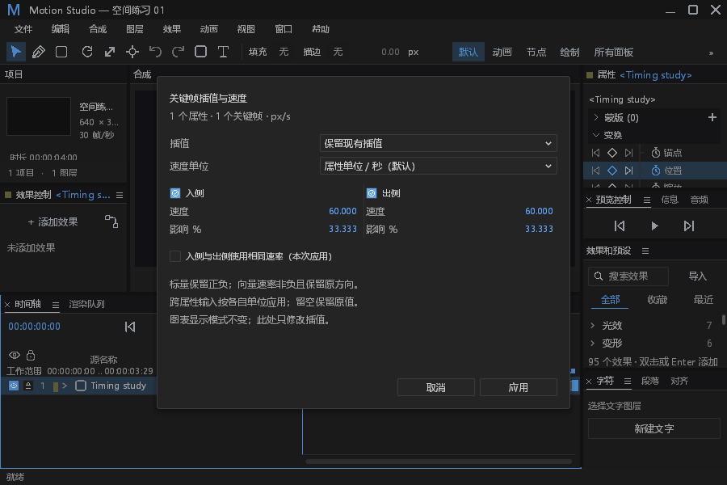
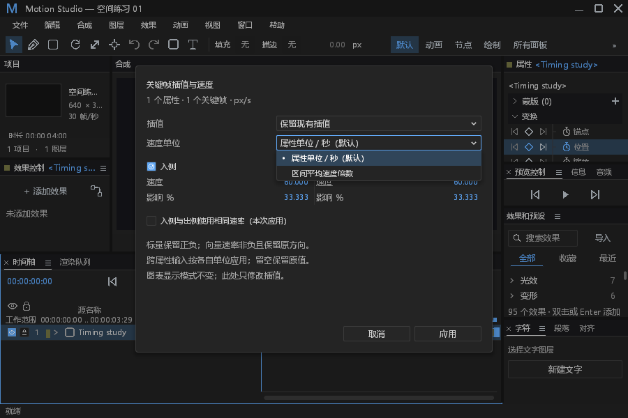
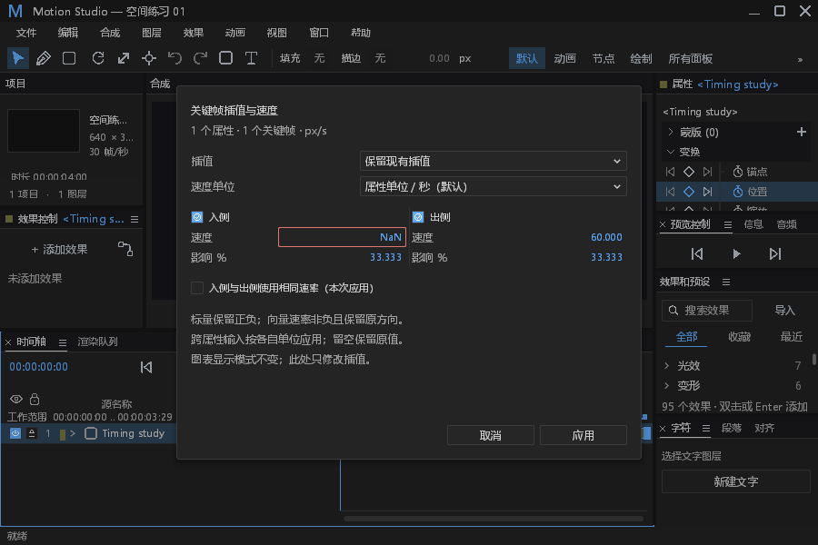
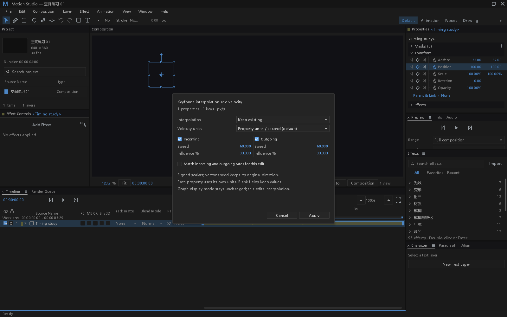
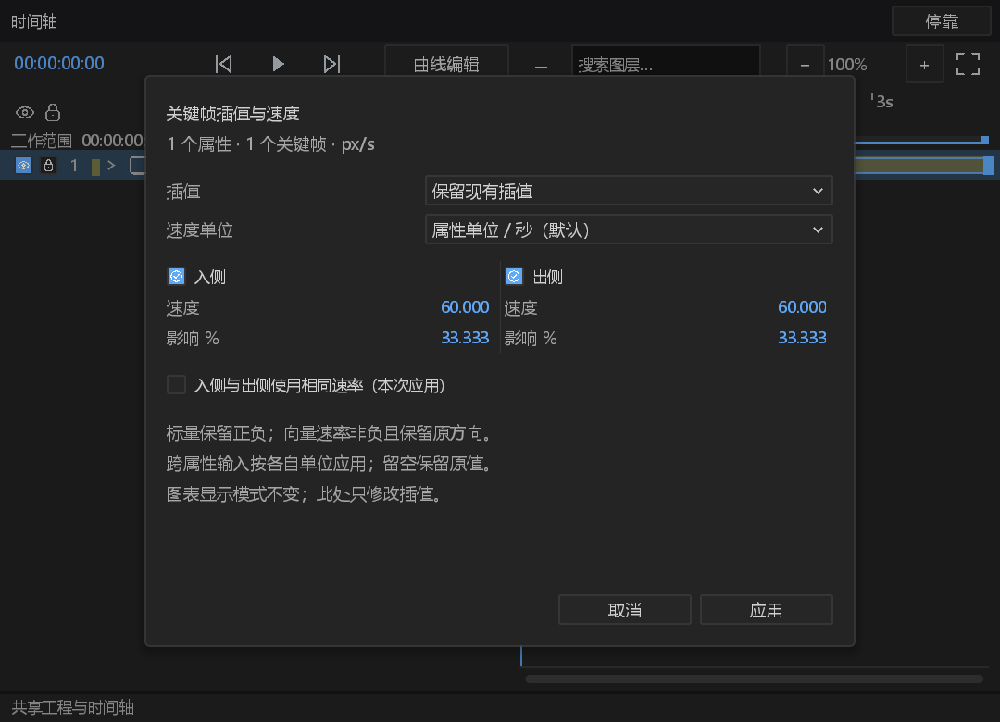
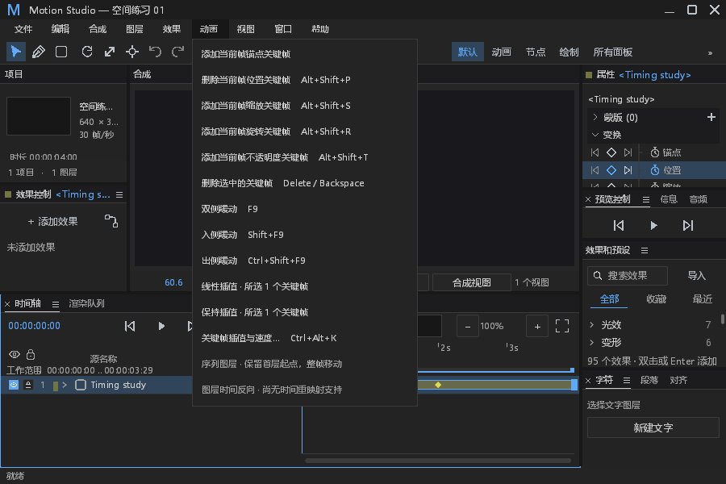

# #218 关键帧插值、速度与影响设置

“动画”菜单与 `Ctrl+Alt+K` 打开同一对话框，冻结打开时的文档来源和明确关键帧选区。提供属性单位/秒和区间平均速度倍数，默认使用属性单位/秒。主窗与原生浮窗共用字段、校验和模型命令。功能提交 `1cd57079`，接续 #501 的主分支与夹具修正后为 `a481bd02`；连续性验证为 `e9d8bd92`，最终日志及正常取消修正为 `3aa4cf45`、`7cbebb58`。未新增依赖、素材或工程格式字段。

## 行为与模型边界

| ID | 行为 | 验证与限制 |
|---|---|---|
| KT-01 | 入侧修改前一区间的末端手柄，出侧修改后一区间的起始手柄。 | 相邻选中键先合并同一区间的修改，再写入；未修改的一侧精确保留。保留现有插值且字段未改时，不转换该区间。 |
| KT-02 | 属性单位按真实端点导数解释。 | 位置 px/s、源尺寸加权的锚点 px/s、缩放及不透明度 %/s、角度 deg/s、音量 dB/s、颜色 RGBA/s。效果的模型没有持久化目录单位时明确显示 value/s，不猜测单位。空间曲线使用实际端点切线；标量保留正负，向量为非负速率且保留原进度方向。 |
| KT-03 | 平均速度倍数与物理速度是同一插值的两种输入。 | 1 倍表示端点位移／区间时长，不是空间路径弧长；可使用负倍数反向进度。两种单位分别保留未提交的速度草稿，切换单位不修改工程。 |
| KT-04 | 保留、线性、保持、显式进度贝塞尔。 | 二次进度曲线可无损升阶；替换保持、速度空间或弹性表示需明确选择贝塞尔。布尔／枚举只允许保持；曲线对象可使用相对进度速度，不冒称具有物理速度。显示值图／速度图与存储插值空间相互独立。 |
| KT-05 | 影响是相邻区间时长的百分比。 | 接受大于 0 且不超过 100 的有限数；不可表示的数值、静止端点非零速度及向量负物理速率明确拒绝，不夹值或重试。留空保留原值；混合值不填假默认值。 |
| KT-06 | “入侧与出侧使用相同速率”只作用于本次编辑。 | 要求物理单位、两侧及相同显式速率。不是永久连续性约束，也不改变空间方向／切线。 |
| KT-07 | 全部预检后，一次原子命令应用。 | 覆盖跨属性、分离轴、图层偏移、合成之前的本地键、成组／未成组矢量、相邻多键及非活动合成。缺对象、缺键、锁定、别名重叠或数值错误时，完整工程／修订／历史不变。 |
| KT-08 | 对话框草稿不写历史，失效来源不应用。 | Esc／取消没有编辑；应用走既有受来源保护的 `EditorAction`，一次撤销／重做；工程变化后显示未应用提示。没有新增重启、超时、重试或自动恢复协议。 |
| KT-09 | 窗口所属对话框独占输入。 | 实际主窗绘制及 `present_float` 路由验证 Tab、数字输入、Enter、Esc、弹层优先、IME 消费、失焦、背景屏蔽和关闭所属浮窗；小浮窗使用滚动，不缩小命中区。系统前台物理输入仍待人工核验。 |

## 验证与实际样式

模型关键帧剪贴板回归 **51 项通过**，包含 17 项新增速度设置／连续性用例；完整面板回归 **545 项通过、0 失败、1 项显式手工 GPU 测试未自动运行**。545 项发生在主分支缓存／绘制同步之前，不冒称当前最终程序的完整回归。最终对话框与真实默认错误信道专测 7 项、动画菜单 9 项通过；同步后的默认键位参考 1 项及既有降级观察 2 项通过，完整合并代码仍须当前 PR 的 CI 验证。在 `ee60eb15` 再次接续主分支统一截图协议后，7 项对话框／真实错误信道及 3 项截图协议／真实 GPU 写文件失败回归通过，FFmpeg 重新编译并在仅系统 PATH 环境解码通过；截图和速度实现未变。分阶段源提交及证据分别保留。默认键位文档由真实快捷键解析器生成，关闭更新开关后精确核对。样式消费者检查及 `git diff --check` 通过。[#252 边界记录](keyframe-timing-boundaries.md) 补充实际 f32 采样连续性，以及四组真实 MP4 的逐帧像素对照。

原生 GPU 验证使用真实 Windows 主窗／浮窗和共享引擎设备，输入为生产绘制路径的显式 `Input`。生成中英 × 900×600／1600×1000 × 1／1.5 比例八张对话框 PNG，另有动画菜单、单位下拉、非法速度、编辑状态、主窗屏蔽及浮窗六张。主窗和浮窗分别通过实际队列应用与一次撤销；保存后的完整 `Project` 由独立 OS 进程重新打开并精确比较，新历史为空。没有将截图或注入的面板输入称为系统物理鼠标／IME 服务的人工验收。

```powershell
$env:MOTION_KEY_TIMING_GPU_ARTIFACTS = '<新的空证据目录>'
cargo test -p motion-desktop --bin motion-studio timing_dialog_native_pixels_focus_transactions_and_independent_reopen -- --ignored --test-threads=1
```

该测试显式标记 `ignore`，避免让日常 CI 为截图重复初始化 GPU。右键菜单没有改动；“动画”菜单的新增入口和原生下拉效果均有截图。













## 默认日志与错误处理审计

| ID | 分类 | 原始证据与边界 |
|---|---|---|
| KTO-01 | 新观察 | 打开之前记录 Info start，含窗口、修订、文档代次、首对象及有界计数；成功完成为 Debug，失败保留原始 profile 原因和耗时，Error 到文件与 stderr。真实缺对象后成功重开，完整工程／历史保持。 |
| KTO-02 | 既有覆盖 | 实际串行 `EditorAction` 在处理前发布在途状态并写默认 Info start。五次真实拒绝覆盖 NaN、影响越界、静止端点、缺对象、缺键，检查完整工程／修订／历史不变、随后成功恢复及撤销。Error 文件和 stderr 均保留通道、对象、帧及原因；stdout 无诊断。既有在途／阻塞验证沿用，不新增线程期限。 |
| KTO-03 | 正常分支 | 空选区、能力不支持、用户输入错误、取消、过期来源不是系统故障；字段／禁用入口／未应用提示反馈。过期命令沿用 cancelled 回复，取消不记 Error，不改变 `respond`。健康 Present 不新增 Info。 |
| KTO-04 | 有界降级 | 可选 popup 样式缺失复用现有 Counter：连续首次数为 Debug、60 次为 Error，成功重置；固定站点，不按每帧写 Warn。`field.number` 是 StyleSheet 编译时必需类，缺失即拒绝加载，不存在合法样式表中悄悄缺字段的分支。 |
| KTO-05 | 功能与协议边界 | `KeyframeTiming`、草稿、窗口所属模态输入和过期操作标记属于功能改动；日志只记录真实失败。没有清除错误、吞 panic、改写返回值或通过重试隐藏错误。 |
| KTO-06 | 保留与待验 | 原始 GPU stderr 保留本机缺失 Epic Vulkan 层注册文件的既有错误；没有宣称全部日志无 Error。真实系统前台键鼠／IME 服务及其他操作系统的窗口焦点尚无本次人工证据，远端 CI 以当前 PR 为准。 |

## 初始失败和修正记录

1. 新模型测试先使用了不存在的命令注册器接口，改为真实 catalogue／注册命令及非活动合成路径。新增解析导数的 f64 计算产生 `0.20000000000000132`／`0.4000000000000001`，仅解析导数比较使用 `1e-12` 精度；已创作数据、相反手柄、完整工程及持久化比较保持精确，不改已有断言。
2. 分离轴夹具原本保留禁止分离的空间切线，先清除该夹具的切线再进行分离。缺键负向夹具原先先撞上通道别名重复，改为不同通道以实际到达缺键检查。不可表示数值保留原始 “Bezier control is outside its numeric range” 原因，不改为宽泛错误。
3. 新 UI 验证曾因绘制裁剪 API、VecDeque、导入和可见性错误未编译，改用现有 API。未删测试、未改生产阈值。审查发现保留模式会转换没有实际字段改动的另一侧，已修正并以速度空间相反区间精确保留验证。
4. 向量物理输入调整为非负速率，并保留原进度方向；有反向需求使用有符号平均倍数。分别增加模型及实际字段反馈验证，未改模型采样器或渲染语义。
5. 首轮原生 GPU 验证已通过，随后减少对话框多余留白并统一中文背景，再生成最终样式截图；旧截图及原始输出仍在证据包中，不将旧样式当作最终样式。
6. 同步自己 #501 的主分支修正时，仅验收记录追加行发生冲突；保留完整已有记录和新失败证据。共享构建目录曾复用另一工作树中不含 timing 的模型产物，导致缺符号编译失败；确认当前源文件包含定义后，刷新相关源文件时间以触发完整模型／核心重建，不改接口或吞错。原失败日志保留。
7. 补齐打开失败的 2048 字符日志原因上限，回复保留完整原始错误。新增长原因测试的首轮把线程名等日志前缀也算进 2300 字符假设，实际文件行长 2355、其中原因恰好 2048；改为直接精确断言原因长度 2048，保留完整 8192 字符原始回复断言，不修改生产上限或原有断言。初始失败原件保留。

## DESIGN.md §0.7／§12 处置

新增对话框复用 `dark.json` 中 preferences、row、field、checkbox、popup、tree.separator 和已有颜色状态；没有新增 token、字面颜色、枚举循环按钮或开关按钮。值字段只在编辑／焦点状态打开背景；两侧参数各自一属性一行。既有命中容差、时间轴列、吸附线及树布局未改。

| 既有基线行 | 本轮处置 |
|---|---|
| path_controls 六处行步进 | 保留；本轮不改路径控件行高，旧行号已经随拆分变化，完整视觉核验待该范围工作。 |
| path_controls 双列宽度 | 保留；对话框使用自己的语义 token 布局，不冒称修复旧路径双列。 |
| path_controls 混合按钮高度 | 保留；不缩小旧命中区。 |
| path_controls 自绘数值背景 | 保留；本轮字段使用既有 field.number。 |
| path_controls 布尔全宽按钮 | 保留；新对话框使用 Checkbox，不改旧路径工具。 |
| effect_controls 行高和步进 | 保留；主分支缓存改动沿用，不重排效果属性。 |
| effect_controls fx／— 布尔按钮 | 保留；没有修改旧效果开关。 |
| effect_controls 枚举按钮 | 保留；新增对话框使用原生 Dropdown，不代表全局枚举已验收。 |
| effect_controls hover alpha | 保留；没有新增 alpha 或 hover token，旧位置需单独核验。 |
| effect_controls 层级缩进 | 保留；没有修改效果树或扩展 hit box。 |
| 时间轴列坐标／11 列栏 | 按兼容基线保留，不重排。 |
| 时间轴黄色吸附线 | 保留原行为，未宣称 token 化。 |

源提交、实际可执行文件 SHA-256、分层测试结果、截图清单及剩余限制见 [结构化结果](keyframe-interpolation-results.json)。完整原件和失败记录见 [证据包](keyframe-interpolation-evidence.zip)。本地通过不替代远端 CI；#218 保持开放，待窗口物理输入与最终验收确认。
