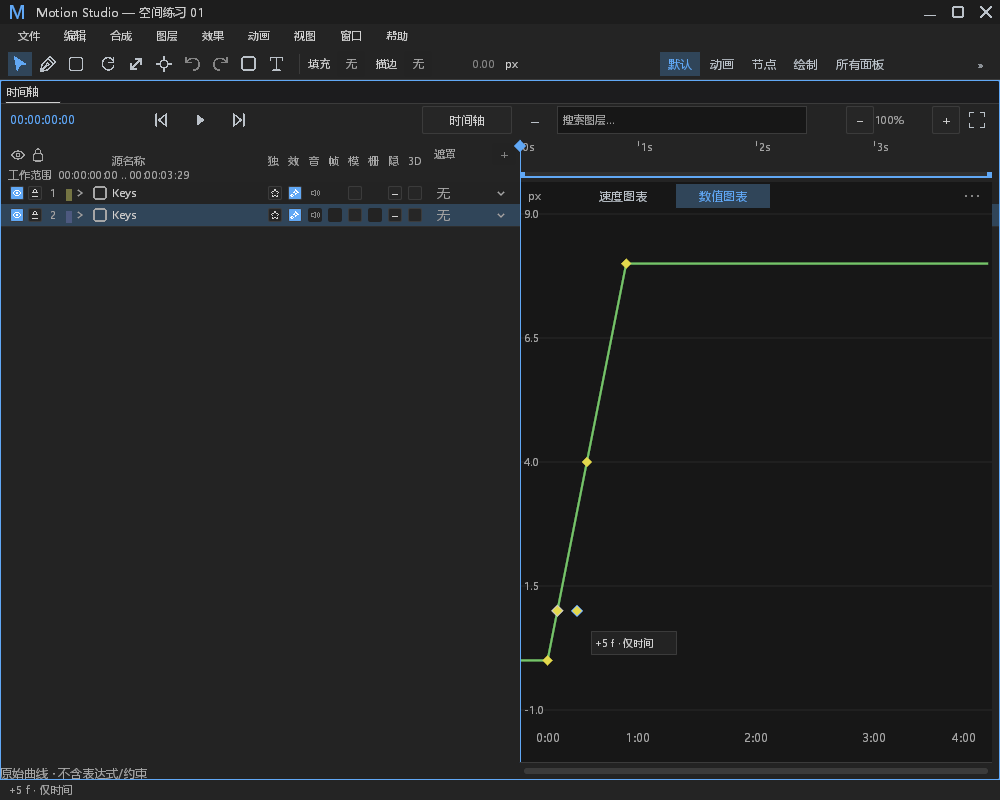
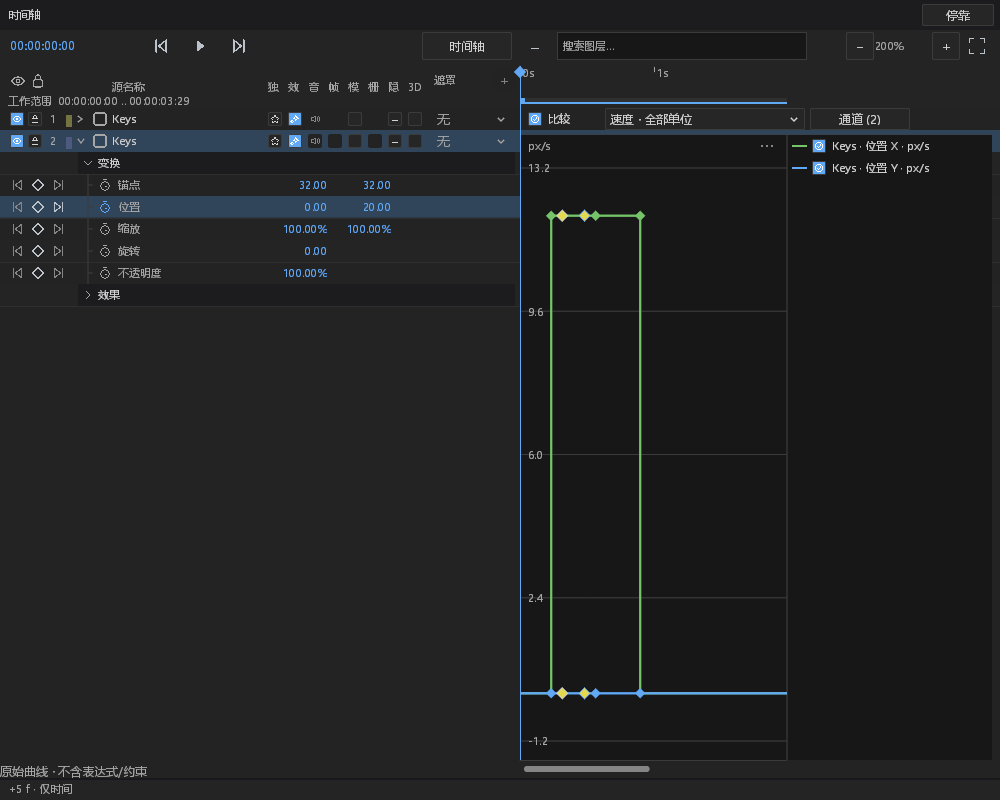

# Roving 曲线真实取样与稳定身份输入：进行中

本轮接续 #260 / 草稿 PR #576，基线 `d18ec054`，main 基线 `49890ce0`。
开工核对开放 PR：仅自己的 #576 和另一个 agent 的后台预渲染 #575；未修改后者或根工作区。
本文不代表 #260 已完成。先前时间轴验收保留在 `keyframe-roving-desktop-progress.md`。

## 功能与语义

- 空间轨道数值图使用真实 authored Track；不从 timeline 摘要伪造 reference、next_id 或整数键。
  原来的整数重建入口拒绝空间摘要，显式加键取样则使用真实轨道。
- 时间轴每个 owner 只保留一个按文档、revision、目标通道失效的只读轨道缓存。
  完整身份下成功和失败均缓存，重绘不再次准备弧长几何；缺失身份时重建取样，不能授权复用。
  错误去重另保留一个来源／目标，成功恢复或换来源后重置；缺失 revision 也不会随重绘刷 Error。
  其他目标替换缓存，不建立全局无界注册表。
- 曲线比较支持真实空间存储；所选通道读取与整数剪贴板分开，过期选区仍不能回退。
  分数时间和重合时间保留各自 ID；适应全部／所选范围不做整数截断。
- 模型新增每本地帧的速度查询。手工区间使用时间缓动导数和空间切线；弧长区间使用
  与实际 sampler 相同的分段线性逆度量导数；不以跨越关键帧的差分制造 Hold 尖峰。
  图表转换为每秒单位并保留既有 Anchor 像素缩放。外部区间静止，内部结点取出侧，末端取入侧。
- 空间图上标记进入既有统一输入记录器；拖动仅调整时间，松手用稳定 ID 成组移动，
  一次 EditorAction / 一次撤销。未给旧整数图形控制器伪造地址，未新开鼠标监听。
- 曲线比较的全选收集完整显示通道的键，包括视口外时间；同一 ID 的不同分量去重。

当前空间拖动仍是保留原分数的整帧相对位移。空间数值拖动、空间切线编辑、Roving 类型入口与
准确状态、空间剪贴板／预设、连续吸附和实际编码输出仍待交付；不把上述暂缺功能算作修复。

## 失败、修正与边界

| ID | 类型 | 处置／证据 |
| --- | --- | --- |
| RG-01 | 自己 PR 的 CI 编译遗漏 | run 41158490348 / job 124410488069 在 parenting.rs 缺 auto_bezier 字段；补 false，保留测试语义；本地 parenting 6 项与空间事务 8 项通过 |
| RG-02 | 新取样功能 | 模型空间相关 31 项通过，包括每帧采样与速度无分配、保存重开、手工空间切线、Hold、分数与重合键 |
| RG-03 | 测试 oracle 修正 | 首次弧长速度差分跨过逆查找表斜率变化；原误差 0.01568，探针从 h=0.001 缩到 0.0001 后与解析值一致。改为 f64 arc sampler 的 h=0.000001 局部导数，误差要求由 0.015 收紧到 0.0001；保留两份原失败 |
| RG-04 | 编译接口修正 | 首次桌面构建两条新代码错误：选区返回类型与私有方法。保留可选返回的旧过期断言，扩大带类型选区方法的内部可见性；未放宽旧断言 |
| RG-05 | 本地测试环境 | 首次直接执行未使用任务临时目录，tempfile 在系统临时目录 PermissionDenied。设置已有可写任务 TEMP/TMP 后执行；不修改生产路径、权限或返回值 |
| RG-06 | 新缓存故障观察 | 每目标/文档/revision 加载失败一次 Error，包含对象、目标、revision、generation、阶段、耗时和原始原因；同源 90 次不重复，恢复后可再次报告；含有／缺失 revision 的四个故障阶段分别一次 Error。默认文件日志、Error stderr 与 stdout 隔离实测 |
| RG-07 | 原生图交互 | 最终构建的普通图、比较图、时间轴各 8 组通过，共 24 张实际 GPU 原图；中英文、主窗／浮窗，实际 worker 一次提交与完整工程撤销 |
| RG-08 | 原生比较测试前置条件 | 首次低缩放点击同时落入相邻键的既有命中范围；测试需放大至 2 倍以明确命中单键，ID 和 Move 断言保留。未缩小生产命中半径；最终 8 组比较图重跑通过 |
| RG-09 | 扩展回归发现 | 默认 Windows 测试线程栈在大轨道故障验收溢出，探针定位在 50,288 字节 Panels 夹具构造期，绘制尚未开始。8 MiB 仅作定位；生产迭代器／缓存装箱试验仍失败，已撤回。只把测试的三份完整 Panels 放到堆上，保留 33,000 键、12 个故障站点及全部断言；默认栈首次 356.03 秒通过；最终构建 243.99 秒通过，两次均无 RUST_MIN_STACK 覆盖 |
| RG-10 | 编译调度失误 | 上述诊断仍占用测试 exe 时链接报 LNK1104；原始输出保留。等已确认存活的诊断进程退出后再重建，不隐藏失败或重启产品 worker |
| RG-11 | 正常／既有分支 | 只读、取消、过期选区、正常缓存未命中继续由既有机制处理；未更改 Info start、Present、panic hook、重试或超时策略 |
| RG-12 | 尚未完成 | 本地原生重跑已通过；跨平台 CI 与上文剩余空间编辑能力未完成；#260 保持打开，PR 保持草稿 |

## 本轮验证范围

最终构建为 Windows FFmpeg/GPU 测试程序，不是发行应用；桌面既有 27 条告警保留。
`build-observation-final.log`、`*-reviewed.log` 是最终源码的本地验证；`*-first`、
`*-final`、`*-verified`、`*-fixture` 等历史／中间材料仅作排错记录，不重复计数。

| 验证 | 不同测试数 | 状态 |
| --- | ---: | --- |
| 模型空间取样、时间表、速度和无分配 | 31 | passed |
| core parenting 与空间事务 | 14 | passed |
| 桌面空间曲线、比较、采样、选区、范围、快捷键、类型菜单 | 162 | passed |
| 三组原生 GPU／真实 worker | 3 | passed，24 张原图 |
| 大轨道默认栈故障验收 | 1 | passed，两个独立子进程 |

合计 **211 项不同测试通过**；样式消费者检查与 `git diff --check` 通过。

常规桌面筛选的 7 个 ignored 没有计作通过；其中 3 个空间原生用例另行显式运行，
剩余 4 个未运行。较重故障用例在范围筛选中明确跳过，单独运行、单独计数。
曲线比较默认故障用例为保留独立日志又执行一次，不增加不同测试数。

原生验收使用隐藏 winit 窗口、实际 GPU、实际面板输入记录器和真实 worker，
未移动物理鼠标或改变 OS 焦点。每组验证预览不改工程、松手只提交 ID 2 的 `+5` 时间移动、
保留分数起点 9.5 / 固定化本地时间 7.5、只新增一次撤销并恢复完整原工程。
截图逐张生成，抽查普通／比较图四种语言、owner、模式组合的合成联系表。
没有菜单改动；不把截图当作物理输入、多 DPI 或跨平台验收。

模型差分负对照、无分配计数器负对照、缓存范围失效、重合时间多 ID、旧时序反例均保留。
日志中的 Epic EOS Vulkan 层 JSON 缺失是本机 loader 环境错误，原样保存，未过滤或修注册表；
本轮 GPU 捕获仍成功。不把这些 Error 描述成无故障环境。

[原始材料与 SHA-256 清单](keyframe-roving-graph-evidence/manifest.json)
记录被测源码、Cargo.lock、工具链、程序 hash、构建命令和每份原始文件。
程序本身与临时工程不入库；旧源码 hash 清单仍保留原名，不能冒充最终清单。

## 后续入口边界

下一阶段先补 `animation_menu::Operation` 与 `type_state` 的 Roving 启用／固定化，
复用 `Command::SpatialKeyframes`。现有 `MenuScope` 已保留空间 ID，但旧类型统计只读取
整数 `keys`，不能用“无有效关键帧”冒充准确状态。仅耦合的 Position／Anchor／Target
提供能力；端点、非空间属性、分离轴和整组混合的不支持情形必须整体禁用。
保存重开、撤销、菜单失效、主／浮窗和中英文验证后，再做真实 Roving 编码验收。
空间数值／切线编辑与剪贴板／预设在未交付期间继续明确禁用，不能部分成功。

## DESIGN §0.7 / §12

新增空间图形标记使用已有 graph.key_radius、graph.selection.hit_radius、motion.drag_threshold、
border 及语义颜色；未新增布局行、SVG、颜色、尺寸 token 或三方资产。

| §0.7 项 | 处置与原因 |
| --- | --- |
| 路径六处纵向步进 | retained：未修改路径布局 |
| 路径双列分割 | retained：未修改路径列 |
| 路径按钮与字段高度 | retained：未修改这些控件 |
| 路径手工数字背景 | retained：未修改数字控件 |
| 路径布尔全宽按钮 | retained：未修改路径布尔入口 |
| 效果行高与步进 | retained：未修改效果行 |
| 效果布尔文本按钮 | retained：未修改效果布尔控件 |
| 效果枚举全宽按钮 | retained：未修改效果枚举控件 |
| 效果手工 hover alpha | retained：未修改效果 hover |
| 效果树层级 | retained：未修改效果树 |
| 时间轴十一列坐标 | retained：只接入真实曲线与稳定身份标记，列坐标不变 |
| 时间轴吸附线颜色 | retained：未更改吸附或主题 |

§12 本轮数值图、速度图与比较图的实际截图已核对，无新布局／样式变更。物理 OS 输入、多 DPI、全部平台与其余面板不在本轮已验范围。
