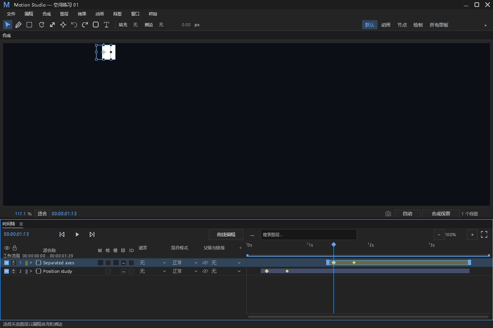
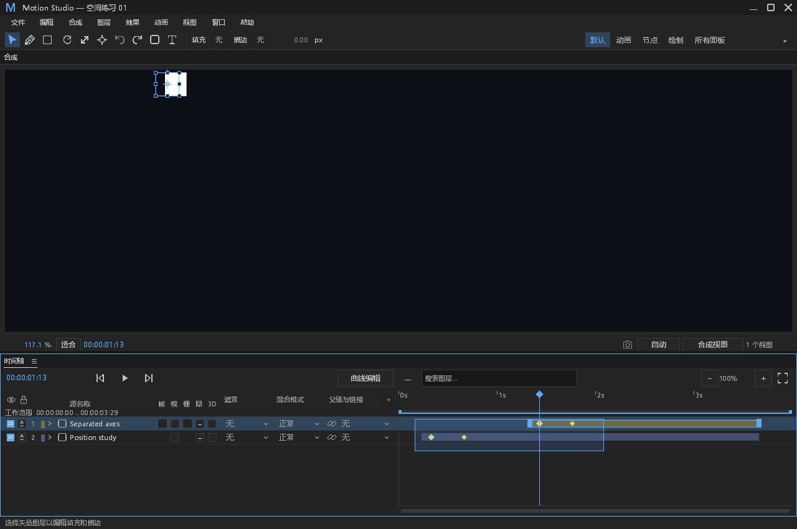
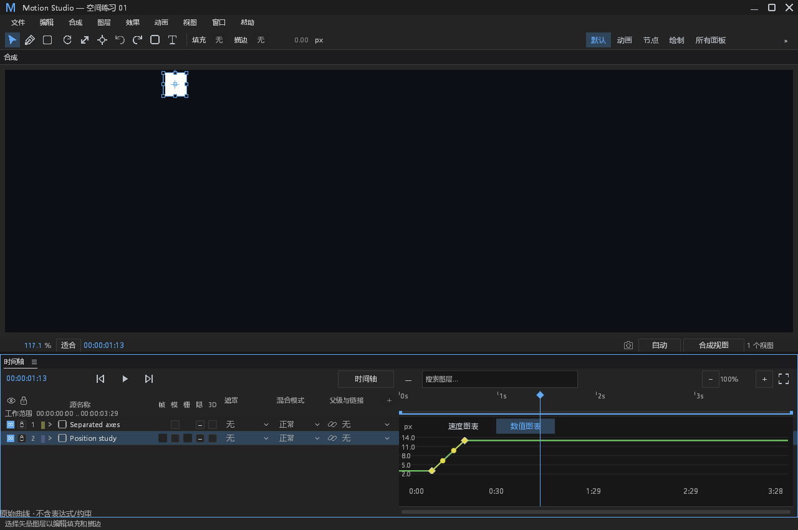
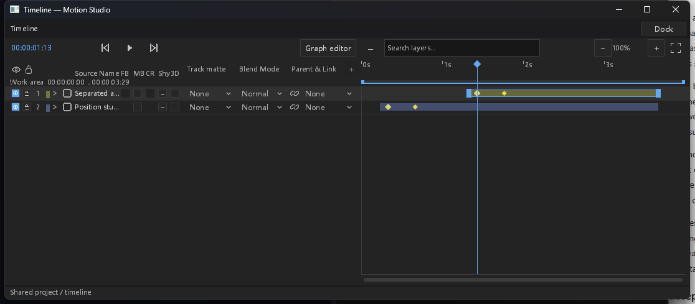
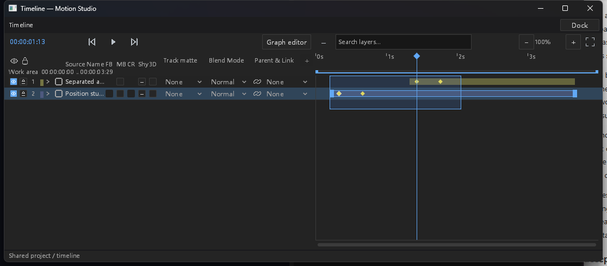
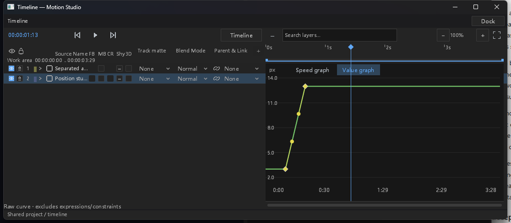

# #216 关键帧多选的交互验收

时间轴与曲线现在用同一个类型化选择集记录通道、合成帧号和主选键。单击替换，Shift 追加，Ctrl 切换；背景拖动框选，Ctrl+A 选择当前范围内的已创作键。Delete、F9 和剪贴板命令按该集合执行，空集合或失效集合继续持有关键帧所有权并给出提示，避免退回删除整层。

基础模型与命令证据见 [基础进度](keyframe-selection-progress.md) 和 [基础结果](keyframe-selection-foundation-results.json)。基础阶段文档中“尚未接入”的条目是当时的交付边界；本轮已接入鼠标、框选、轮廓、全选和主属性投影。本记录区分实际系统输入与面板级输入测试，不将编译通过等同于交互验收。

## 行为与数据边界

| ID | 分类 | 结果 |
|---|---|---|
| KU-01 | 选择 | 跨图层、分离轴及图层偏移使用类型化原始通道地址；同一个耦合轨道的 XYZ 显示投影不会生成三份身份。折叠摘要也包含效果、蒙版、矢量和音频各自的关键帧时间。 |
| KU-02 | 批量编辑 | F9 汇总相邻区间的入／出侧，保留未选通道和值；Delete 先完整预检再一次编辑。每个批量操作只有一个撤销项。原子性及实际失败信道沿用基础证据。 |
| KU-03 | 焦点 | 框选遵守文字、IME、菜单和活动编辑的既有仲裁；Esc、失焦、文档／合成／修订变化、缩放／滚动映射变化取消当前框选。迟到的释放不提交。主属性仍投影给既有单通道控制器。 |
| KU-04 | 全选与清空 | 保留曲线原有整体选择框，同时采集视区外的有效键。普通时间轴已持有关键帧时全选通道；未持有时保留原图层全选。清空后 Delete 不删除图层。 |
| KU-05 | 拖动边界 | 现有单键或折叠摘要拖动发出实际移动命令后，集合跟随其真实移动的身份；取消恢复原身份。#217 的多键拖动、#218 的插值对话框属于后续工作。 |
| KU-06 | 显式属性导航 | J／K 选择新的蒙版或形状键时，立即结算该次意图，释放旧选择集合；随后点击的新属性保持所有权。没有把旧导航意图留到下一次属性点击再仲裁。 |

## 真实进程与系统输入

使用普通 `motion-studio --mcp-ui`、FFmpeg 调试构建及原生 Vulkan 窗口。外部脚本调用系统鼠标和键盘事件，逐次检查窗口所有权、前台 HWND、实际 client 坐标及 DPI；MCP 只读取权威状态。没有注入面板输入、使用编辑器测试钩子、修改鼠标命中坐标或伪造成功返回。每张原始窗口截图都附有几何记录，运行时清单保留 EXE／DLL 的 SHA-256。

| 场景 | 实际验证 |
|---|---|
| 中文主窗口 | 跨图层 Shift 追加；折叠摘要框选全部八个原始键；F9、Delete 后一次撤销恢复完整工程；曲线框选；Esc 取消加迟到释放不改工程；曲线删除只改变选中位置通道。 |
| 英文原生浮窗 | Shift 追加后 F9；Ctrl 切换移除分离轴摘要的三个键；Delete 精确删除剩余选中的第一个位置键；框选全部摘要；曲线框选与删除；一次撤销／重做与完整工程对照。 |
| 最终构建的英文主窗／中文浮窗 | `608381a4` 的普通 FFmpeg 构建，分别验证跨层追加、F9、取消框选与迟到释放、Delete 精确移除四个选中键；一次撤销／重做及保存前后的完整权威工程一致，正常退出且 stdout 保持 JSON-RPC。 |
| 独立进程重开 | 在英文浮窗保存，退出该进程，再以中文普通主窗口打开同一工程。新旧 PID 不同；权威完整工程相等；新进程历史为空。 |
| 主／浮窗 × 中／英文的完整四格 | 四种组合都经过普通系统进程验证选择、F9、Delete、取消及撤销；原生曲线的普通系统输入覆盖中文主窗与英文浮窗。完整曲线／宿主／语言四格由实际 chrome 的面板输入测试覆盖。 |

### 实际截图

## 错误信道与正常分支

| ID | 分类 | 证据与限制 |
|---|---|---|
| KUO-01 | 新观察 | 批量捕获遇到缺失原始 keys 数组时保留旧集合，给出本地化提示及原始原因；Error 进入文件和 stderr。默认日志级别的独立子进程检查 stdout 没有诊断。 |
| KUO-02 | 新观察 | `selection.gesture_scope` 在身份缺失时阻止旧键／图层控制器处理鼠标。实际 chrome 连续 120 次输入保持集合与所有权；静态 site 的进程生命周期计数首次 Warn、第 60 次 Error，随后抑制。健康选择恢复后可继续操作；没有将此计数解释成连续失败重置或一秒。 |
| KUO-03 | 既有观察 | 原子编辑继续走串行 `EditorAction` 的在途状态、默认 Info start 和 Error 信道。基础证据已覆盖六次真实编辑失败、工程／修订不变及成功恢复；本轮不改变协议、生产预算或工作线程超时。 |
| KUO-04 | 正常分支 | 空键数组、普通未命中、缓存未命中、取消、旧戳及空历史不作为故障。新增通道摘要的损坏数据观察复用有界静态 site；健康播放不添加逐帧 Info 或文件 IO。 |
| KUO-05 | 保留限制 | 合成面板测试使用的字体图集产生既有缺字观察；实际机器还保留 Epic Vulkan 层注册缺失和 Windows 内存探测警告。原件没有过滤，不宣称全部日志无错误。 |

## 失败原件与修正

1. 完整面板首轮 530 项中 519 通过、11 失败。旧测试快照缺当前文档身份、旧执行器未处理 `EditorAction`，以及同步 Ctrl+A 和 J／K 意图的产品回归分别修正。原始数据、通道、工程及撤销断言保留；效果 F9 改为更精确的来源戳与帧集合命令断言。
2. 第二轮 531 项中 530 通过、1 失败：路径 J／K 的待消费意图抢回后来的变换属性。立即结算后，原 `latest_typed_property_choice_replaces_old_transform_mask_and_shape_owners` 及全部 9 项 `property_focus` 测试通过。没有修改该断言。
3. 首次外部工程夹具错误地同时写分离轴与耦合 value／keys，被严格 `TrackRepresentation` 正确拒绝。修正夹具后重新启动，原始失败目录保留。
4. 中文主窗计划误将 Ctrl+Y 当作重做，实际默认会创建空对象；这轮末尾状态不作为重做或持久化通过证据。英文浮窗改用实际默认 Ctrl+Shift+Z，完整工程的重做及新进程重开均通过。
5. 首次切换验证器误认为应删除两个原始位置键，实际只选中了第一个。外部验证脚本改为断言精确剩余的第二个时间和值；原错误结果保留。
6. 原始存储 JSON 使用 f32 的短十进制表示，权威快照的 JSON 浮点会扩展成 f64，直接逐数字比较两种 JSON 不相等。采用保存前后两个实际进程的完整权威工程相等断言，不做容差放宽或只比较所改字段。
7. 原生浮窗启动时曾直到真实点击才完成首帧绘制，初始与探测截图保留；物理 Shift+F3 的一次尝试未切换视图，曲线入口使用实际工具栏按钮完成。本轮不宣称修复或验收浮窗初始曝光和该快捷键。

## DESIGN.md §0.7／§12

§0.7 的 12 项全部为 **retained with reason**，逐项状态见基础进度表。本轮只增加现有 `text`／`keyframe`／`focus` 和尺寸 token 驱动的轮廓及框选覆盖，路径／效果属性行、布尔与枚举控件、缩进、字段外观、时间轴列坐标、既有吸附线和命中容差保持该表所述边界。

§12 本次范围内的选择反馈、实际截图、原子撤销、输入焦点、取消和默认故障信道有上述证据。没有新增右键菜单、依赖、第三方资产或效果包；截图来自本项目实际运行窗口。Windows 普通构建的中英文四种窗口组合已验证，跨平台实际窗口与更高 DPI 未由本机验证；由 PR CI 补充构建与自动测试，不能替代本机以外的系统输入验收。

## 最终回归

同步主分支至 `608381a4` 后，`cargo test -p motion-desktop --features ffmpeg --bin motion-studio panels:: -- --test-threads=1` **531 项通过、0 失败**，耗时 306.40s。24 项关键帧选择测试、9 项属性焦点回归及各个先前失败组已包含其中，不重复累加。核心基础的 26 项通道／批量命令测试见基础结果。样式消费者检查与 `git diff --check` 通过。

最终普通构建通过（22.66s，保留 21 条既有编译告警）。截图及先期原生回执对应 `322182b9`；焦点修正、同步主分支后的最终测试与另两种窗口组合对应 `608381a4`。机器可读结果与原件索引见 [验证结果](keyframe-selection-ui-results.json)。[原件压缩包](data/keyframe-selection-ui-608381a4.zip) 共 291 个成员、1,821,438 字节，SHA-256 为 `05764a9045ce86a6dc9e9c45d79bd1430302dbfa497076c2e70c5774bdd99708`，已校验所有成员 CRC；此前两个完整回归的失败原件保留。
