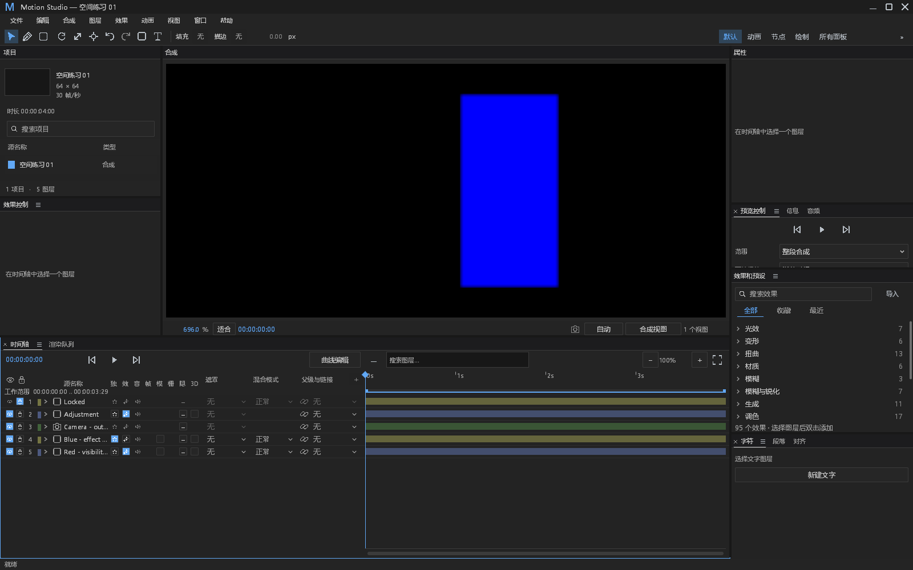
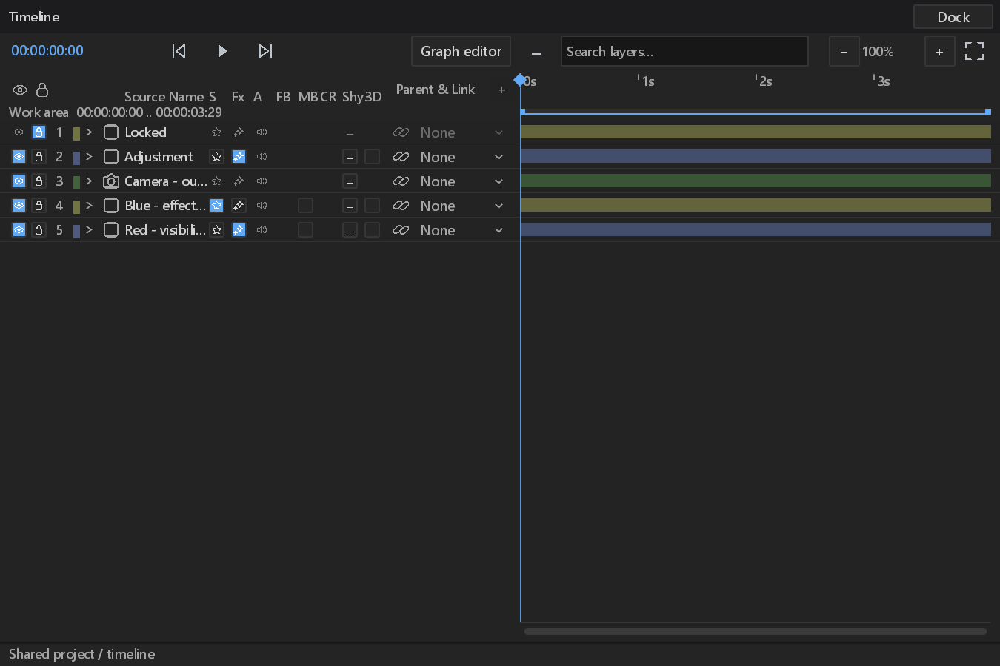

# 图层输出开关验收（#210）

状态：本地验收完成，502 项相关测试通过、0 失败、1 项原有忽略。合并及 CI 状态另见 PR。

## 功能边界

- 复用现有画面可见性、3D、素材静音及合成引用静音，新增 `solo` 和 `effects_enabled` 两个必填字段。工程版本为 28，只接受当前版本，保留版本号，没有旧格式迁移或缺字段默认值。
- Solo 是当前合成的输出隔离状态，预览、PNG/影片输出和音频混音共同遵守。嵌套合成分别筛选；预合成保留被选内容的 Solo 隔离。摄影机和空对象没有 Solo，摄影机仍参与视图计算。
- 效果总开关仅旁路效果链，保留每个效果原有启用状态、参数及关键帧。摄影机、空对象和音频层没有效果总开关。调整层保留效果及 Solo 开关，其输入仍遵守现有下层合成规则。
- 画面与音频互不隐含修改：隐藏视频画面保留声音，静音保留画面。音频层没有画面开关；无音轨视频及普通图形没有音频开关。合成引用的音频开关控制子合成混音。
- 所有上述输出状态写入工程，可撤销及保存重开。Shy、列显示偏好等现有列表组织状态继续属于工作区。
- 行内控制提交带 revision 和合成地址的 `SetLayerSwitch`，锁定、失效 revision、错误对象和不支持的内容类型不产生修改。保持原有 3D 路径和命令。

## 证据项目

| ID | 类型 | 检查与边界 | 当前证据 |
| --- | --- | --- | --- |
| LS-MODEL | 新功能 | Solo 输出筛选及非 Solo 蒙版源保留；效果总开关保留单效果状态；批量回滚、锁定、错误对象、撤销/重做、保存重开、预合成及嵌套作用域 | `motion-core --test layer_switches` 5 项通过 |
| LS-PCM | 新功能 | 真实 `AudioMixer` 打开确定性解码 PCM，进行声音规划和混音；隐藏画面、静音、Solo 及撤销的数值对照 | 新桌面测试通过；不宣称音频设备实播或重新验证解码器 |
| LS-INPUT | 新功能 | 中文/英文提交同一命令；锁定、内容限制、失焦和 IME 取消不提交；观察相机不禁用独立输出开关；保持完整 icon.slot 命中范围，窄面板不重叠 | 6 项新桌面测试通过，含实际 PCM |
| LS-NATIVE | 新功能实测 | Windows 原生主窗与浮窗、中文/英文、DPI 1/1.5；生产 Input、Shell 和编辑回复；保存重开及撤销 | 手动原生测试通过，4 张完整窗口截图；没有物理 OS 鼠标注入，不把逻辑坐标的输入测试称为真实鼠标操作 |
| LS-PIXELS | 新功能实测 | 真实生产 PNG 导出：独立预期红/黄像素 → Solo + 效果旁路后的黑/蓝像素；保留单效果原开关 | 6 张 64×64 PNG 逐像素采样断言通过，主窗捕获也显示隔离后的蓝层 |
| LS-ERROR | 已有错误信道复用并实测 | `edit` / `edit_checked` 的缺失对象、锁定、不支持和过期 revision；原始原因、请求号、Info start、文件+stderr Error、stdout 隔离 | 实际子进程默认等级断言通过；保留既有 revision 拒绝回复与日志策略，不把正常失效请求重新归类成新缺陷 |
| LS-STYLE | 新退化观测实测 | 自定义样式缺少 tooltip 时使用必有 label；复用进程站点 Counter：首次 Warn，第 60 次 Error，之后抑制；成功清零。固定站点、原因有限长，无健康帧 IO | 两轮各 120 次失败，中间恢复；文件/stderr 恰好各 2 条持续退化 Error，stdout 无该站点。首次 Warn 沿用既有设施；次数不代表固定时间 |
| LS-REGRESSION | 实测 | 模型/核心完整测试，原有采样、3D、Shy、列交互回归及带 FFmpeg 构建 | 模型/核心 476 passed、0 failed、1 原有 ignored；本轮桌面 26 项通过（新增 7、列 5、3D 2、Shy 4、采样 7、阻塞状态 1）；FFmpeg 桌面构建通过 |

首轮模型测试 5 项失败保留原始证据：效果夹具未重建插件依赖，视频/音频夹具路径不一致。修正夹具后 5 项全部通过，未删除或放宽原断言。原始日志与复验日志随最终证据收录。

首轮既有采样回归有 1 项失败（`reason=3`）：采样能力不可用时，新开关被布局到原采样列的点击区域。生产布局现保留这些未启用采样槽的空间，避免重分配点击目标；显式列偏好仍可释放空间。原断言保持，修复后 7 项采样测试全部通过，并新增能力有/无时的几何对照。原始失败日志完整保留。

本机仍有既有 Epic Vulkan overlay 注册路径缺失的 Loader Error，原始日志完整保留；本次未修改系统注册项或屏蔽驱动日志，GPU 输出及窗口断言通过。Windows 原生捕获完成，macOS/Linux 原生行为未在本机重验。

独立桌面程序的裸构建目录没有附 FFmpeg DLL，首次启动返回 Windows `STATUS_DLL_NOT_FOUND`（-1073741515，进入 main 前）。本地预览目录逐一核对仓库固定 BtbN LGPL 清单的 7 个 DLL 和 5 个许可证 SHA-256，并与程序相邻放置，随后 `--help` 退出 0。保留失败、依赖检查和成功证据。此为本地开发预览，不伪造 GitHub 发布元数据、不修改系统 DLL 或环境；帮助信息按既有行为写 stderr。验收辅助脚本一度错误要求帮助输出在 stdout，保留此脚本断言失败，不记作产品缺陷。

## 可观测性审计

`SetLayerSwitch` 是既有串行编辑处理器内的有界模型操作，不新增线程、重试、重启、每帧日志或 IO。它复用编辑处理器在进入处理前发布 in-flight 与 Info start，以及原有错误文件/stderr、计时、panic hook 和回复语义。既有受控阻塞测试再次验证 in-flight 和队列深度；原生失败日志验证默认 Info start，生产调用点在 start 后、handler 前 flush。成功编辑、正常未命中、未启用控制、IME/失焦取消不是故障。没有在业务锁或观测锁内增加日志调用。PNG 和 UI 截图验收使用既有原生等待辅助器与导出命令；没有延长产品超时。

新增的缺失 tooltip 退化与功能修改分别列在 LS-STYLE 与功能边界中。未变更既有表达式、解码、音频设备或 Present 的观测策略；这些路径的已有覆盖不能被解释为本次全部重新验收。

## DESIGN §0.7 的 12 项处置

| 基线位置 / 问题 | 处置与理由 |
| --- | --- |
| path_controls 六处逐行步进 | retained：本次未修改该面板，原问题不计为修复 |
| path_controls 两列固定拆分 | retained：同上 |
| path_controls 混合按钮高度 | retained：同上 |
| path_controls 手工数值字段背景 | retained：同上 |
| path_controls 布尔整行按钮 | retained：同上 |
| effect_controls 行高及步进 | retained：本次未修改该面板 |
| effect_controls 布尔文字按钮 | retained：同上 |
| effect_controls 枚举整行按钮 | retained：同上 |
| effect_controls 手工 hover alpha | retained：同上 |
| effect_controls 缺少层级 | retained：同上 |
| timeline 旧列坐标及 11 列 gutter | 既有基线保留；新开关通过已有可测 ColumnRects 分配，不改已有基本尺寸。空间不足先隐藏可选文字列，偏好仍保存；320/468/640/900 gutter 几何、默认主窗与最小逻辑浮窗截图及真实 Shell 输入通过 |
| timeline snap guide 固定颜色 | retained：未修改拖动反馈，不声称颜色已 token 化 |

本次为 #210 功能变更，工程字段及命令另行说明，不以视觉整理为由改变模型。新控件复用 Checkbox、图标、tooltip、label、icon.slot、value.min_width、row.height 与 padding.panel；没有添加颜色、尺寸 token、第三方依赖或素材，没有右键菜单改动。§12 只针对受影响的列与交互验收；未重新验收全部 19 面板、五套布局、Reduced Motion 或完整状态矩阵，不能据此宣称全 DESIGN 合规。

## 复现与归档

- 核心/模型：`cargo test -p motion-model -p motion-core --tests --locked --offline -- --test-threads=1`。
- 桌面：`cargo test -p motion-desktop --bin motion-studio --features ffmpeg --locked --offline --no-run`，然后运行本次测试二进制的 `panels::playback_switches --include-ignored`、`panels::timeline_columns::`、`panels::timeline_3d_tests::`、`panels::shy_layers::`、`panels::layer_sampling::` 和 `diagnostics::tests::in_flight_and_queue_depth_track_a_blocked_worker`，均 `--test-threads=1`。
- 原生测试用 `MOTION_OUTPUT_SWITCH_ARTIFACTS` 指定证据目录；父进程显式移除 `MOTION_LOG`，子进程验证文件、stderr 与 stdout。Windows 原生窗口和 GPU 为其手动验收前提，因此该用例默认 ignore，本文结果包含显式执行。
- 构建：`cargo build -p motion-desktop --bin motion-studio --features ffmpeg --locked --offline`。
- [结果与源码 SHA-256](layer-playback-switches-results.json)、[完整日志与原始失败证据](data/layer-playback-switches-evidence.zip)。本地原始目录为 `E:/Dev/aem/artifacts/pr-ci-followups/layer-playback-native-verified/`，可运行开发预览为 `E:/Dev/aem/artifacts/layer-playback-switches-preview/`。归档不包含可执行文件或第三方运行库。
