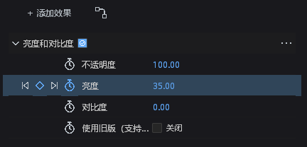
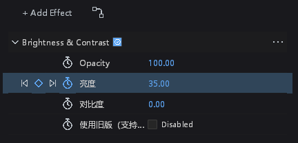

# #257：精确时间的参数编辑与关键帧导航

接续 `d5a9d12f`，使用 `feat/layer-time-mapping` 分支。开工前核对了开放 PR
和近期其他分支：#575 为原生预渲染，跟踪导入、姿态转换、后台调度分支与本阶段
没有功能重叠。未审查或修改其他人的 PR。音频策略沿用用户确认的“音高随速度变化”。
**这是 #257 的一个阶段，不是整个 issue 的完成报告，不关闭 issue。**

## 功能和边界

新增 `TrackAt { target, frame, edit }`，`frame` 为精确的合成时间，`target` 沿用
共享的类型化通道地址，支持写值、开关动画和当前时刻切换关键帧。普通键仍保存
有符号局部整数时间；非整数且不可表示的时间明确失败，不通过取整改别的关键帧。
静态值允许在局部小数时刻改值，关闭动画在准确的局部时刻冻结采样值。
连续空间轨道按原有稳定 ID 和连续时间处理；如果合成投影精确命中已有空间键，
更新该 ID，避免浮点逆算后插入邻近的新键。重合键仍要求明确 ID，最后空间区间
的删除仍遵循既有 owner-level 转换边界。

整数键身份使用严格的投影往返判定：浮点逆算得到接近整数的数时，仅当候选
整数投影**精确等于**请求合成时间才接受。没有 epsilon 容差，附近的其他可表示
合成时间仍必须拒绝。该规则仅用于编辑时钟，不修改源视频/音频、渲染采样代数
或效果包。颜色映射曲线冻结使用高精度采样表，清除重复的通道表；已有键改值
保留其时间插值元数据。

效果面板的取值、数字拖动、颜色通道和曲线对象编辑、布尔/枚举写值与秒表操作
接入精确时间命令。变换属性数字输入和合成变换手柄也接入同一适配器。
未映射图层保留原命令路径（包括原有合成小数帧的编辑规则）；参数面板优先读取工程中的真实 clip
偏移，派生时间轴仅补充缺失的旧视图，防止陈旧派生快照改变取值时钟。

效果的 J/K 和逐行导航投影到合成时间，倒放按屏幕时间前后导航。普通属性导航
保留精确 Seek 和局部整数键/稳定空间 ID 选区，不再把小数合成帧强制转成 i64。
映射行的菱形通过相同精确时间协议插入/删除，无法表示的普通局部时间禁用该
入口。只读、锁定、未实现、不可动画参数沿用功能边界。

数值写入可加入已有手势；开关动画/切换关键帧仍是独立事务。错误批次回滚，
取消恢复手势前状态。无效时钟先保留原原因，再取消已经开始的数值/颜色编辑，
避免关闭面板后留下未结束的事务。未新增重试、重启或吞错处理。

没有新增依赖、资产、行、颜色、尺寸、图标或菜单，没有修改工程格式和效果包。

## 验证与证据

固定源码后共 **161 项通过**：41 项核心测试、119 项桌面回归和 1 项原生验收。
另有 3 项不属于本阶段的手动用例未运行，没有将它们计为通过。完整工作区
`cargo check --workspace --all-targets --exclude motion-android`（FFmpeg 与
diagnostics 特性）通过；新增模块的 rustfmt、样式消费者检查和 diff 空白检查通过。
保留现有编译警告，未将通过编译作为交互验收的替代。

最终桌面测试程序 SHA-256：
`135d8b0595ea3ca014035002731e2570c1d16fc4907e4adb63f545ac00ab1c41`。
[清单](layer-time-authoring-evidence/manifest.json)记录 20 个源码文件的构建输入
哈希、各测试程序哈希、161 项名称、未运行项、原生进程 ID、截图和证据包哈希。
[原始证据包](layer-time-authoring-evidence/evidence.zip)包含源码补丁、构建与检查
日志、每组测试 stdout/stderr、默认级别故障文件日志、8 张原生截图及独立重开结果；
也保留本阶段先前失败和夹具修正记录。测试程序本身留在本地验证目录，未提交二进制。

下图是最终原生窗口截图的无修饰裁剪：中文主窗正放、英文浮窗倒放均在合成
6.5 帧编辑局部第 3 帧，将亮度从 20 连续拖动到 35；相邻关键帧不变，单次撤销、
重做及另一个进程重开完整工程均通过。

原生用例使用实际 Shell、GPU、串行 worker、中文主窗表面和英文浮窗表面；
通过效果控件的原始输入入口注入按下/持续按下/释放，设置相应窗口 owner。
它不注入物理操作系统鼠标，不冒充完整 chrome 焦点路由、其他操作系统或 DPI
的验收。保存后的工程在第二个进程重开，比较完整工程对象和空撤销栈。

保留初次失败证据：无 FFmpeg 特性单独构建核心测试时，rustc 在 motion-render
代码生成阶段以 `STATUS_ACCESS_VIOLATION` 退出，未产生产品错误诊断；之后使用
同一 FFmpeg/diagnostics 特性组合构建。首轮新协议测试把外层 `InComposition`
路由的 ID 当成实际命令；首轮导航夹具遗漏 `document_generation`；原生输入夹具
未设置持续按下状态，仅在 release 产生一次更新；新观测用例最初错误地要求无按键时返回已消费，现明确验证正常的 false 分支；第一次原生运行也使用了不可写
的系统 TEMP。修正的是新夹具和测试环境，不改既有断言、误差、等待预算或产品
错误返回。原始失败输出和其局限随证据保留。

## 报错和正常分支审计

| ID | 分类 | 处置和证据边界 |
|---|---|---|
| TIME-A-01 | 功能/协议 | 精确合成时间统一解析为局部编辑时间；整数键、静态值、连续空间键保持各自存储身份。候选通道预检与核心事务保留原子回滚。 |
| TIME-A-02 | 既有覆盖扩展 | 新命令走原有 worker 的 Info start/在途状态、Error 文件和 stderr；错误保留 target、object、阶段和原始原因，未记录参数完整载荷。本阶段未重新证明整套线程或 panic 观测。 |
| TIME-A-03 | 新增观察 | 参数取值时钟、数字关闭、颜色弹窗、导航时钟/投影和局部键身份使用固定 site 的现有 `observe!`。计数按进程生命周期累计，首个 Warn，第 60 个 Error，成功不重置；沿用既有策略，避免正常邻行清空故障证据。 |
| TIME-A-04 | 实际故障注入 | 无效时钟覆盖参数行、属性采样、键盘导航、行导航的默认文件记录、Error stderr、stdout 隔离及 120 次调用的抑制；也注入投影键数组、时间、局部身份及空间键数组/ID 损坏；原生 worker 注入无法表示的局部时间并验证工程不变、后续正常编辑恢复。其余新 site 未逐一注入。 |
| TIME-A-05 | 正常分支 | 无按键、空关键帧、不可表示的普通局部时间、只读/锁定、正常取消、重合空间键需 ID、最后空间区间不可直接删除均不当作每帧故障。显式非法编辑请求仍返回错误。 |
| TIME-A-06 | 功能修正 | 无效时钟中止正在进行的数值手势，先记录原因，再走现有取消信道；不通过清空错误伪装成功。 |
| TIME-A-07 | 待完成 | 旧展开属性编辑器/迷你曲线、主图映射手柄、锚点保持画面位置的专用操作、其他矢量/蒙版/音频数字入口、合成位置/颜色拾取、稳定 ID 剪贴板，摄影机专用平移/推拉、有效时钟或播放头在编辑期间改变的守卫，以及真实视频预取/音频设备/高速抗混叠验收仍需继续核对。完整 chrome 焦点调度不由本阶段的直接控件输入验收代替。 |

## DESIGN §0.7 的逐项处置

以下全部为 **retained with reason**：本阶段只接入时间与命令，不进行视觉整改，
截图用于核对现有控件和输入结果，不宣称修复这些基线。

| 基线行 | 处置 |
|---|---|
| path_controls 六处 y 步进 | 保留；未编辑此文件。 |
| path_controls 两列拆分 | 保留；未编辑此文件。 |
| path_controls 混合按钮高度 | 保留；未编辑此文件。 |
| path_controls 自绘数值背景 | 保留；未编辑此文件。 |
| path_controls 布尔整行按钮 | 保留；未编辑此文件。 |
| effect_controls 行高/步进 | 保留；改的是取值和命令，没有改行几何。 |
| effect_controls 布尔控件 | 保留；仅替换映射图层的写值命令。 |
| effect_controls 枚举控件 | 保留；仅替换映射图层的写值命令。 |
| effect_controls hover 背景 | 保留；未改绘制或 token。 |
| effect_controls 层级缩进 | 保留；未改层级和布局。 |
| timeline 十一列坐标 | 保留兼容基线；未编辑该文件。 |
| timeline snap guide 颜色 | 保留已知行为；未编辑该文件。 |
