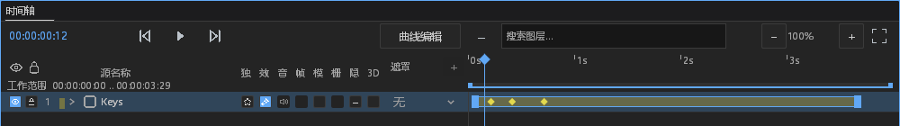
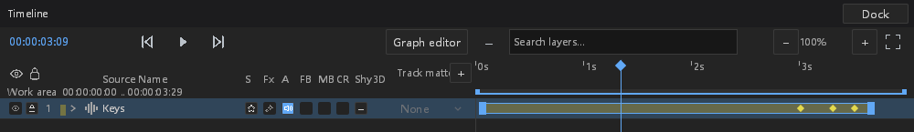

# #257：变速与倒放图层关键帧剪贴板

本阶段接续 `63445d55`，使用 `feat/layer-time-mapping`。开工核对本地分支和
开放 PR：只有 #575 负责原生预渲染，与本次无重叠，未修改或审查其分支。
**#257 仍未整体完成，不关闭 issue。** 音频继续采用用户确认的音高随速度变化策略。

## 功能和边界

沿用同一个剪贴板控制器、后台读取、来源身份守卫、缓存、取消及提交协议。
新增有符号局部关键帧选择；复制时冻结源时钟与存储地址，传输时使用精确合成时间。
普通整数选择与局部选择可以混合复制，粘贴使用未取整的播放头，目标按自己的
时钟转换。剪切先验证完整源键及冻结时钟，失效来源不能删除当前键。

反向时钟之间传输会调整区间插值归属、贝塞尔控制点和空间切线方向。
目标冲突或任一通道失败，整批拒绝并保持工程、revision、历史不变。
未修改采样/渲染语义、工程格式、线程等待策略，也未增加依赖和第三方资产。

整数 Track 仍不能存储任意小数局部时间，因此无法精确表示的目标位置明确报错；
不使用 epsilon、吸附或近似合并身份。反向跨时钟的多键 Hold（缺少反侧阶跃）
和 Elastic（缺少等价反转表达）明确拒绝；单键和相同时钟方向不受此限制。
稳定空间 ID 的独立存储剪贴板仍不可用；混合选择不会只复制可用的子集。
效果、音频、蒙版、平面和分组矢量参数读取原始局部键，不经过素材 remap。

## 验证及原始证据

共 **268 个不同测试通过**（核心 74、桌面 194），
另有 8 项手动测试未执行。FFmpeg / host diagnostics 桌面测试构建、
排除 Android 的工作区 all-targets check、新增模块 rustfmt、样式消费者及 diff 检查通过。
最终测试程序 SHA-256：`e98b05d55310d0666d39ef67660f49cae8e1f3311110ea9903bdaef71df1b050`。
原生验收生成 20 张实际截图，核验五个工程在独立进程重开后的完整状态。
既有编译警告和机器上 Vulkan overlay 注册残留的 loader 报错保留在原始输出，
未修改系统注册表或把这些日志算作本功能修复。

[证据清单](layer-time-clipboard-evidence/manifest.json) 和
[原始证据包](layer-time-clipboard-evidence/evidence.zip) 收录最终结果和历次原始失败。
两张下图仅裁掉空白区域，原始整窗截图仍在证据包。

原生验收使用实际 Shell、主窗/浮窗绘制、指针与快捷键输入路径和真实 worker，
不属于物理操作系统输入注入。每种参数类型在中文主窗正放、英文浮窗倒放中
复制并粘贴，再验证完整撤销与独立进程重开；不宣称覆盖所有平台、DPI、设备。
生成的音频 WAV 是测试自产的静音样本，不是第三方资产。

首轮命令曾把 host diagnostics 功能错误传给仅 core 的测试包；随后修正命令。
新增核心测试首轮编译发现空间切线 Option 被移走，改为借用；新增原生测试
首轮编译发现误写请求枚举名，改用既有 ClipboardCommit，均保留失败输出。
新测试最初误将只改变 revision 视为选择失效；实际选择按文档身份和键存在性
继续有效，冻结请求才按 revision 拒绝。补充两种行为的正负对照后，删除源键的
夹具又漏增 revision，命中既有按 revision 验证缓存；现以新 revision 注入真实
删除，保留完整失效断言。没有改生产缓存或失效规则。
首轮原生捕获与独立重开子进程均通过，但父进程读取了重开进程已轮转的日志；
现在分目录保留两个进程日志，保留同样严格的 Error/start/输出断言。

已有测试的变更限新增空局部选择参数和 f64 类型适配；旧的
“局部键剪贴板必须不可用”断言按本阶段实现改为精确局部身份和真实捕获验证，
仍保留不冒充整数键、不回退复制图层及失效守卫的断言。
没有为通过验收放宽任何错误、不变性或输出断言。

## 报错与正常分支审计

| ID | 类别 | 实现及证据边界 |
|---|---|---|
| TIME-C-01 | 功能/协议 | 精确时钟传输、混合身份、插值反向和整批撤销；复用既有 worker、队列与来源守卫。 |
| TIME-C-02 | 新观察 | `clipboard.mapped_keys` 观察原始轨道的键解析、排序、时钟和数量错误。沿用既有面板观察器：按站点在进程生命周期累计，首次 Warn、第 60 次 Error，计数饱和；健康邻行不重置该累计证据。不是按秒阈值。 |
| TIME-C-03 | 实际退化验证 | 默认级别子进程交替注入 120 次坏轨道与健康轨道，核验第 1/60 次后抑制、文件 Warn/Error、Error stderr、stdout 隔离及健康功能恢复。健康轨道不是故障。最终结果另见证据。 |
| TIME-C-04 | 既有 worker 覆盖 | 真实缺失源键、不可表示目标时间走读取/提交请求，保留 start、请求号、原始原因、Error 文件及 stderr，完整状态不变。既有排队取消、panic 和来源守卫回归另列测试；不新增超时或重启。 |
| TIME-C-05 | 正常边界 | 空音频包络是静态可粘贴目标；没有关键帧、失效来源、稳定空间 ID 暂不支持、取消或 superseded 不记录故障，不回退到整图层复制。 |
| TIME-C-06 | 保持的边界 | 不更改 respond 尽力回复、在途状态发布/清理或 panic hook；模型原始错误向上传递，没有吞错、清除错误或返回伪造成功。 |

## DESIGN §0.7 逐项处置

这次只接入既有属性所有者的剪贴板数据与输入，不改绘制函数、尺寸、颜色、
行结构、控件、容差或菜单位置。以下全部 retained with reason，不能计入本次修复。

| 基线位置 | 原状 / 本次后状态 | 证据 / 状态 |
|---|---|---|
| path_controls.rs:860,884,953,1002,1070,1149 | 六处行步进保持 | 源码范围未改；retained：只改剪贴板读取，不改路径绘制。 |
| path_controls.rs:893 | 双列宽度保持 | 源码范围未改；retained：只改剪贴板读取，不改路径绘制。 |
| path_controls.rs:894–953,1038 | 按钮尺寸保持 | 源码范围未改；retained：只改剪贴板读取，不改路径绘制。 |
| path_controls.rs:1124,1130 | 数字输入绘制保持 | 源码范围未改；retained：只改剪贴板读取，不改路径绘制。 |
| path_controls.rs:1151–1170 | 布尔按钮保持 | 源码范围未改；retained：只改剪贴板读取，不改路径绘制。 |
| effect_controls.rs:958,1043,1050 | 行高保持 | 源码范围未改；retained：未改效果绘制。 |
| effect_controls.rs:998–1013 | 布尔按钮保持 | 源码范围未改；retained：未改效果绘制。 |
| effect_controls.rs:1053–1064 | 枚举按钮保持 | 源码范围未改；retained：未改效果绘制。 |
| effect_controls.rs:974 | 悬停颜色保持 | 源码范围未改；retained：未改效果绘制。 |
| effect_controls.rs 全文件 | 树层级保持 | 源码范围未改；retained：未改效果绘制。 |
| timeline.rs:541–547 | 列坐标保持 | 源码范围未改；retained：不修改时间轴布局。 |
| timeline.rs:1432–1436 | 吸附线保持 | 源码范围未改；retained：不修改时间轴绘制。 |

## 剩余范围

#257 其他曲线视图、导航和数值编辑的完整时钟接入、稳定空间 ID 剪贴板、
视频预取、真实音频设备及高速抗混叠验收仍待完成。
上述有明确错误的表达能力边界不等于这些能力已实现。
