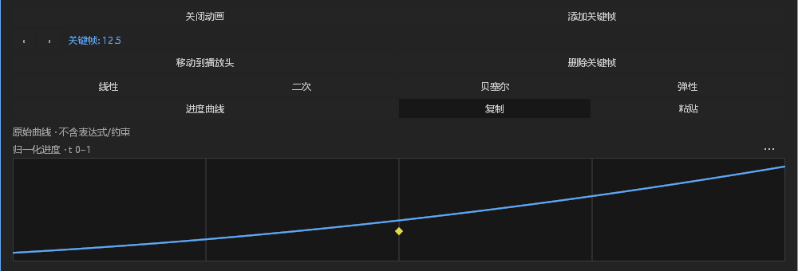
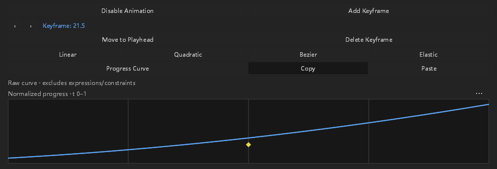

# #257：变速图层的局部关键帧曲线剪贴板

接续 `34ed1c5e`，继续使用 `feat/layer-time-mapping`。开工前重新查询开放 PR 与近期本地分支，只有 #575 原生预渲染 PR 开放，没有发现本阶段的重叠工作。未审查或修改其他人的 PR。用户确认音频首版音高随速度变化的策略继续有效。

本阶段只完成 #257 的一项缺口，不能关闭整个 issue。

## 行为与协议

曲线复制仍只传输归一化缓动定义，不传源帧、属性值或物理速度，不改变既有剪贴板 JSON 格式。`PasteEasing` 增加语义可选的 `local_selections`，不更改工程或效果包版本。未映射请求继续原路径；有局部地址的请求先统一预检两种地址空间，然后执行同一事务。

曲线面板对映射图层发送有符号局部整数键，合成投影可以是小数；菜单沿用现有 addressed selection。复制只接受一个通道的一个源区间，可读锁定源；粘贴必须可写，所有通道先检查锁定、目标存在、明确分离轴、局部帧排序唯一、区间存在和跨地址空间别名。末尾键混选时跳过末尾，末尾单选报错。稳定空间 ID 暂不冒充局部帧；布尔和枚举只允许 Hold。

引擎读取、原生 OS 剪贴板服务、文档 generation/revision/composition 印记、取消屏障和提交队列保持既有流程。旧文档或取消操作不发起过期写入，已完成的 OS 复制仍报告成功。没有新线程、重试、超时/重启策略，没有改 respond 或 Present 日志。没有新增资产、依赖、布局、尺寸、颜色或图标；图像基线的渲染语义不变。

## 验证

固定源码共 **360 个不同测试通过：核心 74 项、桌面 286 项（包含 1 项手动原生剪贴板验收）**。重复过滤器命中的同名测试只计一次；17 项其他手动用例未运行，未计为通过。覆盖旧曲线剪贴板、局部正向/倒放、负局部帧、小数投影、混合地址整组失败、跨空间重复目标、锁定、末尾键、分离轴、矢量与效果/颜色曲线类型、选区、菜单、快捷键、跨属性焦点和现有剪贴板服务。没有修改旧断言来取得通过，旧构造器仅补空局部选区，旧 UI 断言额外确认局部选区为空。

带 FFmpeg / host diagnostics 的桌面测试构建、排除 Android 的工作区 all-targets check、新模块 rustfmt、样式消费者和 diff 空白检查通过。既有编译警告保留。最终桌面测试程序 SHA-256：`a1cf10cee50010ec529a583e9e3b024b5de3a443fde6ce85f86caa086946fb85`。

原生验收经过实际主窗/浮窗 chrome 的按下入口、Shell、串行 worker、GPU 和真实系统剪贴板；不注入物理 OS 鼠标，不宣称其他平台/DPI 验收。局部第 3 帧的曲线复制到局部第 -3 帧，核对完整工程除目标缓动外不变，一次撤销和重做、保存及另一进程重开一致。保留 8 张完整原生截图、各步 JSON，以及主窗/浮窗非法局部键的默认 Error 文件日志和 stderr。窗口进程 PID 15836，独立重开 PID 17864。

首轮原生用例因剪贴板为空、无法备份文本而在写入前停止，保留该前置条件失败。外层脚本确认格式数为 0 后放入临时文本，验收完成恢复为空；`clipboard-fixture-result.json` 同时记录退出 0 和恢复格式数 0。

图形范围压力组首次被外部脚本的 180 秒限时截断，不计为完成。确认残留子进程结束后，仅将外部验收限时改为 600 秒，生产代码和断言不变；固定程序完整补验 24 项通过，耗时 334.82 秒。保留初次部分输出、子进程文件及完整补验记录，不能把初次截断解释为产品失败或通过。

[证据清单](layer-time-easing-clipboard-evidence/manifest.json)列出 26 个构建输入源码哈希、360 项测试名称、未运行项、三个测试程序哈希和图像哈希。[原始证据包](layer-time-easing-clipboard-evidence/evidence.zip)保留源码、补丁、构建和检查日志、初次失败/截断记录、完整测试输出、原生截图及保存/撤销/重开 JSON；测试二进制仅在本地保留。原始目录为 `E:/Dev/aem/artifacts/issue-goal-current/time-clipboard-final-validation`。

下图是最终程序复制按钮操作的无修饰裁剪，分别显示合成第 12.5 帧和倒放第 21.5 帧，内部都保留局部第 3 帧。它们不是布局整改，也不是粘贴后画面的假定示意图。

## 故障和正常分支审计

| ID | 类别 | 处置与证据边界 |
|---|---|---|
| TIME-C-01 | 功能/协议 | 新增局部地址，归一化载荷不变；同组预检、单事务、同次撤销。 |
| TIME-C-02 | 既有观察 | 引擎非 Present Info start、完成 timing 与失败文件/Error stderr 沿用原路径；曲线 OS 服务既有有界请求和 in-flight phase 不变。新局部错误添加目标与操作上下文，不新增热路径计数器。 |
| TIME-C-03 | 正常分支 | 空/过期选区、锁定菜单、忙、失焦/IME 禁用及取消/superseded 沿用原语义，不当作持续故障；显式非法请求返回原原因。 |
| TIME-C-04 | 实际故障与既有覆盖 | 原生两种窗口显式非法局部键须保持工程、默认文件/Error stderr 含原因和对象、stdout 隔离；实际 worker 桥接先失败再成功验证恢复。已有阻塞状态发布、取消、panic/主因保留、默认错误信道和图形计数/独立进程重置用例补跑通过；没有新增观测器，不据此宣称所有新前检错误逐一走过默认日志。 |
| TIME-C-05 | 剩余范围 | 主图映射手柄完整接入、连续空间键旧迷你编辑与稳定 ID 曲线剪贴板、锚点补偿、其他矢量/蒙版/音频数值和合成拾取入口、摄影机专用手势、数字拖动时钟守卫、真实媒体预取与音频设备/高速抗混叠验收仍待推进。 |

## DESIGN §0.7 逐项处置

本阶段修时间与身份，不整改样式。以下均 retained with reason，保留不等于已修复。

| 基线位置 | 处置与理由 |
|---|---|
| path_controls 六处 y 步进 | 保留；未修改该文件。 |
| path_controls 两列拆分 | 保留；未修改该布局。 |
| path_controls 混合按钮高度 | 保留；未修改该控件。 |
| path_controls 自绘数值背景 | 保留；未修改该绘制。 |
| path_controls 布尔整行按钮 | 保留；未修改该事件或状态。 |
| effect_controls 行高/步进 | 保留；本阶段未修改效果控件。 |
| effect_controls 布尔控件 | 保留；本阶段未修改效果控件。 |
| effect_controls 枚举控件 | 保留；本阶段未修改效果控件。 |
| effect_controls hover 背景 | 保留；本阶段未修改效果控件。 |
| effect_controls 层级缩进 | 保留；本阶段未修改效果控件。 |
| timeline 十一列坐标 | 保留兼容基线；未修改该文件。 |
| timeline snap guide 颜色 | 保留已知行为；未修改绘制或 token。 |

曲线面板自身既有大按钮、留白与硬编码布局同样未宣称整改；未增加新的尺寸或
颜色字面量，截图用于验收时间与输入语义，不能替代 DESIGN §12 的整体视觉验收。
