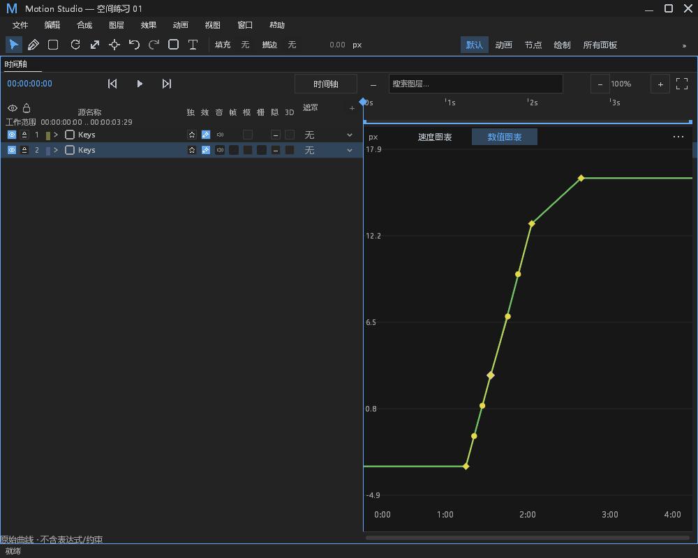
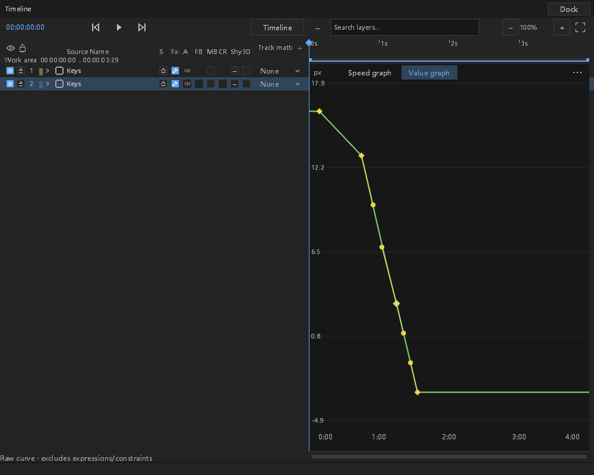

# #257：映射图层的主图曲线手柄

本阶段在 `feat/layer-time-mapping` 接续局部关键帧编辑与缓动剪贴板。开工核对其他本地分支和远端 PR，未发现相同主图手柄工作。#257 仍未完成，不关闭 issue；音频第一版按已确认方案随变速改变音高。

## 功能与协议

主图为映射图层显示、命中并编辑时间贝塞尔手柄。局部键顺序不因倒放改变，屏幕横向区间允许为负；速度图用带符号的合成帧差计算物理速度。邻接区间联动沿用物理斜率，Alt 解除联动，Ctrl 与 Shift 沿用现有约束。显式恒等映射也使用局部身份，不再凭时钟恰好等于默认值选择旧整数命令。

`LocalKeyEdit::Handle` 仅携带有符号局部区间起点、端点方向和一个归一化控制点。模型复用既有手柄解析，在应用时读取另一端当前值；自动贝塞尔只转换所拖端点，冻结它的另一个相邻区间并保留另一端的自动策略。标量、矢量、分离轴、路径几何及颜色曲线复用局部通道预检；离散参数仍只允许 Hold，连续空间键仍走独立稳定 ID 协议。新增目录 schema 与 tagged JSON 一致，不添加顶层命令。

连续手柄编辑可进入已有手势，结构性局部编辑仍单独提交。一次完整拖动对应一次撤销；失焦、IME、丢失按住状态、Escape、选区/时钟/播放头/几何变更、当前选择消失或切换比较/效果图时，取消旧手势。按下手柄后，关键帧命中和框选不再处理同一次按下，也不发布 Seek。映射手柄仅能在可见图表内启动拖动，捕获后仍可拖出边界；离屏手柄不再劫持左侧区域。没有改鼠标命中容差、图标、颜色或布局尺寸。

## 验证状态

共通过 **348 个不同测试**：模型 86 项、桌面 262 项，包含本阶段手动运行的原生用例；另 15 项其他手动用例未运行，未计为通过。覆盖正放/倒放、两种窗口和语言、数值/速度图、两个端点、负局部帧与小数投影、联动/Alt/Ctrl/Shift、自动贝塞尔端点归属、失焦/IME/丢失 release/时钟/选区/锁定/缩放/Escape/视图消失取消、可见区域命中与框外拖动、一次撤销、保存、错误信道及既有选区/菜单/剪贴板回归。最终图形范围压力组 24 项通过，耗时 216.75 秒；不以不同运行的墙钟差异宣称性能提升。

带 FFmpeg / host diagnostics 的测试构建、排除 Android 的工作区 all-targets check、新模块 rustfmt、样式消费者和 diff 空白检查通过。保留既有编译警告。旧测试仅补调用所需状态参数；目录断言从 6 变为 7 是新增协议分支，并额外严格核对 `handle` 的有符号 `frame` 及不存在 `frames` 字段，不是放松校验。

本轮新写的原生测试曾使用错误参考值：线性预设的 Y 控制点由既有实现计算为 `1 - 1/3`，与手写 `2/3` 相差 1 ULP。参考值改由原有整数手柄命令产生，仍然精确比较另一端控制点，完整工程断言不变，没有放宽生产精度。随后补上可见区域命中保护及回归测试，**全部计数用例均在最终冻结程序上重新运行通过**；348 项不包含前轮通过数或重复补验数。清单记录的 22 个源码文件在构建、测试及打包时哈希一致。

原生用例通过实际主窗/浮窗 chrome 的 Input、串行 worker 和 GPU，未注入物理 OS 鼠标。完整工程仅允许目标局部区间的曲线字段改变；实际预览/取消、一次撤销/重做、保存和另一进程重开逐步留存 JSON。6 张原始截图包含两种窗口各自的修改前、数值图和速度图。截图进程 PID 17832，重开进程 PID 6572。默认级别下，非法局部键请求须保持工程不变，文件与 Error stderr 均含原始原因、对象和操作，stdout 不含日志；坏投影键的累计阈值、抑制、健康恢复及独立进程重置另有直接绘制入口验证。

保留初次手势分类错误、默认 Windows 临时目录拒绝访问，以及上述原生参考值失败的原始记录。手势分类作功能修复；临时目录改用现有可写验收目录，原断言不变。初次原生失败不计为通过，不把外部 Vulkan overlay JSON 缺失当作本次失败的主因。

[证据清单](layer-time-graph-handles-evidence/manifest.json)记录最终源码、固定测试程序、通过/未运行测试与图像哈希；[原始证据包](layer-time-graph-handles-evidence/evidence.zip)包含源码快照、补丁、日志、初次失败、原生截图和保存/撤销/取消/重开 JSON，前轮记录单列在 `earlier-attempts`。测试程序留在本地 `E:/Dev/aem/artifacts/issue-goal-current/time-handles-verified-validation`，未纳入仓库。最终桌面程序 SHA-256 为 `1976184fdee7916945885f08160b91267d565763e6112c3e4d154767b6f5af08`。

以下为实际 GPU 截图，不是设计稿；没有右键菜单改动。

## 观察与边界审计

| ID | 分类 | 处置和证据边界 |
|---|---|---|
| TIME-H-01 | 功能/协议 | 新局部手柄端点载荷、带符号屏幕方向、应用时保留另一端；不是日志改动。 |
| TIME-H-02 | 新观察 | 主图入口校验映射时钟、键数组、局部键身份/顺序/投影/有限值和命中区间身份；邻接控制点校验和命令构造沿用有界 `observe!`。禁用编辑时保留原始原因和对象/属性/阶段。 |
| TIME-H-03 | 既有观察 | 复用固定调用点、进程生命周期饱和计数：首次 Warn、累计第 60 次 Error，其余抑制；正常条目不重置，独立进程重置。沿用既有面板机制，不宣称是连续失败计数或一秒阈值。健康绘制不增加文件 IO。 |
| TIME-H-04 | 正常分支 | 无选中键、过期选区、锁定、平坦区间、Hold、不支持的空间键和取消均为交互边界。视图正常消失直接取消局部手势；实际采样/快照故障仍由具体调用点记录。 |
| TIME-H-05 | 默认信道 | 引擎非 Present Info start、in-flight 和错误文件/Error stderr 复用既有通道。针对坏投影键检查第 1/60 次、抑制、健康恢复及进程重置；原生用例显式非法局部键验证 worker 失败、工程不变和 stdout 隔离。未声称每一个新前检分支都单独经过系统级故障注入。 |
| TIME-H-06 | 剩余范围 | 连续空间键旧迷你编辑与稳定 ID 曲线剪贴板、锚点补偿、其他矢量/蒙版/音频数值与合成拾取入口、摄影机专用手势、数值拖动时钟守卫、真实媒体预取与音频设备/高速抗混叠验收仍待推进。 |

## DESIGN §0.7 逐项处置

本阶段改时间身份和交互，不做视觉整改。以下为 retained with reason；保留不表示缺陷已经修复。

| 基线位置 | 处置与理由 |
|---|---|
| path_controls 六处 y 步进 | 保留；未修改该文件。 |
| path_controls 两列拆分 | 保留；未修改该布局。 |
| path_controls 混合按钮高度 | 保留；未修改该控件。 |
| path_controls 自绘数值背景 | 保留；未修改该绘制。 |
| path_controls 布尔整行按钮 | 保留；未修改该事件或状态。 |
| effect_controls 行高/步进 | 保留；本阶段未修改效果控件。 |
| effect_controls 布尔控件 | 保留；本阶段未修改效果控件。 |
| effect_controls 枚举控件 | 保留；本阶段未修改效果控件。 |
| effect_controls hover 背景 | 保留；本阶段未修改效果控件。 |
| effect_controls 层级缩进 | 保留；本阶段未修改效果控件。 |
| timeline 十一列坐标 | 保留兼容基线；仅修改主图交互，不改图层表头布局。 |
| timeline snap guide 颜色 | 保留已知行为；未修改绘制或 token。 |

本次截图只验收实际主图交互，不替代 DESIGN §12 的整体视觉验收，亦不宣称其他系统或 DPI 已验收。
