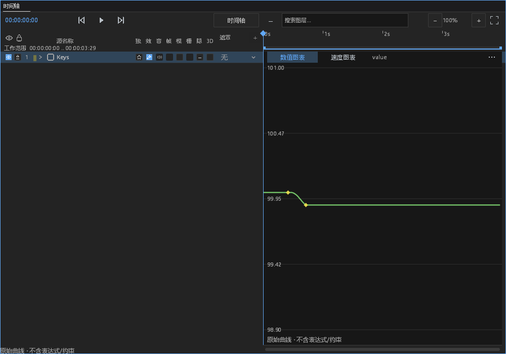
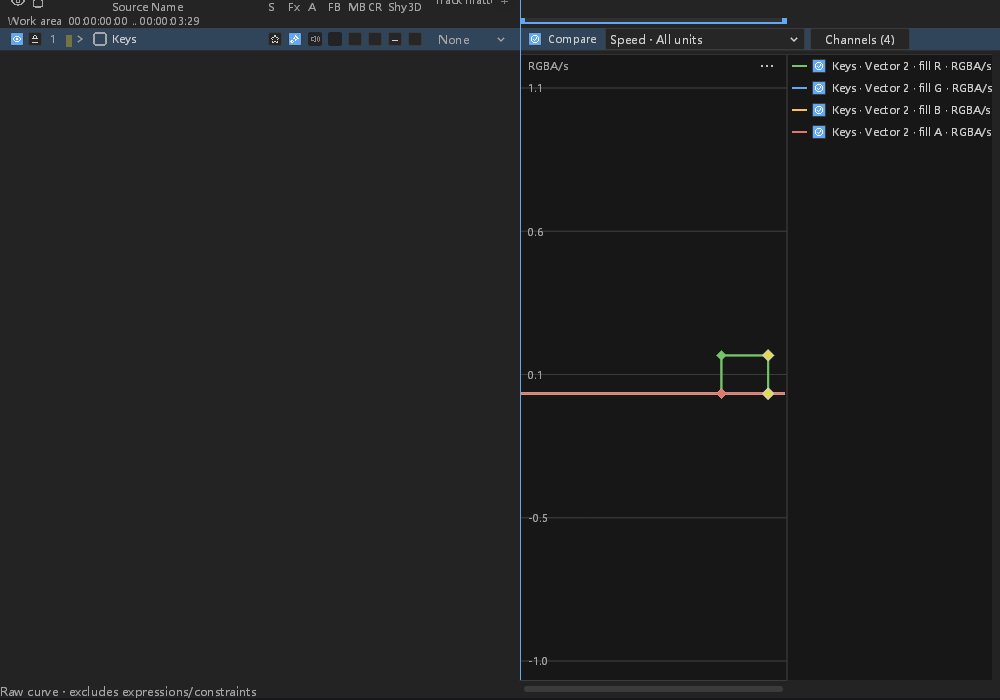

# #257：比较曲线和效果图形视图的图层时钟

接续 `faeabdfc`，分支 `feat/layer-time-mapping`。开工时核对开放 PR 和其他分支：
#575 为原生预渲染；近期跟踪导入、姿态转换和后台调度分支与本次无功能重叠。
未审查或修改其他人的 PR。**本阶段不是 #257 整体验收，不关闭 issue。**
音频策略继续采用用户确认的“音高随速度变化”。

## 功能与协议

比较曲线、效果数值/速度图、拟合范围、标记和读数通过图层时钟转换合成时间。
普通键保留有符号局部整数身份，连续空间键保留稳定 ID 和 prepared 后的时间；
不能用取整后的合成帧代替键地址。速度乘有符号时钟速率，倒放时方向反转。
素材 remap 不改变属性曲线的时钟。未映射图层保留原有惰性采样种子和数值路径。

复用主图形视图的有界种子投影，比较视图和效果视图也保留跳变两侧的相邻
可表示合成时间；补齐连续空间键的边界。沿用自适应误差和评估预算，未提高预算。
比较视图支持按局部键横向拖动和纵向改值。效果视图通过相同地址选择、拖动和
拟合；反向区间的手柄使用有符号时长，并更新原始局部区间。

实际回归发现：`LocalKeyframes` 原来全部被归为独立事务，手柄的连续更新因此
返回 `Gesture`。现在仅 `LocalKeyEdit::Curve` 可进入已有手势，结构性的移动、
复制、删除等保持原限制。失败批次恢复上一份预览；取消恢复手势开始状态，
提交后只产生一个撤销项。未引入重试、重启或吞错路径。

未修改渲染器、效果包、工程格式、布局、尺寸、颜色或图标，没有新增依赖/资产。
颜色映射曲线对象仍由效果控件编辑，不冒充数值时间曲线；静态/不支持通道仍是
正常不可用分支。稳定空间 ID 的独立存储剪贴板不属于本阶段。

## 验证和证据

最终测试统计、程序 SHA-256 和截图清单见
[证据清单](layer-time-graphs-evidence/manifest.json)，
[原始证据包](layer-time-graphs-evidence/evidence.zip) 保留执行命令、输出和失败记录。

共 **179 个不同测试通过**（桌面 155、核心 24），另有 8 项手动测试未运行。
FFmpeg / host diagnostics 桌面测试构建、排除 Android 的工作区 all-targets check、
新增模块格式、样式消费者和 diff 检查通过。既有编译警告保留在原始输出。
最终测试程序 SHA-256：`c0d9c5745fcffba899c29c24e5331becca46e965341c3d3a8cfc31525fe3839a`。
同一程序完成最终回归、14 张实际截图以及两个工程的独立进程重开。

原生验收使用实际 Shell、GPU、主窗/浮窗 chrome 指针路径和串行引擎 worker，
覆盖中文正放、英文倒放的比较曲线拖动、效果曲线手柄、保存、完整撤销和独立
进程重开。窗口隐藏，不注入物理操作系统输入；不宣称其他操作系统和 DPI 已验收。
截图是实际程序输出，展示裁图仅去掉空白，整窗原图保留在证据包。

原始失败保留：首次 check 的区间索引被投影结果遮蔽、旧手柄测试初始化缺字段；
首轮桌面手柄测试揭示独立事务限制；新增核心故障用例最初预期了错误的
英文措辞，现断言实际的 `selected keyframe does not exist` 以及对象和阶段上下文。
周边回归还发现新增日志上下文误改了既有 `frame` 字段名，已在生产代码恢复原名，
附加精确局部帧与文档上下文，没有修改原日志断言。
旧测试只补新时钟参数的默认值和新字段，不改原断言、误差或等待预算。

## 报错和正常分支审计

| ID | 分类 | 处置与证据边界 |
|---|---|---|
| TIME-G-01 | 功能 | 所有数值类型、蒙版、平面/分组矢量、效果、音频的数值与有符号速度对照；连续空间键单独核验 prepared 时间、稳定 ID 和相邻种子。 |
| TIME-G-02 | 新增观察 | 效果图的时钟/clip offset、标记、选区、区间投影和手柄时钟守卫复用固定 site 的 `observe!`，保留原原因。计数按进程生命周期累计，成功不清空；首次 Warn，第 60 次 Error，使用既有有界键和上下文。不是每秒阈值。 |
| TIME-G-03 | 既有覆盖扩展 | 比较曲线解码失败复用每目标/版本缓存和原 Error 信道；连续 120 次重绘只解码/记录一次，随后新 revision 的正常工程恢复。无效时钟默认日志文件和 Error stderr 可见，stdout 隔离。 |
| TIME-G-04 | 正常取消 | 手柄期间失焦、Escape、时钟或 offset 变化取消既有事务；测试不把正常取消算故障。无效时钟则先观察原因，再关闭已开始的编辑。 |
| TIME-G-05 | 功能/协议 | 核心层允许局部曲线参与手势，保持结构编辑禁令；验证错误批次保留预览、提交/取消、撤销/重做和保存重开。原生 worker 验证同一协议。 |
| TIME-G-06 | 既有覆盖 | 沿用非 Present worker 的 Info start、在途状态、完成计时和失败记录；未改队列、panic hook、线程生命周期、回复或超时策略。本阶段没有重新证明整套线程观测协议。 |
| TIME-G-07 | 正常分支 | 只读、静态、颜色映射曲线、取消和失效来源保持既有语义；正常采样不新增文件 IO、Info start/done 或每帧告警。 |
| TIME-G-08 | 待办 | 数值入口/导航、其他迷你曲线、主图映射手柄的完整接入，稳定空间键剪贴板、视频预取及真实音频设备/高速抗混叠验收仍待完成。 |

本阶段主动注入验证新增时钟错误，其余新增 site 未逐一注入。预算故障使用既有
真实图形视图用例，不宣称每条映射投影的预算错误都已独立触发。

下一步已定位到 `animation_controls.rs` 的播放头取整和所选帧转整数路径，以及
`effect_controls/key_navigation.rs` 仍按单一 offset 采样的路径。
迷你曲线读数复用本次修改的 `Data`，其既有未映射回归已运行；迷你视图的完整
映射输入与编辑仍需单独验收，不能把共享读取修复当作整套编辑入口已经完成。

## DESIGN §0.7 逐项处置

本阶段只修时间和身份语义，不做视觉整改；以下源码范围均未修改。
保留不代表这些既有缺陷已经修复。截图用于验证当前图形视图交互结果。

| 基线位置 | 前后与处置 |
|---|---|
| path_controls.rs:860,884,953,1002,1070,1149 | retained：保留行步进，未修改路径面板。 |
| path_controls.rs:893 | retained：保留二列分割，未修改路径面板。 |
| path_controls.rs:894–953,1038 | retained：保留混合按钮高度，未做尺寸整改。 |
| path_controls.rs:1124,1130 | retained：保留数值域绘制，未改样式来源。 |
| path_controls.rs:1151–1170 | retained：保留布尔控件，未改事件或状态。 |
| effect_controls.rs:958,1043,1050 | retained：保留行步进，未修改效果控件。 |
| effect_controls.rs:998–1013 | retained：保留布尔控件，未修改效果控件。 |
| effect_controls.rs:1053–1064 | retained：保留下拉布局，未修改效果控件。 |
| effect_controls.rs:974 | retained：保留悬停绘制，未做样式整改。 |
| effect_controls.rs 全文件 | retained：保留层级布局，未做样式整改。 |
| timeline.rs:541–547 | retained：保留列坐标和命中范围，未修改布局。 |
| timeline.rs:1432–1436 | retained：保留吸附线；本阶段未改主题 token。 |
