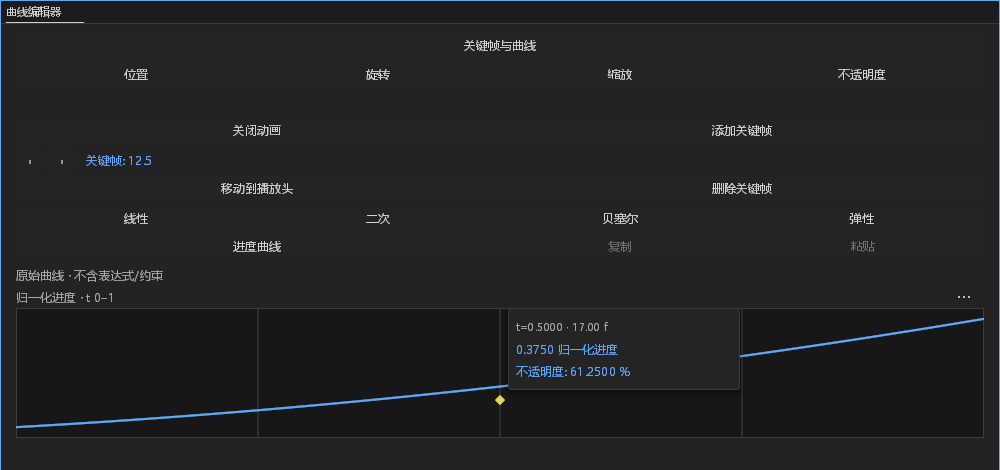
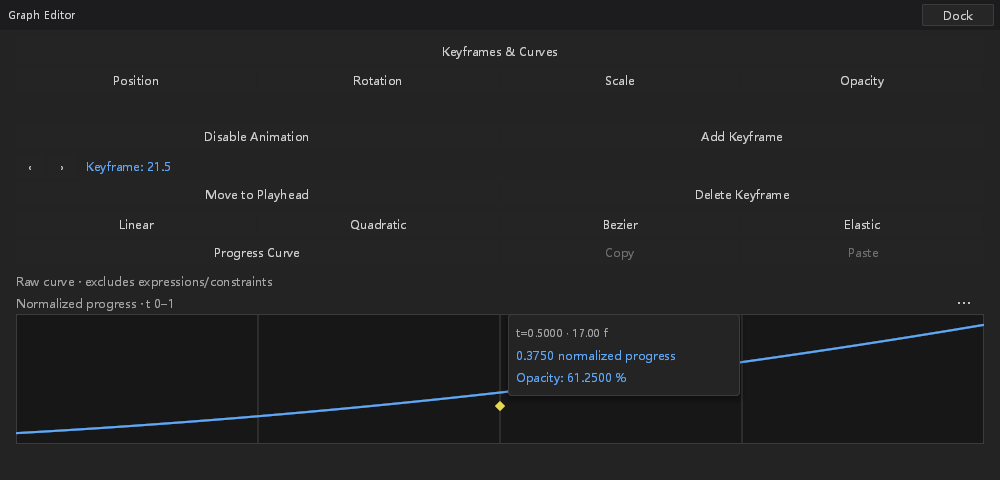

# #257：变速图层的曲线面板与迷你曲线编辑

接续 `61e9c975`，继续使用 `feat/layer-time-mapping`。开工前核对开放 PR 和近期
本地分支：仅 #575 原生预渲染 PR 开放，跟踪导入、姿态转换及后台调度分支没有
重叠。本阶段未审查或修改其他人的 PR。用户确认的音频策略仍为音高随速度变化。
**本阶段继续推进 #257，没有完成全部范围，不关闭 issue。**

## 功能与协议

旧曲线面板直接把合成播放头取整，并把投影帧作为普通命令地址。现在映射图层
使用真实图层时钟和 clip offset：当前采样、加键及动画开关走精确 `TrackAt`；
所选区间的曲线、删除和移动使用 `LocalKeyframes` 的有符号局部键身份。只在
准确可表示的局部整数时刻允许加键或移到播放头，关闭动画仍能冻结小数时刻。
普通键数组必须保持有序、唯一，且投影必须与作者时钟一致；损坏快照不可回退
到 0 帧。连续空间键仍保留其独立稳定 ID 协议，本阶段没有冒充普通帧来编辑它。

面板显示合成时间，导航保留小数投影；倒放时左右箭头按合成时间的前后移动。
内部选区区分局部身份和旧合成帧，禁止将局部第 3 帧传作旧命令的合成第 3 帧。
实际曲线面板在发布选区后同步既有 addressed selection，使键盘操作仍使用同一
通道与局部身份。分离轴只编辑指定轴，其他轴、数值和相邻区间保持不变。

迷你视图仍是作者区间的归一化 t=0–1。实际数值及物理速度读数先将该局部区间
投影回合成时间，再交给已有采样器；倒放保留速度符号。自适应采样与缓存规则
未改。适应选区读取局部端点，包括负局部帧；空选区与过期选区不回退成旧选区。

手柄捕获时记录时钟、偏移、播放头和所选键。时钟、偏移、播放头、目标身份
变化或失焦时取消原事务，恢复手势前工程；无效时钟先记录原因，再取消。
曲线值验证失败保留上次有效预览，通过现有观察器保留原错误。

没有新增布局、颜色、尺寸、图标、依赖或资产，没有改渲染采样代数、工程格式、
效果包和基线。旧未映射图层保留原有命令与帧处理路径。

曲线剪贴板目前使用既有合成整数帧协议：映射键投影恰好为可表示的合成整数时
可复用，非整数投影不伪造或取整地址。完整的局部曲线剪贴板仍需继续接入。

## 验证与证据

最终固定源码共 **185 个不同桌面测试通过**：184 项普通测试及 1 项手动原生
验收；另有 10 项其他手动用例未运行，未将它们计为通过。范围包括曲线面板、
图形范围、关键帧剪贴板、快捷键、选区与跨属性焦点。最初使用
`panels::property_focus` 过滤器未找到测试，保留该零匹配记录，随后按实际
`property_focus` 名称补跑 9 项消费者测试；与选区组重复的 1 项只计一次。

FFmpeg / host diagnostics 桌面测试程序构建、排除 Android 的工作区 all-targets
check、新模块 rustfmt、样式消费者及 diff 空白检查通过。既有 26 项桌面编译
警告保留，没有通过修改旧断言或隐藏警告取得通过。

最终测试程序 SHA-256：
`a123fad9b8e1c47cdfe5689d73ba883b6ab9b27fe728bc672fa46a8d1b8ba2c7`。
[证据清单](layer-time-mini-evidence/manifest.json)保留 7 个构建输入源码的哈希、
185 项测试名称、未运行项、原生进程 ID、原图及展示裁图哈希。
[原始证据包](layer-time-mini-evidence/evidence.zip)包含最终源码补丁、测试命令
与输出、构建和检查日志、默认故障文件日志、8 张原生截图、保存/撤销/重做和
独立进程重开结果，以及本阶段早期验证记录。测试程序留在本地，不提交二进制。

下图为最终原生 hover 截图的无修饰裁剪。所选局部第 3 帧在正放显示 12.5 帧，
倒放显示 21.5 帧；归一化 t=0.5 对应局部第 6 帧和合成第 17 帧，不透明度
61.25%。数值读数和时间标签均来自实际程序。

原生验收通过实际主窗/浮窗 chrome 的按下、持续按下和释放入口，使用实际
Shell、GPU、串行 worker；不注入物理系统鼠标，不声称其他平台或 DPI 已验收。
每种窗口保留 idle、hover、drag、after 四张实际截图。完整工程对象、一轮撤销
与重做，以及另一进程重开均作比较。显式非法局部键请求须保留工程，错误须在
默认文件日志与 stderr 可见，后续有效拖动恢复。

首轮曲线面板 15 项测试通过；第二轮 17 项及手动原生用例通过，图形范围周边
回归 24 项通过。最终源码另增加局部适应选区、分离轴验证，并纠正时间标签为
合成投影；早期程序不作为最终源码的替代证据。未改既有断言、误差或预算。

## 错误与正常分支审计

| ID | 类别 | 处置与证据边界 |
|---|---|---|
| TIME-M-01 | 功能/协议 | 参数写值沿用 TrackAt，曲线及移动删除沿用 LocalKeyframes；保持原事务、锁定、只读、原子失败与一次撤销。 |
| TIME-M-02 | 新观察 | 固定站点 curve.controls.clock/keys/selection/move_delta/handle_value/easing 与 curve.mini.readout_clock，保留对象、通道、阶段、原始原因；不记录完整用户载荷。 |
| TIME-M-03 | 观察策略 | 沿用进程生命周期累计，首次 Warn、第 60 次 Error，健康调用不重置；固定站点、有界上下文，非按秒计时。健康绘制不增加文件 IO 或逐帧日志。 |
| TIME-M-04 | 实际故障 | 无效时钟、不一致键投影和迷你读数时钟每站点 120 次，验证默认文件日志只出现两条、Error stderr 一条、stdout 隔离和健康邻行不清零。其余新站点未逐一注入。 |
| TIME-M-05 | 既有覆盖扩展 | 实际 worker 非 Present Info start、失败文件及 Error stderr，通过非法 local_curve 请求验证；无新阻塞线程、重试或回复协议，不宣称重新验收整套 panic/阻塞观测。 |
| TIME-M-06 | 正常分支 | 不可表示的局部时刻禁用加键/移键；空轨道、空或过期选区、只读/锁定、失焦与有效时钟变化取消不当作每帧故障。非法显式协议请求继续返回错误。 |
| TIME-M-07 | 待完成 | 主图映射手柄完整接入、连续空间键的旧迷你编辑、局部及稳定空间 ID 曲线剪贴板、锚点补偿、其他矢量/蒙版/音频数字和合成拾取入口、摄影机专用手势、数字拖动期间时钟守卫、真实媒体预取及音频设备/高速抗混叠验收仍待推进。 |

## DESIGN §0.7 逐项处置

本阶段修时间与身份，不整改样式。以下均 retained with reason，保留不等于已修复。

| 基线位置 | 处置与理由 |
|---|---|
| path_controls 六处 y 步进 | 保留；未修改该文件。 |
| path_controls 两列拆分 | 保留；未修改该布局。 |
| path_controls 混合按钮高度 | 保留；未修改该控件。 |
| path_controls 自绘数值背景 | 保留；未修改该绘制。 |
| path_controls 布尔整行按钮 | 保留；未修改该事件或状态。 |
| effect_controls 行高/步进 | 保留；本阶段未修改效果控件。 |
| effect_controls 布尔控件 | 保留；本阶段未修改效果控件。 |
| effect_controls 枚举控件 | 保留；本阶段未修改效果控件。 |
| effect_controls hover 背景 | 保留；本阶段未修改效果控件。 |
| effect_controls 层级缩进 | 保留；本阶段未修改效果控件。 |
| timeline 十一列坐标 | 保留兼容基线；未修改该文件。 |
| timeline snap guide 颜色 | 保留已知行为；未修改绘制或 token。 |

曲线面板自身既有大按钮、留白与硬编码布局同样未宣称整改；未增加新的尺寸或
颜色字面量，截图用于验收时间与输入语义，不能替代 DESIGN §12 的整体视觉验收。
