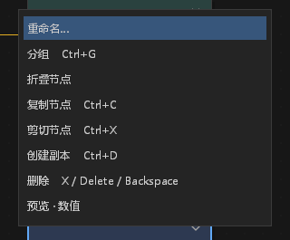
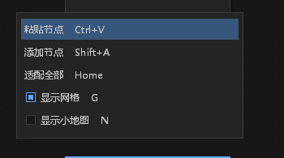
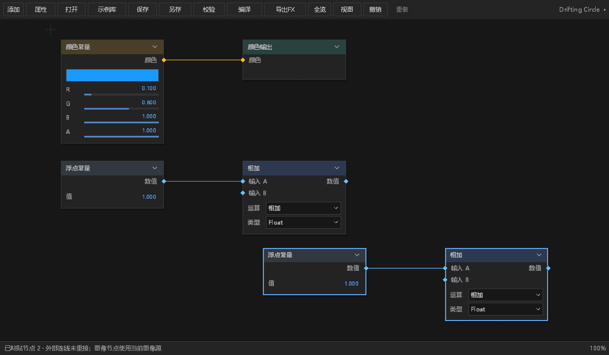
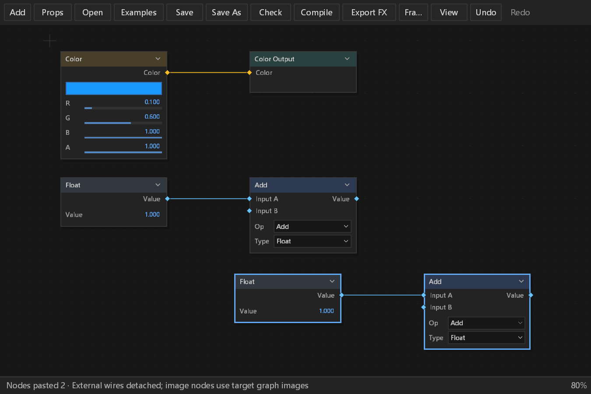

# 节点子图剪贴板验收与错误审计

对应 #229。分支 `feat/node-subgraph-clipboard`，开始前核对开放 PR、本地 worktree 和近期分支，没有重复的节点剪贴板实现。根工作树中其他线程的效果包、网站和文档改动未带入。基于已包含 #468 和停靠布局缓存的 main `d07b8b13`；不审阅或接管其他 PR。

## 交付范围与边界

- Ctrl+C / Ctrl+X / Ctrl+V 及节点、画布右键入口使用同一动作；快捷键进入现有可配置目录。原 Ctrl+D 保持即时创建副本，中文入口改为“创建副本”，避免与缓存到剪贴板混淆。
- 剪贴板是应用内的一份节点快照，不读写系统文字剪贴板，也不跨应用重启保留。打开另一个图、进入/离开组、独立草稿与图层效果之间切换时保留当前快照；不放入图文件、工程历史或异步 worker snapshot。
- 保存选中节点、选区内部连线、所引用的公开参数，以及完整递归组及其接口。单独的组边界属于宿主组，不能剪切/复制；应复制整个组。显式缺失选择、缺失参数或端点拒绝操作，保留已有剪贴板。
- 每次粘贴都为节点、嵌套边界和公开参数生成新 ID。两个复制的参数引用仍共享本次复制的同一个新定义；不与源图或上一次粘贴共用控制。保留名称、默认值、单位、动画标记、输入默认值、节点相对位置及组端口。
- 外部连线不自动重接，已有目标连线不被替换。当前图模型中的 Image 只引用 Input / Source 宿主输入，没有文件路径或外部纹理字节；复制保留该种类，粘贴绑定目标图的输入图像。任意文件资产迁移属于尚未实现的图像资源接口，不伪造复制成功。工作色彩空间或 alpha 契约不一致时明确拒绝，不隐式转换。
- 在当前鼠标位置粘贴；指针不在画布时使用可见画布中央。连续粘贴有偏移，保留相对布局；不会强制适配或修改用户视图。
- 所有新节点、公开参数和线先进入候选图。检查端口类型/单位、重复输入、环、组深度、原有根图预算和唯一 Color Output；允许保留尚未接完的草稿。补充每个作用域的连线验证，避免既有 MissingOutput / MissingInput 草稿路径提前返回而掩盖非法粘贴。深度不超过 16，快照不超过既有 4 MiB 图文档预算。
- 校验失败不改图、选择、ID 计数器、撤销/重做或粘贴计数。剪切在快照成功后才删除；粘贴/剪切分别使用既有单步撤销。不引入其他历史系统。
- 搜索、字段、重命名、内联控件、IME 组合/已消费输入、失焦和拖动拥有输入；不把它们的 Ctrl+X/V 转成节点编辑。OS 按键重复不能重复执行节点剪贴板操作。

## 验证记录

最终源码验证：

| 验证 | 结果 | 本机原始证据 |
|---|---|---|
| 节点编辑器完整回归，包含 11 项剪贴板专项 | 151 通过，0 失败，43.77 s | `node-clipboard-final-editor.log` |
| 快捷键目录与绑定 | 8 通过，0 失败 | `node-clipboard-final-related-shortcuts__.log` |
| 主窗 / 浮窗节点键盘作用域 | 3 通过，0 失败 | `node-clipboard-final-keyboard-node-scope.log` |
| 节点图层与工程保存 | 7 通过，0 失败 | `node-clipboard-final-related-node_layer__.log` |
| 节点任务与实际导出错误 | 6 通过，0 失败 | `node-clipboard-final-related-node_tasks__.log` |
| FFmpeg 产品构建 | 成功，50.91 s；保留 20 项既有 app 警告和 render 既有警告，无剪贴板新警告 | `node-clipboard-product-build.log` |
| 隔离 PATH 启动 | 退出 0，stdout 为合法命令 JSON，stderr 0 字节 | `node-clipboard-startup.stdout.json` / `node-clipboard-startup.stderr.log` |

以上共 175 项测试通过。一次错误的 `panels::keyboard_node_tests::` 过滤器匹配 0 项，不计入测试数量；使用 `--list` 核对真实模块后运行 `panels::keyboard::node_scope_tests::`，3 项全部通过。构建命令为 `cargo build -p motion-desktop --bin motion-studio --no-default-features --features ffmpeg --locked --offline -j1`。只对新增剪贴板模块执行 rustfmt；样式消费门禁及 `git diff --check` 通过。

本机开发构建位于 `E:/Dev/aem/artifacts/desktop-node-clipboard-preview/`，包含本次 exe、完整共享 FFmpeg DLL 和许可证；使用既有打包器验证 12 个运行时条目及 Windows x86_64 PE。exe SHA-256 为 `5087340733047a196f714527dabbb6a68c42dd9b414bfa8a78a8d075085eedcc`。启动验证移除开发 FFmpeg / PKG_CONFIG 配置，PATH 仅保留 Windows 和 System32；不将命令目录启动等同于完整人工播放验收。初次验证脚本因 Windows 环境变量大小写查找失败而未启动进程，统一键大小写后真实启动验证通过；没有修改产品错误处理。

初版第一次测试因新子模块的默认路径解析到既有 `node_editor/tests.rs`，实际运行了 25 项旧测试；它证明既有编辑未回归，不能当作剪贴板专项证据。随后显式指定模块路径，9 项真正专项全部通过。其后增加嵌套深度/上下文转移测试，150 项完整节点编辑器回归通过；最后补充主窗/浮窗完整 chrome 与 IME 所有权检查，最终结果另列。快捷键回归首次为 7 通过 / 1 失败：真实解析器的目录检查发现文档尚未生成新增 C/X/V 行；按 CONTRIBUTING.md 使用生成开关更新 DEFAULT-KEY-BINDINGS.md，并补齐用户快捷键说明，不更改断言。该失败原件为 `node-clipboard-related-shortcuts__.log`。不修改已有断言以获得通过，原始日志保留在本机 `artifacts/pr-ci-followups/node-clipboard-tests-first.log`、`node-clipboard-tests-second.log` 和 `node-clipboard-editor-regression.log`。

新增验证使用真实 NodeEditor、GraphDocument、既有校验/撤销和引擎状态。保存重开会比较完整图；重新编译并真实导出 msfx 文件。错误验证以独立子进程初始化默认日志 sink，制造实际节点预算拒绝，核对原图不变、用户原因、文件与 Error stderr，以及 stdout 隔离。

原生截图使用两个真实 Windows HWND / GPU surface 和生产 NodeEditor::draw / Present / CaptureUi。主窗截图为 1200×700 面板；浮窗为 900×600 逻辑面板、150% 输出比例，实际 1350×900。中英文、两个右键菜单和粘贴后状态均实际渲染。输入显式注入生产 panel API，不冒充人工物理鼠标或系统 IME 验收。完整 chrome 测试另覆盖主窗/浮窗、两种语言、只执行一次及组合/失焦输入不删除节点。非 Windows 的系统输入法、物理快捷键、原生焦点切换及更多 DPI 仍由平台人工验收；远程 CI 验证平台编译与回归。

原生夹具为了截图可读，在成功粘贴后调用既有 Fit All；产品的粘贴命令没有自动调整视图。未把夹具的适配行为描述为产品功能。

## 错误与边界审计

| ID | 类型 | 处置与证据 |
|---|---|---|
| N-CLIP-01 | 新观察：显式用户操作拒绝 | Error 包含 operation、epoch、revision、graph ID、depth、selected 和原始原因。graph 最多 128 字符，cause 最多 512 字符，不记录图 JSON、文字内容或资源字节。通过默认文件/stderr/stdout 测试验证。每次离散操作一条，重复按键被快捷键规则阻止；不新增每帧日志或累积计数。 |
| N-CLIP-02 | 正常分支 | 空选区、空剪贴板显示说明；字段、搜索、IME、拖动和失焦不触发节点操作。不作为持续退化或故障计数。 |
| N-CLIP-03 | 功能边界 | 所有校验和分配在候选图中完成；失败保留旧剪贴板和原图。每次只保留一份有界快照，遍历受节点/连线预算及深度约束。没有文件 IO、线程等待、新 worker、重试、重启或吞 panic。 |
| N-CLIP-04 | 既有覆盖 | GraphDocument / CompileOptions、既有语义 revision 和 undo/redo、工作流异步编译、保存/导出、panic hook 和 worker Info start/in-flight 继续使用原通路。本批纯内存编辑不引入新的串行 worker handler；未以成功返回测试代替异常证据。 |
| N-CLIP-05 | 保留限制 | 原生截图不是 OS 输入法或物理输入验收，跨平台运行由 CI 与人工补验；没有声称关闭其他错误审计合集。既有 Epic Vulkan overlay 缺失日志保留，不屏蔽环境错误。 |

## 样式与来源

没有新增依赖、外部图像、字体、图标或复制 UI 资产；已核对 PROVENANCE.md、ATTRIBUTION.md、NOTICE。附图由本项目原创节点夹具生成。没有修改 dark.json、面板列宽、命中容差、控件行高或已有菜单绘制。只增加菜单项与本地化反馈；复用既有样式和快捷键标签，没有新增颜色或尺寸字面量。

DESIGN §0.7 逐项处置均为 retained with reason：path_controls 六处步进、双列、按钮高度、数值 painter、布尔控件五项均未触及；effect_controls 行高、fx 布尔、枚举、hover 和层级五项均未触及；timeline 既有列坐标及吸附线两项均未触及。本批不是属性树视觉整改，不声称历史违规已消失。§12 的剪贴板动作、菜单取消、输入优先级、局部显示与历史不变性按上述证据验收；其他面板、系统 Reduced Motion、全组件状态矩阵和总体性能基线不在本批改变范围，未宣称全面通过。

截图及日志原件位于本机 `artifacts/pr-ci-followups/node-clipboard-native-final/`。附图的原件尺寸、裁剪与 SHA-256 记录在 `node-subgraph-clipboard/captures.json`，只裁剪、不重绘。

## 实际界面

节点右键菜单：

画布右键菜单：

主窗粘贴后的两个新节点保持内部连线：

英文浮窗 / 150% 输出：

