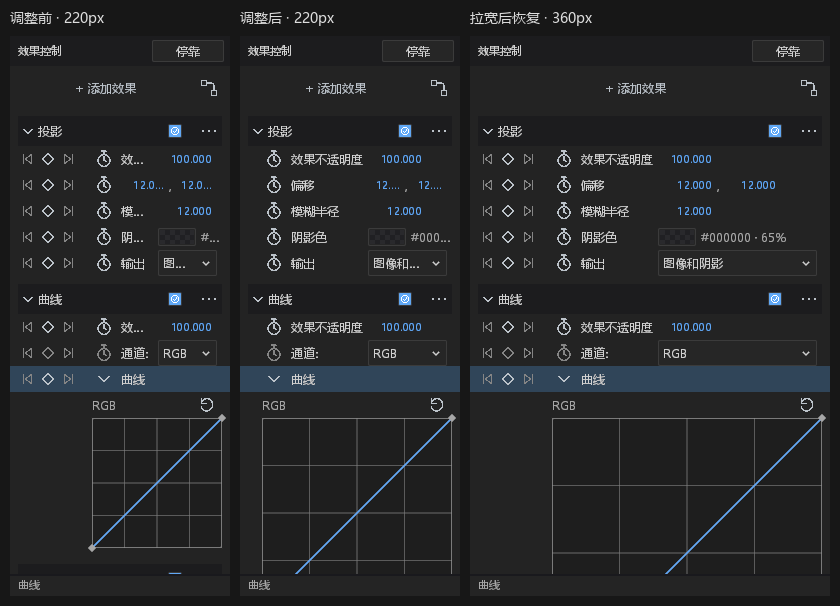

# 面板排版统一：首批整改

分支：`feat/panel-layout-consistency`。基于主分支 `8f870211`。

## 范围与来源

根据本聊天的 19 个面板真实截图整改。沿用 `motion-ui`、现有图标和
`dark.json`；未添加第三方依赖、资产、生成图片、工程字段或编辑状态。
已核对在途分支：曲线范围由 `feat/259-curve-view-ranges` 负责；深度由
`feat/87-static-depth-playback` 负责；蒙版拖柄为本聊天此前的独立 PR。
本批不修改上述功能。时间轴表头为用户随后指定的下一批范围。

## 实际变更

- `InspectorColumns` 统一变换、蒙版、矢量、效果的属性列。值区有宽度上限，
  窄面板先压缩值区并保留名称。矢量实际层级仍缩进，数值列不随深度漂移。
- 共用槽位不替代原命中范围：普通秒表保留 20px 目标，效果保留 24px；
  时间轴的既有属性坐标分支不变。实际值来自窗口样式表。
- 根据用户随后明确要求，检查器宽度小于
  `inspector.navigation.min_width`（320px）时，隐藏上一关键帧/关键帧/下一关键帧
  三按钮，回收整列宽度。秒表与键盘导航保留，变宽后恢复。隐藏状态不画图标、
  不注册旧命中目标；这是用户要求的交互呈现变化，不是日志修补。
- 节点属性独立面板不重复绘制标题。选中节点标题与删除动作同排；标识另行
  显示。输入连接单行显示本地化端口与来源节点名称，保留跳转、断开及撤销。
  内嵌节点检查器仍绘制自己的标题。
- 节点字段复用属性列，非编辑状态不再铺设凹陷背景；焦点、无效值和选区使用
  现有语义样式。保留原字段编辑、IME 和事务路径。
- 浮动窗口底部仅展示实际错误、交互反馈或状态，不再反复显示通用提示。
  渲染错误优先级及错误信息没有改变。

## DESIGN.md §0.7 逐项处置

旧行号均已移动；以下按原审计项标识，区分既有覆盖与本次整改。

| 原审计项 | 当前核对与本批处置 | 状态 |
| --- | --- | --- |
| Path 六处字面量步进 | 原段已由既有紧凑属性实现替代；本批保留 token 行高 | 保留既有修正 |
| Path 字面量二列分割 | 蒙版与矢量检查器改用 `InspectorColumns`；属性树/矢量截图及几何回归通过 | 本次修正 |
| Path 混合按钮/字段高度 | 普通行、字段、专用控件保留既有语义高度与命中区域 | 保留，避免缩小目标 |
| Path 自绘数值 SUNKEN/ACCENT | 当前参数行已使用既有数字编辑器；本批不替换编辑行为 | 保留既有修正 |
| Path 全宽布尔按钮 | 当前为既有 Checkbox | 保留既有修正 |
| Effect 30/26/34 步进 | 当前已 token 化；26px 效果行保留命中高度，改用共用列 | 本次修正列布局，保留高度 |
| Effect fx/横线布尔按钮 | 当前为既有 Checkbox | 保留既有修正 |
| Effect 全宽枚举按钮 | 当前为既有 Dropdown；共用值区限制宽度 | 本次修正宽度 |
| Effect 手写 hover alpha | 当前对应实现已没有 `.with_alpha(0.2)` | 保留既有修正 |
| Effect 无层级 | 当前已有组头和折叠；本批统一属性槽位 | 本次修正列布局 |
| Timeline 列坐标 | 本批不动时间轴列布局；后续另做表头 | 保留，下一批范围 |
| Timeline 吸附黄线字面量 | `timeline.rs` 原行为仍在 | 保留，与本批无关 |

## 验收与观察边界

本批为布局和文案呈现改动，没有新增后台操作、错误信道、超时、重试或
失败吞掉路径。节点端口元数据沿用既有 `observed("inspector.ports", …)`；
字段提交、选择、断开和撤销走原实现。正常未连接端口显示“未连接”，不作为故障。

原蒙版几何测试使用共用的 `inspector_rail` 描述新的窄面板布局；原有不重叠、
字段边界与模式命中断言全部保留。另加独立测试验证隐藏时没有绘制或点击，
319/320px 边界、再次变宽恢复，以及时间轴原导航区域不受此规则影响。

首轮效果错误信道验收发现，其模拟导航行只有 160px，按用户新规则已隐藏按钮，
因此健康对照没有发出打关键帧命令。保留原失败日志，将该夹具的宽度改为主题
定义的可见边界；原来的坏样本拒绝、健康样本两条命令、阈值、恢复、文件/
stderr 与 stdout 隔离断言均未改动。

首轮节点拒绝编辑测试仍按旧检查器布局点击 `y=140`，没有触发布尔控件，
因而未产生预期的拒绝日志。输入夹具现按两行标题和主题间距计算布尔行位置；
文档、版本、撤销历史不变及原始诊断日志断言全部保留。两次失败的日志保留，
不作为通过证据。

## 验证结果与截图

- 带 FFmpeg 的离线锁定构建通过。原有 28 条构建 warning 保留，没有宣称警告清零。
- 属性、效果、路径、导航、节点、相机、表达式、时间轴列八组回归共 304 项通过，
  2 项原有忽略项未运行；共用列几何测试另 1 项通过。
- 中文、英文各 19 个真实原生浮动面板完成截图，两个报告均 `ok: true`，
  每个报告另有 46 张设计场景截图，测试工程未被截图过程改变。
- 最后仅将英文删除动作从 `Delete selected node` 缩短为 `Delete node`，
  不改变按钮宽度和行为。该文案提交另行复跑节点回归和英文截图，结果见 JSON。
- `verify_style_consumers()`、新增共用几何文件的 rustfmt 检查及 `git diff --check`
  通过。初次曾在 panel 测试直接取默认样式，被检查拒绝后改为从 PaintList 取样式；
  没有修改检查器或增加例外。

左图是本分支首轮截图（亦为用户指出问题的状态）；中、右图是适配修改后的
220px / 360px 截图。仅增加图片外的标题，未重画、缩放或修饰产品界面。

[节点属性实际截图](panel-layout-consistency/node-properties-after.png) ·
[属性树实际截图](panel-layout-consistency/property-tree-after.png) ·
[矢量属性实际截图](panel-layout-consistency/vector-properties-after.png)

验收日志、对应代码提交和截图来源记录于同目录的
`panel-layout-consistency-results.json`。Vulkan 日志仍有本机失效的 Epic overlay
JSON 注册项错误，截图运行正常；未通过过滤或静默处理日志掩盖它。

## 尚未完成的视觉边界

曲线展开后仍使用原有可滚动内容，顶部截图不能显示完整图表；本批没有修改曲线
视域和图表尺寸策略。英文截图中的部分效果参数名仍来自既有中文元数据。
节点操作选项的既有控件及其余面板的全部字号、状态和布局审计也未在本批完成。
真实 Windows 多 DPI、完整焦点/IME 状态矩阵及隔离负载的性能对比仍需后续验证。

截图对照必须区分本地测试工程中的状态与产品整体设计完成状态。
本文件不宣称 19 个面板、全状态矩阵、所有 DPI 或 DESIGN.md 全部完成整改。
