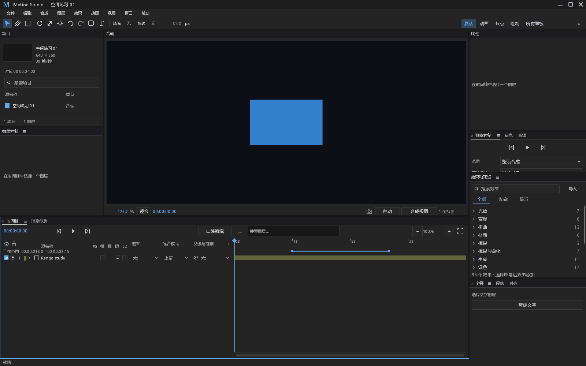
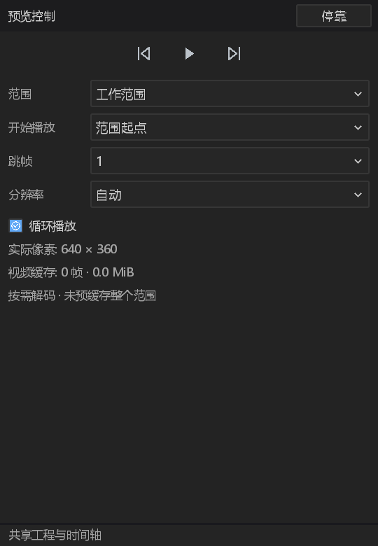
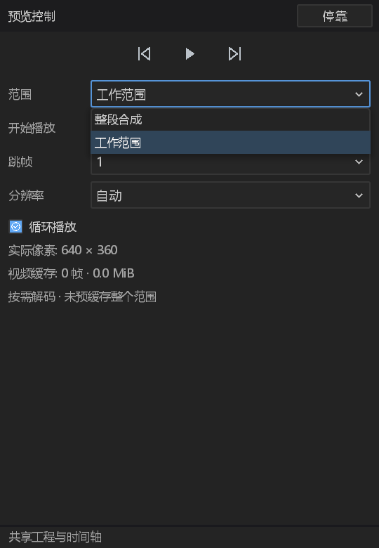
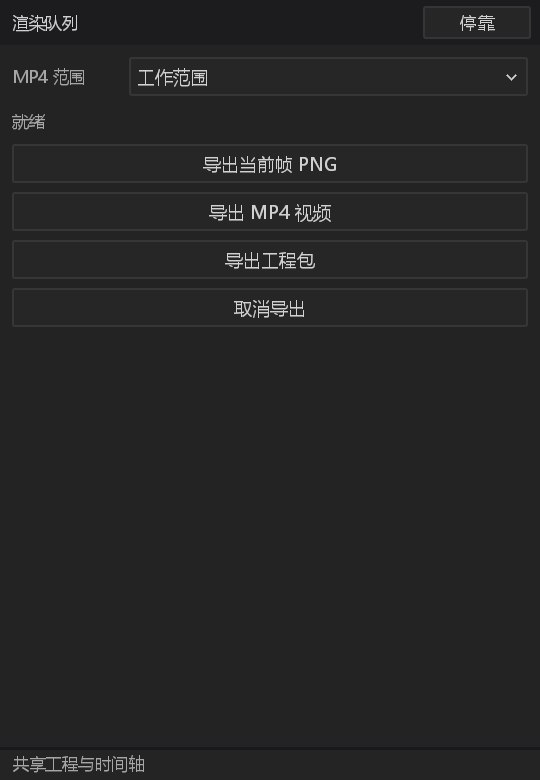

# 工作范围、预览与范围导出验收

关联 #205、#241。开发分支 `feat/preview-work-area`，基于已合入的 #477（`85e475b778a365e65cd66b63247787318c9cfc3a`）。本文件保留后端阶段证据，并在下文补齐桌面交付；CI 状态以本组 PR 当前提交的检查为准，不把本地通过等同于已合入。

## 帧边界与功能

- WA-01：每个合成必填 `work_area`，工程当前版本 25；起点包含，终点不包含，范围必须非空且不超过合成。无旧格式迁移或缺省补全。新合成默认为整段。
- WA-02：`set_work_area` 复用命令注册、合成路由、批次原子性、手势提交/取消、撤销及保存。只改变范围元数据，保留所有图层与关键帧。历史字节核算只更新头部，复用未改动动画的缓存。
- WA-03：合成设置改变时，全范围跟随时长，自定义范围遵守保帧/保秒策略，然后限制到至少一帧。非法原始时钟返回错误，禁止除零。存储合成、活动合成与临时采样视图都携带各自范围。
- WA-04：导出范围从冻结文档解析，默认整段。画面仍在绝对合成帧求值，视频与 AAC 输出时间戳从零开始。音频在两个绝对帧边界分别向下取整到 48 kHz 样本，避免分段取整误差。
- WA-05：桌面预览计划统一整段/工作范围、当前时间/范围起点、单次/循环及跳帧策略。跳帧只减少画面采样，不改变源时间或音频。工作范围外起播回到范围起点。计划在一次播放内固定，停止释放计划。
- WA-06：音频生产者在原混音器内环回，包括跨末尾的插值样本；不重启设备或解码线程。非循环在终点停止，停止与回调观测复用原实现。

## 已有证据与限制

日志保存在 `E:/Dev/aem/artifacts/pr-ci-followups/`。以下分开记录中间阶段与最终后端集成，不把 UI 未完成项计入通过。

- `work-area-core-regression.log`：首轮核心与合成/格式回归 46 通过，1 项原有手动性能测量忽略；当时新范围用例 7 项。随后增加了头部核算与非法原始时钟用例，需以最终日志为准。
- `work-area-model-regression.log`：模型完整测试 68 通过。覆盖多合成查询、图引用、音频时间与矢量输入等原有断言；未削弱既有断言。
- `work-area-mp4-regression.log`：实际 GPU 与 FFmpeg 3 项通过。59 fps 的 5..11 区间输出 6 帧，解码首尾均命中仅在该绝对范围可见的红色图层；输出时间戳首项为零；AAC 样本数与音量符合选中区间。冻结后修改活动范围/图层不影响输出。取消保留原目标并移除自身临时文件。
- `work-area-desktop-regression.log`：实际串行桌面工作线程的无效范围测试 1 项通过。Info 开始记录先于处理，三类失败保留请求号、操作、耗时与原始边界；Error 同时到日志文件和 stderr，stdout 无日志；工程、修订号与已保存文件不变，之后正常范围仍可提交。
- `work-area-error/`：上述默认日志级别进程验证的原始文件、stderr、stdout。未设置 `MOTION_LOG`。

最终后端集成 70 项通过：

| 日志 | 通过 | 说明 |
|---|---:|---|
| `work-area-current-core-lib.log` | 23 | 包含新增历史字节核算用例；另 1 项原有手动性能测量忽略 |
| `work-area-current-range.log` | 8 | 包含非法原始时钟负面对照 |
| `work-area-final-audio_output.log` | 21 | 实际 PCM 混音、44.1/48/96 kHz 边界插值、环回和原有生产者阻塞/故障观测；另 1 项物理设备手动验证忽略 |
| `work-area-final-preview_playback.log` | 3 | 起播、排他边界、跳帧与循环；独立于墙钟等待 |
| `work-area-current-error-process.log` | 1 | 实际错误回复和音频启动参数拒绝，默认文件日志/Error stderr/stdout 隔离 |
| `work-area-final-workspace-preferences.log` | 3 | 既有工作区发布与错误保留回归 |
| `work-area-current-curve-playback.log` | 4 | 曲线/时间轴回流、释放事件及原生手势回归 |
| `work-area-current-mp4.log` | 3 | 最新代码重编译后的工作范围实际 GPU/FFmpeg 验证 |
| `work-area-movie-*` 四份日志 | 4 | 整段导出、嵌套视频/效果/表达式与 PCM、取消、曝光/动画冻结的原有真实输出对照 |

`work-area-final-compile.log` 是对应 FFmpeg 桌面测试程序的完整编译记录。该桌面测试程序 SHA-256 为 `886e78c03e3b1a7a974710cd38cdc4c148fddf4fdeddaeda94e287601f248245`。`work-area-current-error/` 保留最终进程日志与 stdout/stderr，包含三种范围失败以及真实 NaN 音频起播拒绝。最终复验按编译记录选择实际产出的核心测试文件，不计入旧哈希的核心程序和零匹配筛选。

新增 `work_area` 使显式合成测试夹具必须补齐必填字段；两处原有测试直接缩短根合成时同时更新其全范围夹具。没有更改原有断言或渲染期望值。

### 失败与重验

首次核心编译发现显式 `Composition` 夹具缺少必填 `work_area`，随后同步所有明确的合成构造处。首次增量播放编译时误并行执行了旧测试程序，链接器因旧可执行文件被占用返回 LNK1104；失败日志保存在 `work-area-playback-regression.log`。随后编译发现原有物理设备手动测试仍使用整段起播入口，保留其测试入口并令其调用新范围实现，没有改断言，记录见 `work-area-integrated-compile.log`。`work-area-existing-*` 属于旧程序或失败脚本，不作为新功能验收。最终集成编译与执行严格顺序进行，不改变产品重试、等待期限、预算或日志返回语义。

## 错误与观测边界

| 项目 | 分类 | 处理与证据 |
|---|---|---|
| 空/逆序/越界范围 | 新功能拒绝、既有错误信道 | 模型返回含边界的原始错误；实际桌面工作线程进程验证文件/stderr/stdout 与原子性 |
| 非法源时钟 | 新功能拒绝 | 返回 Result 错误，新增 catch-unwind 负面对照；不修复输入或改返回值 |
| 播放音频启动失败 | 新增观测 | 开始信号先于初始化；保留原错误与用户提示，Error 加入 fps、范围、循环状态、耗时及启动阶段；实际 NaN 起播拒绝已验证文件/Error stderr/stdout 隔离 |
| 播放生产者 Err/panic/阻塞、回调降级 | 既有覆盖 | 复用原生产者与监视器，不新增线程生命周期或重试策略；最终音频回归包含原观测测试 |
| 缓存未命中、取消、空撤销 | 正常分支 | 不新增错误日志；取消沿原 ExportControl 清理，不发布半成品 |
| 预览时钟与混音器 | 功能边界 | 新范围策略与 PCM 环回独立于观测；使用实际 PCM 混音与插值验证，不能仅凭编译通过认定完成 |

## DESIGN §0.7 基线逐项处置

以下逐项按本次最终桌面改动核对。路径与效果外观不在本次功能范围，没有把既有违规记为修复。

1. `path_controls.rs` 六处纵向步长：保留，未触及路径控件。
2. `path_controls.rs` 两列间距：保留，未触及字段布局。
3. `path_controls.rs` 不同按钮高度：保留，未触及按钮。
4. `path_controls.rs` 数值背景/颜色：保留，未触及数值绘制。
5. `path_controls.rs` 布尔大按钮：保留，未触及布尔控件。
6. `effect_controls.rs` 行高步长：保留，未触及效果行。
7. `effect_controls.rs` fx/横线布尔：保留，未触及效果启用。
8. `effect_controls.rs` 枚举大按钮：保留，未触及效果枚举。
9. `effect_controls.rs` 手工 hover 透明度：保留，未触及 hover。
10. `effect_controls.rs` 层级缩进：保留，未触及属性树。
11. `timeline.rs` 既有列坐标：保留各列横坐标、宽度和行高。新范围条独占标尺下方的 token 高度；图层行整体向下移动相应距离，滚动范围使用实际正文高度。旧测试改读布局/token，父级、混合、3D、关键帧与音频的原断言不变。
12. `timeline.rs` 吸附线颜色：保留既有颜色与行为；新增范围条使用已存在的 hover/accent token，没有改吸附绘制。

## 桌面交付

- WA-07：时间标尺、音频标记和工作范围各有独立区域。支持拖动入点、出点和整体平移；拖动仅预览，释放时提交一次带 revision 校验的命令，不寻帧。Escape、失焦、工程/合成/版本变化和面板切换取消本地拖动。小到一个像素的时间区域也不会因手柄 clamp 倒置而 panic。
- WA-08：B 设置起点，N 将当前帧纳入范围；Shift+Home/End 跳到范围第一/最后一帧。快捷键不依赖图层选择，不从搜索、IME 或节点作用域抢键。空、交叉和过期范围由既有编辑错误信道拒绝，保留工程和文件。
- WA-09：预览面板通过原生 Dropdown 提供整段/工作范围、当前时间/范围起点、跳帧 0..5；循环使用 Checkbox。选项持久化到工作区，保存失败恢复原值，成功切换选项会停止当前播放。真正的 Shell 起播与推进验证范围、跳帧步长和停止边界；音频与墙钟都在范围末帧停止。从当前时间跳帧以起播点对齐，不先退到较早的网格样本。
- WA-10：渲染队列的 MP4 范围使用明确下拉选择。作用域在提交冻结任务时保存，之后的界面修改不会改变进行中的导出。PNG 仍明确导出当前帧，工程打包不使用电影范围。
- WA-11：分辨率复用实际 Auto/Full/Smooth/Economy 后端策略，同时显示实际像素尺寸；不把现有 2/3 质量策略冒称为 1/2 或 1/4。缓存显示实际视频帧数、缓存字节和进行中的解码数，明确说明按需解码、未预缓存整个范围。删除“先缓存再播放”的占位说明和未接线的音视频复选框。

工作范围不改变图层、关键帧、效果包格式或渲染像素语义。格式 25 的变化是 #205 的持久功能要求，与外观调整分别记录；未重写渲染基线。

### 桌面验证

本轮相关桌面验收 **175 项通过**，包含新功能及既有回归，不声称均为新增测试，也不重复累计中间日志。分组、通过数和对应日志见 [results.json](preview-work-area/results.json)。物理音频设备手动测试继续保留忽略；PCM 混音、公共时钟和生产者 Err/panic/阻塞测试实际执行。

- `work-area-ui-delivery-compile.log`：带 FFmpeg 的当前桌面测试编译完成，22 项既有警告，未声称零警告。测试程序 SHA-256 为 `13ce4d7c1f3416a7959c733a227b35f6a151dcb81c2a4a8de8bd1bfd918aefcf`。
- `work-area-delivery-panels-work_area-tests.log`：端点/整体拖动、单次提交撤销、越界限制、小窗、取消、版本失效及快捷键。
- `work-area-delivery-panels-auxiliary-tests.log`：中英文、停靠/浮窗实际控件选择；循环 Checkbox、电影范围 Dropdown、弹层输入独占与关闭行为。
- `work-area-verified-panels-*`：父级、混合、3D、音频/标记、关键帧、效果/蒙版/属性树及滚动回归。只调整受新增标尺行影响的测试坐标，原断言不变。
- `work-area-delivery-shell-preferences-tests.log`：工作区保存重读与写入失败回滚；真实 Shell 的起播、跳帧、末帧停止和切换选项释放播放状态。
- `work-area-delivery-audio_output-.log`：22 项通过，包含三种实际 PCM 采样率、环回插值、停止取消、生产者失败/阻塞、默认错误输出，以及用真实公共时钟接口驱动的无物理设备末帧测试。后者不作为物理声卡播放证据。
- `work-area-delivery-shell-presentation-curve_playback_tests.log`：4 项通过，包含实际原生窗口跨 DPI 的属性手势与确认帧不抢释放事件回归。
- `work-area-native-delivery.log`：真实 Windows HWND/GPU 主窗、150% DPI 浮窗、中英文拖动、保存、撤销和重做。截图由生产 chrome 输入注入后捕获，不声称物理鼠标自动化。

后台解码三个原有原生测试在不带 `gpu-tests` 的本地构建中默认忽略。最终分别设置它们已有的 CHILD 环境变量，以 `--exact --include-ignored` 执行真正的子进程分支，并在工具侧重验原父分支的日志断言；不是把零通过的忽略输出计入验收。原生窗口/GPU 和受控阻塞解码器验证界面继续呈现、失败不确认未就绪合成、冻结导出与取消，以及跨窗口曝光准备进度。`work-area-pending-png/`、`work-area-pending-chrome/`、`work-area-pending-exposure/` 保留文件、stdout/stderr；每个分支实际一项通过。真实 FFmpeg 取帧和 MP4 编解码输出由前述电影测试提供，两者不混为同一种证据。

### 默认错误信道补充

`work-area-verified-error/` 保留最终进程输出：三种非法范围、引擎已经处理新修改时的过期 revision、NaN 音频起播、两种工作区保存失败。全部保留原始 cause，Error 同时到文件和 stderr，不写 stdout；工作区 Info start 先于保存，失败包括操作、路径、阶段及耗时。保存失败不发布新界面值、不破坏已有配置文件。

面板损坏快照属于有界既有 `observation::Counter` 覆盖：按进程内固定调用点计数，首个 Warn、累计第 60 个 Error，不把累计次数视为秒数。普通缓存未命中、未启动后台任务、主动取消、空撤销和受限边界拖动不是故障，不增加逐帧 IO 或警告。新功能没有添加自动重试、线程重启或吞掉 panic 的恢复分支。

### 截图与 DESIGN §12 边界

[capture.json](preview-work-area/capture.json) 记录实际像素尺寸、DPI、测试程序 hash 与十张图的 hash。以下为独立生成的产品原生截图，没有引入第三方图像素材。

英文及时间轴浮窗图在同一目录。新控件共用既有原生 Checkbox/Dropdown 状态系统，弹层最后绘制并独占输入；尺寸和颜色使用已登记 token。对默认主窗、时间轴浮窗、预览窄窗以及 100%/150% DPI 的相关路径有实际证据。全体 19 面板、五种工作区预设、所有字体/系统缩放组合和 Reduced Motion 的操作系统接线没有在本次本地验收中逐项重跑，保持既有边界，不宣布整个 DESIGN 合规。

首轮桌面编译的快捷键名称、浮窗测试 API、样式变量和测试 Arc 夹具错误，以及原有硬编码点击坐标失败，均保留原日志（`work-area-ui-compile.log`、`work-area-ui-integrated-compile.log`、`work-area-regression-*` 和首轮 `work-area-verified-shell-presentation-curve_playback_tests.log`）。修正实际接线与测试坐标后重新编译、复验；没有改断言、预算、等待期限或产品重试策略。早期零匹配的文档筛选和默认忽略的后台视频筛选不计入通过。

带 FFmpeg 的可运行开发包位于 `E:/Dev/aem/artifacts/desktop-work-area-preview/motion-studio.exe`，SHA-256 为 `6b2142f17ea660c7fdceed0850d30506fe886e0f55a9f9d806e705445f4079ab`。`验证记录.json` 记录程序、7 个 DLL 与许可证等 12 个 runtime payload 文件的 hash；复制原始 FFmpeg 来源清单和项目许可说明，没有添加外部素材。普通构建见 `work-area-preview-build.log`，20 项既有警告。

清除开发 FFmpeg 环境和额外 PATH 后，开发包实际完成命令目录、当前版本工程命令执行/保存，以及原生 libav 视频首帧、中段、末帧和回跳解码；24 fps、72 帧的已有仓库视频夹具确实返回 RGBA 帧。证据在 `work-area-package-check/`。这是本地 debug 包，不冒充正式发行、签名或完整发行验收产物。PR 的远程检查及合入状态以 GitHub 为准。

## PR #479 首轮远程失败与修正

运行 `40073245257` 的 Linux 和 macOS Intel 桌面任务均报告 896 通过、15 失败、1 忽略。原始日志保存在 `work-area-ci-linux-first.log`、`work-area-ci-macos-first.log`；本地原程序也确实复现了首行选择失败，见 `work-area-ci-local-negative.log`，没有将远程失败当成环境问题。

其中 14 项测试仍使用增加工作范围带以前的纵坐标：图层右键/双击、选择、Shy、蒙版关键帧、折叠布局、缩放后的图层条与鼠标释放回流。修正只将测试输入与期望几何改为实际样式中的表头/行高；Shell 的两项拖动测试先绘制一帧，从真实工作范围带的下边缘定位正文，另断言预绘制不产生动作。图层 ID、操作序列、撤销、保存重开及最新释放位置的原行为断言保留。

另一项是节点视图快捷键测试对动画区域 `N` 的旧预期 `None`。本功能明确新增 `Animation/N → WorkAreaOut`，因此将此处更新为精确的新命令预期；`Nodes/N → ToggleNodeMinimap`、节点重复键不触发、Application 区域未绑定及 G 的既有预期保留。这是新增快捷键需求造成的契约更新，不以删除断言或放宽匹配消除失败。

修正阶段同步当前主线 `e6576504b7b68a31ce863a5ede011bc264170232`，包含已合入的 #475 与 #478；没有审查或更改其他人的 PR。`work-area-ci-integrated-compile.log` 记录组合编译，22 项既有测试警告；中间曾新增的两个未用测试变量已移除。此阶段的 FFmpeg 桌面完整测试为 888 通过、0 失败、61 忽略，耗时 713.82 秒，见 `work-area-ci-full-desktop.log`；忽略项不计为通过。测试程序 SHA-256 为 `f17e85cb039d3ff0c29fff6a6178c0b4d5c7f8e2d8114bcd225670c647a96593`。

Windows 首轮另有一项原生测试失败，合计 925 通过、16 失败、1 忽略，见 `work-area-ci-windows-first.log`。工作范围原生测试在同一测试进程再次创建 Winit 事件循环，返回 `RecreationAttempt`。沿用既有原生测试的子进程隔离方式，父进程检查实际子进程退出码及一项测试确实执行，并保留 stdout/stderr 文件；未绕过 GPU 或原生输入路径。

隔离修正后重新编译，仍为 22 项既有警告，见 `work-area-ci-native-isolation-compile.log`。新程序 SHA-256 为 `eabd33d8a15403608b21d799ddde2eff93056f325e8f3b45d959e6e3a097f487`；显式执行忽略的原生工作范围测试，父、子进程均为 1 通过、0 失败、0 忽略，耗时 26.93 秒。证据在 `work-area-native-isolated-parent.log` 与 `work-area-native-isolated/`，包含重新生成的中英文主窗、浮窗和下拉框截图。完整 888 项是隔离修正之前的阶段结果，不冒充新程序的完整回归。此次没有改动 CI、忽略、预算、等待期限、重试策略或产品交互；远程新提交的完整 GPU 组合仍须通过。
