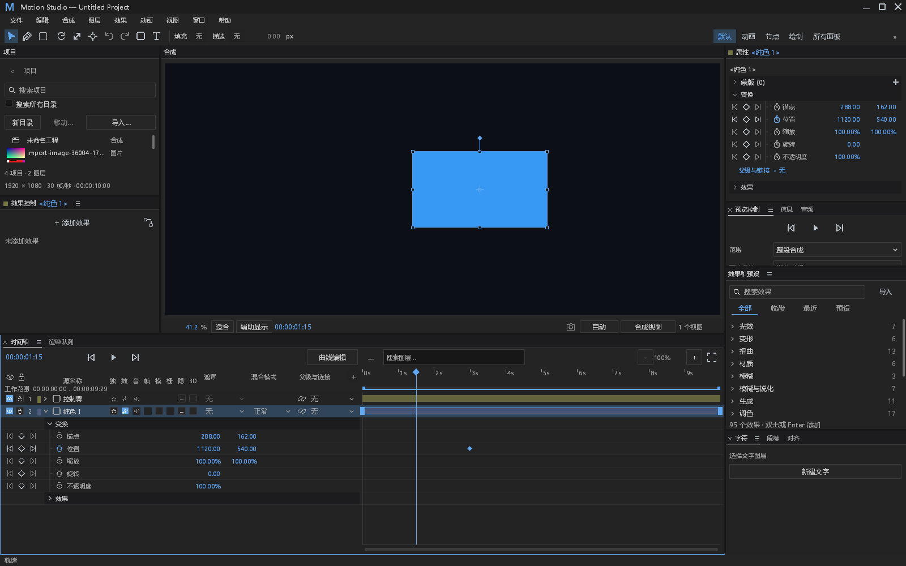

# 项目面板整合后的完整工作区复查

依据用户对功能堆积后界面失衡的反馈，复查源码 `55f0a9a1` 编译的带 FFmpeg 程序。使用测试自有工程、默认工作区和中文 1600×1000 原生 Windows/Vulkan 窗口，通过实际 GPU 截图核对；没有改用户工作区、生产布局或其他 agent 的分支。

| 项目 | 当前可见问题 | 后续收敛方向 | 状态 |
| --- | --- | --- | --- |
| 项目面板顶部 | 导航、搜索、范围、目录操作占四行；默认左上区域只有两三行素材可见 | 保留高频搜索/导入，把目录管理及搜索范围放回已有菜单；根据真实小面板分配高度 | 待实现与截图确认 |
| 操作层级 | 新建目录、移动与导入均常驻；移动同时已有右键入口，低频操作占用稳定空间 | 统一常驻操作和上下文操作的分工，不再按 issue 单独追加一栏 | 待实现 |
| 时间轴表头 | 开关列密集，部分标题缩为单字，工作范围文字与表头竞争空间 | 按 DESIGN 的既有列与命中合同单独复查；本次未改他人时间轴实现 | 仅记录，未宣称修复 |
| 预览弹窗 | 源预览标题和数值定位重复显示当前位置；弹窗本身通过不等于默认工作区协调 | 统一标题、状态与可编辑时间值的职责，先验证全工作区，再验收独立浮窗 | 待实现 |

这轮先收敛现有界面，不添加主题、UI 库或额外功能入口。既有 DESIGN §0.7 十二项仍按原验证文档保留；上表是新增整合问题，不能替代旧基线的逐项认定。

完整隐藏窗口 smoke 报告 `ok=true`，截图过程 `designCaptureProjectUntouched=true`。运行仍输出本机残留 Epic Vulkan layer JSON 的缺失错误，原始日志保留；本次没有修改系统注册表或把环境报错当成已修复。播放器功能证据独立冻结，PR #532 继续草稿，#223 继续开放。
