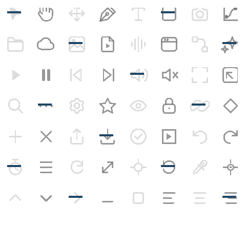
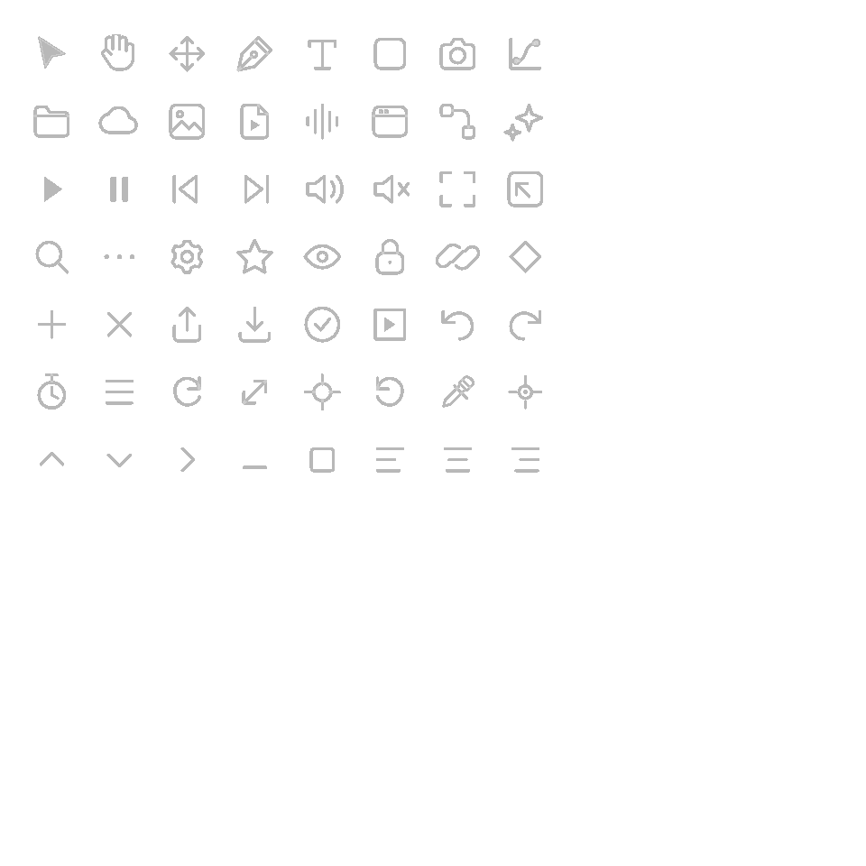

# #129：共享图标网格的分配与输出验证

## 范围与实现

图标注册表已经缓存规范化 SVG 三角网格，但 `icons::draw` 仍逐实例分配、复制
变换后的顶点。此次新增引用进程期静态网格的 `Shape::Mesh`，在已有 Painter
顶点缓冲写入时求坐标。普通图标放置与一次节点画布变换不创建顶点数组。

变换顺序保持逐次 f32 运算；不合并矩阵改变舍入。超过两次变换、真实穿越
裁剪边界时沿用独立拥有的三角形输出，不建立无界变换或裁剪缓存。
颜色、绘制次序、窗口独立绘制列表、GPU 预算与错误协议保持原路径。
新增几何载体需要穷尽匹配的调用者识别 `Shape::Mesh`；其 `points()` 返回实际坐标。

未引入依赖、图标或其他第三方资产。现有独立 SVG 与来源声明保持不变。
没有修改面板布局、尺寸或颜色 token。DESIGN.md §0.7 的各项面板排版问题本次
均保留，原因是此次仅处理图标几何存储和消费，不代表视觉整改完成。

## 验证结果

| 检查 | 结果与范围 |
| --- | --- |
| 完整 `motion-ui` 测试 | 201 项测试及 1 项 compile-fail 文档示例全部通过；默认 GPU 功能开启，无跳过 |
| 桌面节点编辑器 | 177 项通过，包含真实节点控件变换、输入、裁剪及坐标回归 |
| 插件面板与组件缩略图 | 原有 6 项面板测试及新增 1 项缩略图变换测试通过 |
| 预热后的图标绘制 | 1 / 200 个实例均为 0 次分配；普通节点变换后再完全包含裁剪亦为 0 / 0 |
| 完全包含的反复裁剪 | 全部 56 个图标连续裁剪 20 次，0 次分配；保留原始网格指针、逐点坐标、颜色及绘制次序 |
| 独占三角形存储 | 保留原有全部指针、容量与分配上限断言；夹具显式物化独占数组，仍通过。另立共享网格验收，未删掉独占契约 |
| 穿越边界的原有裁剪 | 1 / 200 组三角形均为 3 次分配，原有回归通过 |
| GPU 图标对照 | 全部图标在 5 种像素比例 × 3 种裁剪层数下，15 组实际与独立旧绘制参考逐字节相同 |
| GPU 节点变换对照 | 3 种缩放 × 3 种像素比例下，9 组实际与独占参考逐字节相同；每组故意偏移 1 个逻辑像素的负对照均检出超过 100 个不同字节 |
| 原实现负对照 | 临时换回主线 `6ab57829` 的原 `icons.rs`，成功编译后，新分配断言以 1 / 200 次分配失败，退出 101；随后原样恢复修复源码 |
| 其他门禁 | 新模块和独立新测试的 rustfmt、增量 diff、面板样式消费检查通过；没有声明全工作区 fmt/clippy 合格 |

共 386 项不同检查（385 项测试 + 1 项 compile-fail 示例）。重复运行、父测试派生子进程
及 GPU 场景数量不另计测试数。原有独占数组的断言保持；旧分配断言由
`(1, 200)` 收紧至 `(0, 0)`，属于本次性能契约变化，并由实际原代码负对照证明。

普通图标冷启动仍需要一次注册表构建和绘制列表容量增长；真实边界裁剪、超过两层
变换仍会物化坐标。零分配结论限于预热后的普通实例路径，不外推至整个应用。

## 原始失败与环境限制

- 首次 CI 的桌面构建指出组件缩略图没有穷尽匹配新增的 `Shape::Mesh`。
  已接入 `catalog::reduce`，并增加直接调用该函数的回归；首轮 Linux 日志保留。
- 首轮完整 UI 库运行有 3 项日志子进程测试因默认临时目录访问失败；在可写任务目录
  设置 TEMP/TMP 后原断言全部通过。未修改日志断言、时间预算或错误级别。
- 首次完整集成测试在独占图标存储夹具处失败。该夹具现显式请求独占几何，并新增
  共享几何的指针、坐标、命令顺序及严格零分配验证；首轮失败输出保留。
- C 盘新目录的 MSVC 输出遇到 LNK1104。E 盘初次桌面构建先遇到磁盘不足，
  之后一次编译进程退出 `0xc0000005`。保留原始输出；使用 Cargo 清理相关包的旧
  构建产物后，限定本地依赖调试信息、8 个代码生成单元和 32 MiB 编译线程栈完成
  FFmpeg 桌面测试构建。没有改生产 profile、断言、溢出检查或 CI 预算。
  最终 184 项桌面测试另外在清除 `RUST_MIN_STACK` 的进程中、`MOTION_LOG=info`
  下通过；编译线程栈设置不作为运行时的必要条件。
- `DESIGN.md` §0.7 各项面板视觉问题均保留；此次没有改变面板布局或图标资产。
  CI 结果应以 PR 当前提交为准，局部验证不代表所有 issue 已完成。

原始日志、实际 GPU PNG、二进制 SHA-256、命令与负对照脚本封装于
[`shared-icon-mesh-evidence/evidence.zip`](shared-icon-mesh-evidence/evidence.zip)，
逐文件摘要见 [`manifest.json`](shared-icon-mesh-evidence/manifest.json)。

下图为实际 GPU 输出，布局与图标资产未重画：

## 观测边界与未完成事项

此更改为已有健康热路径移除存储副本，没有新增 worker、错误吞噬或重试。
穿越裁剪边界与额外变换的物化属于正常几何行为，不应产生故障日志。
既有 Painter 内存准入、GPU 上传失败与默认错误信道保持不变，相关回归已包含在
完整 201 项测试中通过。新观测点为零，已有故障输出与恢复验证仍生效。

#129 的复杂文字 shaping、其他控件及整体每帧分配验收不由本项证明，issue 保持开放。
