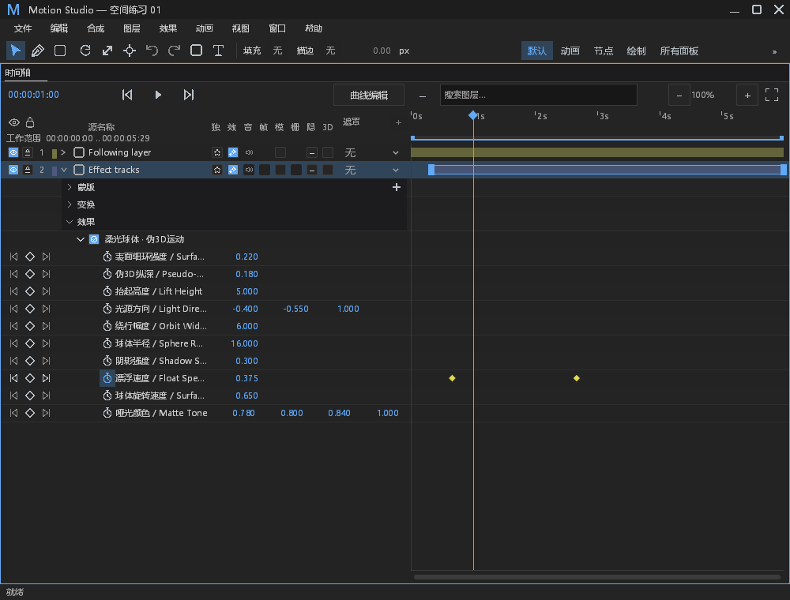
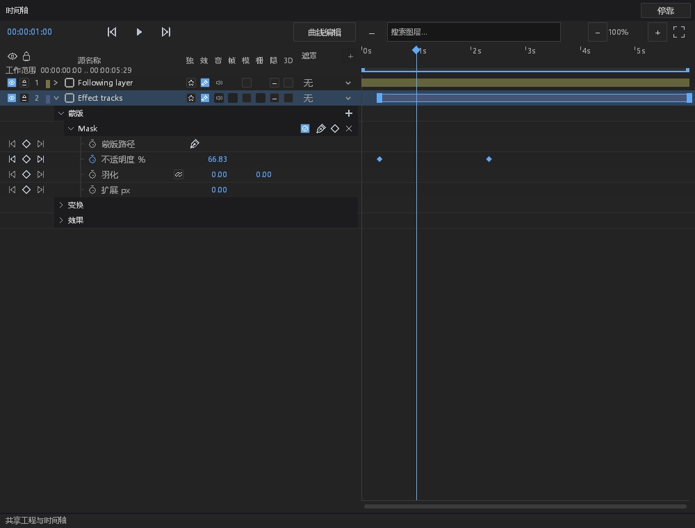

# 时间轴效果／蒙版组快捷键验收

基线：`82633385658dcc616edacbcd557f0f477a6f57c1`，Windows x86_64，FFmpeg 功能开启。对应 #212。实施前核对开放 PR 与相关 worktree；避开插件编辑器、面板重排、模型库和查看器分支的文件。

## 变更与范围核对

| 项目 | 交付与证据 |
| --- | --- |
| E／M | 新按 E／M 展开效果／蒙版组，解除会隐藏参数的属性筛选并展开已有子项；再按折叠。多选统一展开／折叠，无对应组的图层跳过。 |
| 选择与轨道 | 复用 `effect_timeline`、`path_controls` 的行、选中状态与已有命令；仅改窗口的折叠／筛选状态，保留另一组折叠状态和已选关键帧，不写工程、不新增历史。 |
| 支持的内容类型 | 实际合法工程覆盖文本、普通 3D、位置／环绕摄影机及音频的行规划。文本使用已有变换动画轨道；文字内容、字体等静态编辑仍由既有文字面板负责，不伪造新的文字动画、材质或时间通道。音频没有变换行，摄影机不显示锚点／缩放／效果组。 |
| 筛选／折叠／导航 | 新测试覆盖从属性筛选及子项折叠中展开；既有测试覆盖 Animated／Modified 筛选、行高、局部时间偏移、实际参数导航、分离轴和跨面板选择。 |
| 输入所有权 | 时间轴有焦点时可用，主窗和浮窗共用路由。文本、IME、失焦、OS repeat、菜单和活动手势不触发；可重映射并导出／重载，Ctrl+M 等未绑定修饰键不被接管。锁定图层可查看，不因此获得编辑权限。 |
| 持久数据 | 本次不新增持久数据。原有实际编辑测试验证撤销、重做、保存重开及通道隔离；原生截图过程另比较 worker 工程和 `project.json` 字节不变。 |

## 执行结果

- `cargo test -p motion-desktop --bin motion-studio --no-default-features --features ffmpeg --locked --offline --no-run` 通过。测试构建保留既有 26 条 warning。
- 实际测试二进制运行 `timeline_shortcuts_tests`、`shortcuts::documentation_tests`、`panels::effect_timeline::tests`、`panels::key_navigation::tests`、`panels::path_controls::mask_keys`、`panels::audio::tests`、`panels::timeline_layout::tests`：**117 passed / 0 failed / 1 手动原生测试 ignored**，56.65s。
- 最终只调整新增测试的排版和原生字体夹具后重建，再跑新增组测试与键位文档：**7 passed / 0 failed / 1 ignored**，2.20s；生产语义没有进一步修改。
- 显式运行 ignored 的原生验收：**1 passed**，9.58s。实际 DesktopEngine、两个原生窗口、真实 GPU 截图：2 语言 × 2 owner × 2 组 × 展开／折叠 = **16 张**。输入经实际 chrome／floating_chrome 路由，属于归一化 Input 注入，不冒充物理 OS 键盘验收。截图为 1000×760、1× DPI；其他 DPI、全部工作区不在本次新增验收范围。
- FFmpeg 桌面程序 build 与 `--help` 通过，构建保留既有 29 条 warning。程序 SHA-256 见结果文件。
- 样式 consumer 检查、provenance guard、`git diff --check` 通过；无新增依赖或第三方资产。

复现时将测试 exe 放在 FFmpeg DLL 旁，运行以上过滤器，`--test-threads=1`。手动原生测试设置 `MOTION_TIMELINE_GROUP_ARTIFACTS` 为独立证据目录，以 `native_group_shortcuts_capture_both_owners_and_locales_without_document_edits --ignored --nocapture --test-threads=1` 运行。

## 失败与可观测性记录

| 编号 | 分类 | 处置／证据 |
| --- | --- | --- |
| OBS-1 | 新观察 | 无新增故障源、worker 操作或日志状态；本次仅有内存中的窗口视图切换。 |
| OBS-2 | 已有覆盖 | 实际运行 `malformed_effect_rows_emit_bounded_default_file_and_error_stderr_without_stdout`，以及音频非法轨道测试，验证已有默认级别观察与通道隔离；没有改断言或抑制报错。 |
| OBS-3 | 正常分支 | 无选择、缺组、失效对象、文本／菜单／手势占用、只读查看均为不编辑的正常分支，不添加每次警告。缺组不增加工程数据。 |
| OBS-4 | 环境故障保留 | GPU 运行仍输出本机 Epic Vulkan overlay JSON 缺失的 loader Error，文件和 stderr 均保留；没有清除或降级。实际 GPU 捕获成功，不据此声称 loader 环境已修复。 |
| OBS-5 | 验收夹具修正 | 首轮中文截图未加载中文回退字体，日志记录 missing_glyph。已改为与其他原生验收相同的字体回退构造，并断言中文 glyph 有 atlas 区域；最终 16 图无 missing_glyph。首轮原图和日志在 `native-missing-font/`，未冒充产品字体修复。 |
| OBS-6 | 编译失败保留 | `first-build.log` 的错误 Track 构造、`second-build.log` 的 PathBuf 借用、`third-build.log` 的 MaskProperty 导入错误均属新增测试代码，逐项修正。原始失败日志与最终通过日志保留。 |

## DESIGN §0.7／§12 处置

本次未改 paint、尺寸、颜色、命中容差或属性行结构，仍使用既有行规划。以下均为 **retained with reason：未触及对应渲染代码，本 PR 只补键位入口；不宣称修复或完成全局视觉验收**：

| §0.7 条目（原文定位） | 处置 |
| --- | --- |
| `path_controls.rs:860,884,953,1002,1070,1149` 六处行步进 | 保留，排版整改另行验证。 |
| `path_controls.rs:893` 两列拆分 | 保留，未调整列宽。 |
| `path_controls.rs:894-953,1038` 混合按钮高度 | 保留，未改变控件或容差。 |
| `path_controls.rs:1124,1130` 数值背景 | 保留，未修改数值渲染。 |
| `path_controls.rs:1151-1170` 布尔按钮 | 保留，未新增布尔控件。 |
| `effect_controls.rs:958,1043,1050` 行高 | 保留，未改效果面板布局。 |
| `effect_controls.rs:998-1013` fx／— | 保留，未改效果开关。 |
| `effect_controls.rs:1053-1064` 枚举按钮 | 保留，未改枚举。 |
| `effect_controls.rs:974` 悬停 alpha | 保留，未改绘制。 |
| `effect_controls.rs` 层级缩进 | 保留，复用当前实现；本次只显示已有组。 |
| `timeline.rs:541-547`／11 列 gutter | 保留兼容基线，截图确认使用原列布局。 |
| `timeline.rs:1432-1436` 吸附线颜色 | 保留兼容基线，本次不涉及拖拽反馈。 |

§12 本次确认键位／输入所有权、非编辑视图切换和既有编辑回归；19 面板、全部窗口尺寸、1.5／2× DPI、Reduced Motion 与 8×7 控件状态矩阵维持既有范围，**pending verification**，不借编译成功宣称全部合规。

## 证据

[汇总 JSON](timeline-group-shortcuts-results.json)；[原始日志、工程和 16 张截图](data/timeline-group-shortcuts.zip)，1,084,166 bytes / 45 entries，SHA-256 `8f5571900a01a539f1a892670c59c78026b0c3cf544a44ab0b1a659bb9a0d0f2`。

