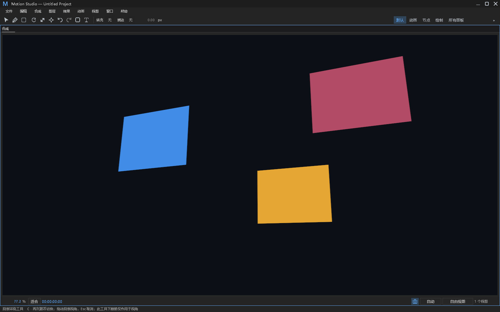
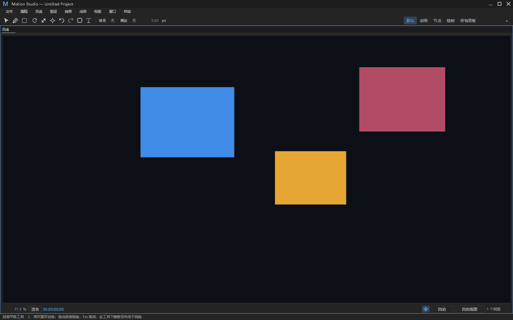
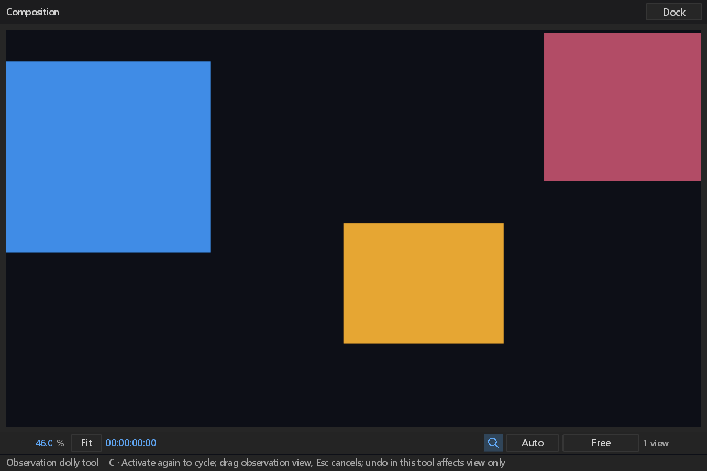

# 查看器观察摄影机手势验收

对应 #248，与 #230 的工具状态合入同一 PR，避免为同一输入状态机增加独立 CI 队列。实施前核对远端开放 PR 与本地分支；#473 的效果菜单由其他工作树处理，本批不接管。独立工作树 `viewer-camera-gestures`，保留根工作树改动。

## 行为与边界

- 自由观察视图 C 循环环绕、平移、推拉；顶视／侧视跳过环绕。底部复用现有 Camera / Move / Search 图标，提示读取实际工具改键，不拷贝外部素材。
- 三种模式仅调整宿主 Observer。工程摄影机继续走原有作者属性，不改工程数据、脏标记、工程历史或导出。`sampledCamera` 保留作者语义；新增 `observationCamera` 记录观察参数及实际采样投影矩阵。
- 起点投影和绝对源坐标差决定整轮姿态；重复同一 Update 不累加漂移。平移复用真实屏幕投影，环绕只允许自由视图，推拉沿半径缩放。
- 松开提交一轮；Esc、失焦、新指针按下、切换输入窗口、工程／帧／视图／倍率变化取消。主窗和浮窗的后台重绘不能抢占另一个原生窗口的手势。中键保持独立画布平移，手势期间滚轮不争抢导航。
- 观察工具且 Composition 焦点下，快捷键、菜单和工具栏的 Undo / Redo 使用独立观察历史（最多 64 轮），拖动中禁用这些按钮。其他工具仍使用原工程历史。方向键不在观察工具下修改作者图层。
- 右键临时环绕／正交平移也进入同一事务，不保留另一套不可取消的相对动作。上下文切换使旧观察历史失效；不序列化运行时观察状态。

## 验证

首轮 19 项工具专项通过（42.19 s），包含 7 项摄影机专项与原工具回归、真实宿主事务、矩阵变化、作者数据不变、64 轮边界、错误输出和 HWND／GPU 截图。随后补充后台窗口绘制验证、输入仲裁和删除旧相对动作，最终整合结果在下节记录；首轮结果不冒充最终源码。

原始中间失败保留：`camera-gestures-first.log` 的新测试帮助函数可见性错误；`camera-gestures-second.log` 的三项断言错误地将作者 `sampledCamera` 当作观察矩阵，现分别断言观察状态变化与作者状态不变，保留项目／历史／撤销等断言。`camera-gestures-final.log` 同时暴露共享 target 使用另一工作树旧宿主产物，以及删除旧动作时误删新 CameraGesture 声明；修复声明、触发正确宿主源码重编译后再次验证。`camera-gestures-integrated.log` 保留声明修复前的编译失败。没有降低断言、改变预算、增加重试或 ignore 测试。

原生截图通过真实 chrome / floating_chrome 输入 API、HWND、GPU Present 和 CaptureUi 生成，主窗中文 1600×1000，英文浮窗逻辑 900×600 / 150%。不冒充物理鼠标、系统输入法或完整跨平台人工验证。测试图层为独立生成的三张纯色 3D 平面，无外部资产。

## 错误与观察审计

| ID | 分类 | 处置及证据 |
|---|---|---|
| CAM-01 | 新命令、复用观察 | CameraGesture 进入现有串行 worker 的非 Present Info start、in-flight、计时、panic 与回复通路；补齐命令名和 panic reply。错误附 phase、token、mode / commit 及原始原因；真实非法坐标测试验证默认文件、Error stderr、request id 和 stdout 隔离。 |
| CAM-02 | 新功能边界 | 拒绝错误 token、重复 Begin、非有限坐标、非法 viewport、正交环绕。非法请求不改发布观察姿态和工程；绝对姿态更新后采样失败尝试回滚，回滚失败用已有 Cleanup 类型同时保留主因与次因。采样失败／回滚二次失败的注入验证仍属限制，不能仅凭正常测试声称已覆盖。 |
| CAM-03 | 有界运行时状态 | 64 轮视角历史，Undo / Redo 分别有界；上下文包含 root、合成、revision、frame bits、视图与观察模式。根／合成重建显式清理，同上下文帧或作者编辑变更取消候选。70 次手势后最多可撤销 64 轮，失效标志随上下文变化。 |
| CAM-04 | 正常分支 | 空观察历史、上下文变化后无活跃手势的 End、后台重绘、失焦、Esc、临时中键与不可用工具均不是故障。不为这些情况逐帧写日志。健康 Present 路径不变。 |
| CAM-05 | 保留覆盖与限制 | 原宿主项目历史、错误信道、采样及原生等待已有测试与限时诊断；本批不引入 worker、线程超时、恢复重启、吞 panic 或静默修改错误返回值。系统 IME / 物理输入、多平台及渲染输出基线仍由现有 CI 与人工验收，不冒充全库报错审计完成。 |

## 视觉与来源

已检查 AGENTS.md、PROVENANCE.md、ATTRIBUTION.md、NOTICE、DESIGN.md 和 dark.json。无新增依赖／第三方资产／工程格式或渲染语义改变。唯一新视觉尺寸 `viewer.camera.width` 先写入 dark.json，再由面板消费；复用按钮高度、间距、状态与既有图标，不缩小原有命中区域。

DESIGN §0.7 的 12 项 retained with reason：path_controls 步进／两列／按钮高度／数值 painter／布尔控件五项、effect_controls 行高／布尔／枚举／hover／层级五项、timeline 列坐标／吸附线两项均不在这次工具导航视觉范围，不宣称已经修复。§12 按本批取消、模式、坐标、不同语言与倍率、主／浮窗、真实渲染验证；其他面板与全局性能基线没有改，也没有以编译代替视觉验收。

## 最终整合结果

整合源代码 **202 项相关测试通过，0 失败**，包括工具 19、快捷键 9、主／浮窗键盘 24、合成查看器 4、工具栏 9、路径 77、时间轴快捷键 48、动作队列 2、节点剪贴板 10。最终工具专项为 `camera-gestures-integrated-fixed.log`（39.88 s），其余为 `artifacts/pr-ci-followups/camera-final-{shortcuts,panels-keyboard,panels-composition,panels-toolbar_style,panels-path_controls,panels-timeline_shortcuts_tests,shell-actions-tests,node_editor-clipboard}.log`。包含新后台窗口重绘断言、观察工具方向键不改作者数据、原有显式动画改键及菜单／工具栏同一历史能力判断。原工具测试由单个旧 ViewOrbit 动作改为 Begin / Update / End 协议，并增加实际宿主观察矩阵变化及作者摄影机不变断言；这是协议变更的行为验证，没有把失败结果改成期望成功。

带 FFmpeg 的 Windows x64 产品构建成功（25.57 s，保留 20 项既有 app 警告），`camera-product-build.log`。开发构建更新到 `E:/Dev/aem/artifacts/desktop-tool-state-preview/motion-studio.exe`，SHA-256 `1648b87d24ac692b33a038ca35953e5462bb18baf9d0f44e65ce5e21ad5140fb`；这份程序包含 #230、#248 和已合入 main 的节点剪贴板。Windows PE 架构、12 个实际打包 DLL／许可证与固定来源逐个核对；隔离 PATH、清除 FFmpeg / PKG_CONFIG / 日志开发配置后，命令目录退出 0、55 个命令、stderr 0 字节。证据为 `camera-package-evidence.json`、`camera-startup.stdout.json` / `.stderr.log`。这是本地 debug 开发构建，远端全平台 CI 尚待验证，不冒充正式发布包。

样式消费门禁、新增文件 rustfmt 及最终差异空白检查通过。构建盘空间不足时仅清理此目标目录下 2026-10-24 前的 20 个过期 motion_studio 测试 exe / pdb（1,529,147,392 字节），删除前验证绝对目录与各文件边界；保留源码、当前程序、运行库和失败／成功证据。没有清理其他工作树或根目录。

实际截图按字节复制，尺寸／SHA-256／源文件位置见 [captures.json](viewer-camera-gestures/captures.json)，没有裁剪、重编码或重绘。矩阵及保存重开断言与截图使用同一次真实运行结果。

