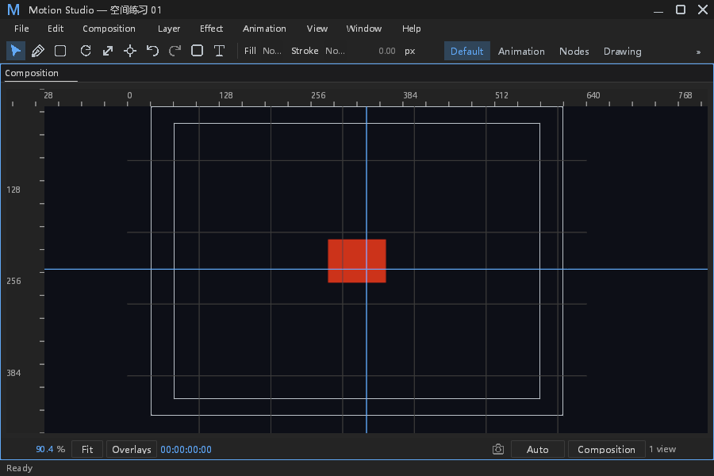
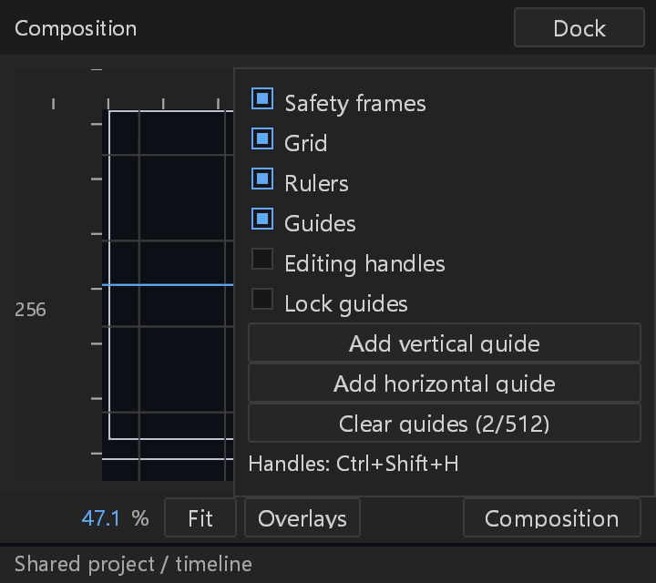

# 查看器辅助显示与参考线验收（#263）

本次完成安全框、网格、双轴标尺、参考线创建/拖动/删除/清空/锁定、移动与缩放吸附和 Ctrl+Shift+H 编辑手柄显隐。菜单使用原生 Checkbox，提示读取实际快捷键。参考线按合成像素保存，唯一 ID、位置和 512 条上限在模型边界校验；释放仅提交一次带工程/代次/版本/合成来源检查的动作。撤销、重做、保存重开沿用既有机制。

基于 main `330d5939ef3bfbf855ca6c71962392e4bb78e1fd`，验收源码提交 `ad2a56558f9cb636fcf22c1e8f20a68e6f772dd5`；先前模型和辅助显示进度记录及证据包保留为历史，不能将旧基线测试计数累加到当前结果。新完成记录没有修改旧断言。开始前核对其他分支和 PR，文字样式、深度和静态模型工作不重复；文字样式与深度合入 main 后已接续并重新验证。未修改他人分支或根工作树用户文件。

本地验收和证据提交后，本分支接续同一份独立 PR #518 的单行所有权优化（节点连线曲线点直接交给绘制器，避免复制）。上面的本地源码提交/哈希仍对应实际运行的参考线版本；这一后续不改变几何的优化由 PR CI 验证组合结果。合并前须核对整个组合树与实际 CI checkout 一致，不能仅以两个 PR 各自变绿代替组合验证。

## 需求证据

| 验收项 | 当前证据 |
| --- | --- |
| 辅助显示开关、菜单和键位入口 | 中英文主窗/原生浮窗实际 chrome 路由；辅助显示菜单按钮、网格 Checkbox、关闭帧独占输入；Ctrl+Shift+H 原生绘制差异。 |
| Fit、缩放、平移与吸附共用坐标 | 同一 Mapping 正逆映射；移动锚点与缩放握点真实 CoreHost 几何、旋转/透视/独立轴、Alt 绕过、无辅助目标旧路径；原生握点和图层主体拖动后吸附并撤销。 |
| 主窗/浮窗比例与布局 | 四个原生案例：900×600/Fit/1倍；1600×1000/缩放平移/1.5倍；360×320 浮窗/Fit/2倍；720×520 浮窗/缩放平移/1倍。两轴参考线六处测量/案例，最大误差 0.199951 物理像素，小于原定1.5像素限值。 |
| 手柄显隐不影响创作/输出 | 隐藏已创作握点的绘制及命中，保留钢笔/蒙版本地草稿和键盘闭合；86项路径回归和实际外层失焦取消；主/浮窗实际显示切换。生产 PNG 导出开关前后640×480所有RGBA像素完全一致。 |
| 成功、取消、失效与持久化 | 实际 UI release→串行 worker→Core；中英文×根/子合成保存重开、撤销重做；Esc、失焦、跨窗真实输入、丢失释放、原始列表/来源变化撤销预览；阻塞真实 worker 后排队修改版本，旧参考线请求正常取消，下一有效请求正常执行。 |

## 当前运行

固定源码前后哈希一致，同一当前工作树程序 SHA-256 `4e95e373228c342db0af9d3dc6c2296783003985d03d4b818ff986ffd8064f00`。当前定向运行：参考线15通过，变换24通过，Composition5通过，Path86通过，共130通过；默认过滤器另跳过一个新增 Windows 手工原生案例，该同一案例已用 `--ignored --exact` 显式执行，1通过，产生22张PNG。不得把默认跳过计为成功，也不得把同一案例重复计数。

完整 workspace（排除既定 Android）all-targets 编译通过，参考线 Core4通过，历史15通过/1项既有性能手工忽略；style consumer 禁用调用检查通过。当前完整面板套件由 PR CI 执行，本地更早584项通过结果只属于旧阶段。远端 CI 与合并状态在 PR 中核对，本记录不冒称尚未完成的 CI。

原始构建、测试、默认日志、失败尝试、源码冻结清单、全部原生图片和像素测量见[证据包](data/viewer-guides-completion.zip)：267项，3814049字节，SHA-256 `f410892b6046bd9b969dce724ea2ed206494e3c9e49022382b1b73f67a09297d`；结构化[结果](viewer-guides-completion-results.json)。

## 失败记录与改动边界

- snap01：新增 worker 日志测试误设结构，改为匹配既有 `start #N editor_action` 与同一请求原始 Error，增加先后顺序校验；没有改生产日志来适配测试。
- snap02：蓝色抗锯齿参考线叠在红色场景上，新像素分类器误判；保留失败RGBA与截图，改蓝色判别，原1.5像素坐标限值不变。
- snap03：f32屏幕输入逆映射与手写十进制期望不完全相等；改新测试期望为真实输入点的精确逆映射，没有在产品中加舍入。
- snap04：新测试固定合成偏移随放大超过既有6逻辑像素吸附距离；改为3逻辑像素输入偏移，目标精度不放宽。真实功能同时补齐握点与参考线交叉处握点优先，保留原容差和其他工具画布所有权。
- snap05：隐藏手柄创作的新测试误把既有暂停播放 Seek 当成工程编辑；明确消费该唯一 Seek，继续断言没有工程修改/历史污染。
- snap06：新叶子面板测试漏了原生外层失焦 cancel_interaction 边界；补上实际路由，未改生产取消语义。
- snap07：测试通过后截图检查发现最小浮窗菜单遮挡停靠按钮；数量合并到清除按钮，菜单保持原行命中高度并让出标题栏。snap08完整重验通过；随后 main 新合入文字/深度，snap09重新编译与全套验收通过；静态模型接续后snap10再次完整重验通过。
- 更早历史首次编译失败、迁移时重叠检查排除记录、辅助显示早期失败仍在历史进度包，未改写为成功。环境已有 Vulkan EpicOverlay JSON 缺失 Error 和字体警告保留，不宣称整个环境零 Error。

## 观察审计

| ID | 分类 | 证据和边界 |
| --- | --- | --- |
| GUIDE-OBS-01 | 新观察 | 非法快照/缺来源实际开始尝试；有界原因/路径/合成/代次/版本/阶段/耗时。连续计数Debug首次、Error第60次一次后抑制，健康快照/正常取消重置；实际默认Info文件、Error stderr与stdout隔离测试。健康每帧不写日志。 |
| GUIDE-EXIST-01 | 既有覆盖 | 复用串行worker的非Present Info开始及来源检查。实际非法ID请求原始原因进文件/Error stderr，同一请求开始先于失败，工程和版本不变；没有新建worker、超时、重试或改变respond。 |
| GUIDE-NORMAL-01 | 正常分支 | 旧工程缺guides、空列表、取消、失效请求、不可达吸附、只读观察、其他窗口被动绘制不算故障。 |
| GUIDE-BOUNDARY-01 | 功能/协议 | 元数据独立于渲染图层；一次释放一次历史。新增握点优先、隐藏握点下草稿创作和标尺裁剪属于功能改动，不能冒称仅日志调整；原始字段复核防止同版本快照列表变化。 |
| GUIDE-LIMIT-01 | 证据限制 | 原生为Windows隐藏真实窗口、受控Input与比例，未做物理鼠标/系统显示设置操作；其他平台新原生截图、视频编码、全19面板5预设、Reduced Motion和FPS/RSS专项未在本项重验。 |

## DESIGN §0.7 逐项处置

下表是当前改动的责任审计，不将历史记录直接宣称修复。Path属性控件已存在于拆分模块，本项只改画布草稿/握点显隐，原属性绘制与尺寸未变。§12在本项涉及的布局/输入/坐标/导出按上表验证；未宣称整份设计规范合规。

| 历史位置/行为 | 本次之后与证据 | 状态 |
| --- | --- | --- |
| Path六处纵向步进 | 当前行尺寸读取row.height；属性排版未在本补丁改动，86项路径回归不替代属性截图专项 | 保留现状，历史逐行视觉验收待专项核验 |
| Path两列划分 | 当前mask_inspector布局未改，无缩小列或命中区 | 保留现状，窄属性面板专项待核验 |
| Path混合按钮高度 | 不改属性按钮尺寸或命中容差 | 保留现状，专项视觉待核验 |
| Path手绘数值背景 | 当前mask_inspector使用field.number，本项未改数值字段 | 保留既有实现，不归为本次修复 |
| Path全宽布尔按钮 | 当前mask_inspector使用Checkbox；新辅助菜单也使用Checkbox | 保留既有属性实现，不归为本次修复 |
| Effect行高和步进 | effect_controls未改 | 保留现状，历史专项待核验 |
| Effect fx/—布尔 | 未改效果控件 | 保留现状，专项待核验 |
| Effect全宽枚举 | 未改效果枚举 | 保留现状，专项待核验 |
| Effect hover透明度 | 未改effect_controls或新增hover色 | 保留现状，专项待核验 |
| Effect树层级 | 未改效果树布局 | 保留现状，专项待核验 |
| Timeline11列坐标 | 时间轴坐标/行为未改；本项仅查看器吸附 | 保留兼容基线 |
| Timeline吸附线颜色 | 时间轴颜色未改；查看器语义token先定义dark.json | 保留兼容基线 |

## 来源

未添加依赖、第三方资产或兼容名称；模型/控制器/测试与程序化场景独立编写，截图来自本项目自己的程序。已核对PROVENANCE、ATTRIBUTION、NOTICE，不复制Adobe二进制或素材。

